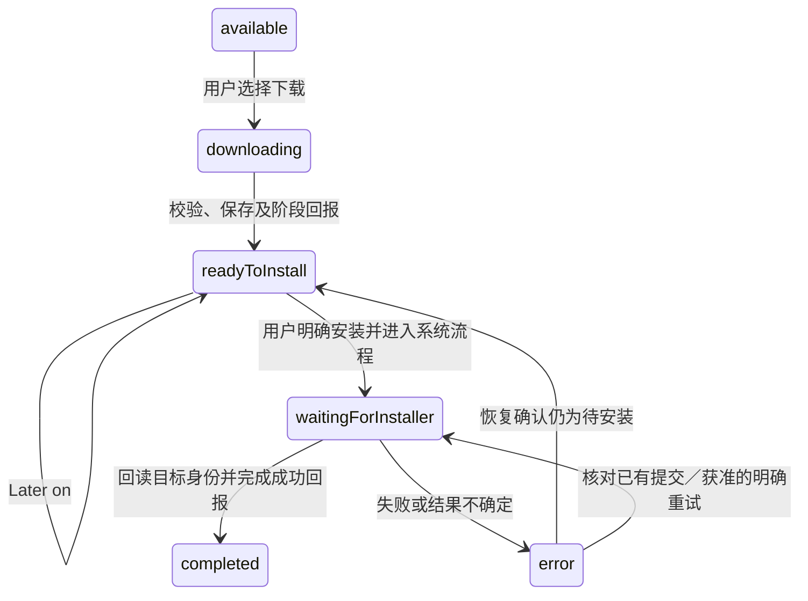

# 下载完成以后：我怎样理解相框 App 更新的恢复边界

[知识库首页](../README.md) · [App Update 专题](../modules/app-update.md) · [基础：更新与一致性](../foundations/updates-trust.md)

一次 App 更新最难解释的时刻，往往是下载进度已经到了 100%，用户却仍然没有用上新版本。文件可能刚写完、签名还没读到；Android 可能已接收安装请求、调用方却没收到返回；
新 App 也可能已经启动，只是告诉服务端的那条成功消息没有发出去。
这几种情况看起来都像“更新失败”，下一步允许做的事却完全不同。

本文以 2026-09-14 读取的 Frame App 更新模块为学习快照，讨论 App APK 替换，不讨论系统固件 OTA。
项目经历的自述背景是：相框这些模块几乎都由我负责。下文 Git 记录只证明具体代码怎样演进，
不根据提交次数或代码行数计算个人贡献；当前行为和验收状态仍由 [App Update owner](../evidence/blog-source-map.md#blog-update-owner) 持有。

## 从“下载好了，为什么 Retry 又下载”开始

设想这样一个故障：用户下载完更新、点了安装，Android 在准备安装器时抛出异常。
如果统一在 `catch` 里清空任务，再让 Retry 从第一步开始，用户会重新下载一个原本完好的 APK。
更危险的是另一种异常：系统可能已经接收 `commit`，只是返回途中出错；此时从头再安装会制造第二次外部操作。

这说明“出现异常”只描述调用方的观察，不能直接证明文件损坏，也不能证明 Android 没有执行。我从这条实现中提炼出的判断顺序是：**先确认最后一个已经成立的事实，再决定哪一步可以重做。**
当前 controller 对准备失败、提交结果未知和确定的 APK 拒绝分别处理，依据见 [恢复与安装入口](../evidence/blog-source-map.md#blog-update-controller)。

因此，需要把更新写成一个可恢复的状态机：用明确状态限制下一步动作，并保存进程消失后仍需记住的事实。这里的“可恢复”不等于任何错误都能自动修好；它首先意味着恢复时不会凭空丢掉旧任务、误报成功或重复提交。

## 一个 readyToInstall，隔开了两种承诺

`available` 表示发现了可供用户选择的版本，`downloading` 表示正在获取文件，
`readyToInstall` 表示文件下载、校验及相应阶段回报已经走到待安装位置。
它仍然没有承诺“Android 已经接受安装”，更没有承诺“新 App 已经运行”。

下载器会核对字节数，再读取文件计算 SHA-256。进度回调可以先达到 100%，随后还需要完成这些工作。
这使“收到全部字节”和“可以展示待安装状态”也成为两个观察点，见 [下载器](../evidence/blog-source-map.md#blog-update-downloader)。



这是主线压缩图，省略了 `checking`、`preparing` 和下载失败等分支；箭头不是任意状态间的跳转许可。真正允许的转移由 controller 的条件决定，尤其 `error` 不等于把状态清成空白。

界面上的 Later 也有两个阶段：offer 的 Later 收起当前自动弹层、保留 assignment；
下载后的 Later on 调用 `postponeInstall()`，保留 attempt 和已校验文件，用户可以从 Firmware 继续。
`Restart now?` 是立即进行 App 替换的产品文案；明确安装动作才会调用平台安装接口，并保留系统确认流程。
这个按钮不会触发整机 reboot，见 [owner 的 UI 与安装边界](../evidence/blog-source-map.md#blog-update-owner)。

## 恢复状态属于更新任务，不能寄存在弹层里

如果下载路径只保存在弹层的 State 中，关闭弹层就可能把事实和展示一起销毁。
当前实现由 `FrameAppUpdateController` 协调 phase、用户动作、检查计时和安装结果恢复；
界面只观察它，持久化记录则用来跨越 controller 乃至整个进程的生存期。

`_PersistedUpdateAttempt` 保存发布标识、更新前后身份、服务端 attempt、下一事件序号、
待确认事件、已确认状态、下载文件摘要与安装错误分类。恢复时据此重建 assignment，
而不是把上一次画面的按钮文案当成安装事实，见 [持久化模型与恢复入口](../evidence/blog-source-map.md#blog-update-controller)。

几个容易混淆的标识必须分清：`releaseId` 是发布，`attemptId` 是服务端的一次尝试；
`installSessionId` 是客户端在领票前保存的关联标识，Android 数字 `sessionId` 才是系统安装会话。
最后，`eventId` 和 `sequence` 描述这次尝试中的某个事件及其顺序，不能每重发一次就随意换掉。

这份记录通过平台桥交给 `FrameAppUpdatePersistence`。关键保存使用 SharedPreferences 的同步 `commit()`，
检查保存结果后才继续相关外部动作；原生安装状态由 Android 侧保存并由 receiver 更新。
这些都是项目自己的协调记录，不是一个横跨 Dart、Android 与后端的数据库事务，见 [host 与持久化](../evidence/blog-source-map.md#blog-update-host)。

生命周期的重点是提前保存，而不是指望退出时补救。Android 官方说明系统杀进程时不保证调用 `onDestroy()`；
同理，不应把重要落盘全部押在 Flutter 页面销毁这一刻。[Android 进程生命周期](https://developer.android.com/guide/components/activities/process-lifecycle)
controller 的 `dispose()` 取消计时器和 observer、阻止继续通知 UI，却不能撤销 Android 已接受的安装效果。

## 调用 commit 前后，是两条不同的失败边界

在 `_submitDownloadedUpdate()` 中，Dart 先保存 `package_installer_commit_unconfirmed`，再跨平台调用安装。
这个名字表示“接下来可能发生提交，恢复时必须核对”，并不是当场宣告系统已经提交。
若进程在平台调用中消失，下一次启动至少不会把缺少返回误解为“从来没装过”。

原生 host 会再次检查缓存路径、长度、SHA-256、APK 包名、版本和当前 signer。
Dart 校验保护下载结果，原生复核保护真正送进安装器的文件；保留文件不等于信任文件永远不变。
这层复核属于 [FrameAppUpdateHost.installVerifiedApk](../evidence/blog-source-map.md#blog-update-host)。

随后 `FrameAppUpdateInstallerSubmission.submit` 创建 session，写入 APK，执行 `fsync`，
准备结果回调，先保存 `submitted`，再调用系统 `commit()`。这些顺序让恢复记录尽量先于外部效果建立。
如果前置保存失败，就不能假装已经具备继续提交的恢复条件，见 [原生提交 helper](../evidence/blog-source-map.md#blog-update-submission)。

Android 官方对 `commit` 的说明是：“The final result of the commit will be reported through the given callback.”
提交可能还需要用户操作，因此函数返回不是安装成功的同步凭证。[PackageInstaller.Session](https://developer.android.com/reference/android/content/pm/PackageInstaller.Session#commit(android.content.IntentSender))

在准备阶段失败时，helper 会处理未提交 session 的 `abandon`；只有清理结果允许，才把失败归为可重试准备失败。
若 abandon 本身出错，就保存 `package_installer_cleanup_unconfirmed` 并封住继续建会话的入口。
如果已经尝试 commit 后抛错，则保留 `submitted` 或 receiver 已写入的结果，不覆盖成普通准备失败。

还有一个不显眼的边界：`close()` 释放 session 句柄，不能把 commit 后的 close 异常解释为再次安装的许可。
官方也把 `close` 的释放对象语义和 `abandon` 的废弃会话语义分别定义。[Session 资源与会话方法](https://developer.android.com/reference/android/content/pm/PackageInstaller.Session#close())
这比“所有异常统一重试”复杂，却让每一次重试都有可解释的前提。

## 用户点了 Retry，也必须重新证明可以提交

`_retry()` 先进入 `_continuePersistedAttempt()`。恢复入口第一件事就将 `_installerRetryAdmitted` 清为 false，
避免上次“可以重试”的布尔值沿用到本次读回失败、归属不符或事件尚未确认的情况。
只有这次恢复成功核对之后，明确点击的调用链才可能再次提交保留的 APK。

当前策略可以用下面这张表检查，但不能只看错误文案猜分支，依据是 [controller 的错误分类](../evidence/blog-source-map.md#blog-update-controller)。

| 已知事实 | 当前保留与下一步 |
| --- | --- |
| `package_installer_prepare_failed`、`apk_signer_missing` | 保留 APK 与 attempt；明确 Retry 重新读回并复核，通过准入后可提交 |
| `package_installer_commit_unconfirmed` | 保留旧归属；Retry 核对结果，不建立第二次安装 |
| `package_installer_cleanup_unconfirmed` | 清理未确认，不能因按钮再点一次就创建新会话 |
| hash、包名、版本或 signer 明确不符 | 确定拒绝；按终态处理，不把校验绕过包装成恢复 |

`apk_signer_missing` 的含义是证书信息没读到，不是证书已经与目标不符。允许重试读取，不代表允许跳过签名校验。这个区别正好说明：错误分类应表达证据强弱，而不只是显示一句“安装失败”。

启动、`resumed`、轮询和联网通知可以继续恢复已有事实，却不会替代用户明确的安装决定。
它们与点击操作由 `_runExclusive` 串行协调；忙碌时自动唤醒合并为待处理标记，避免重入又不丢掉恢复机会。
这是同进程内的协调，跨进程恢复仍依靠持久化记录，见 [调度与互斥](../evidence/blog-source-map.md#blog-update-controller)。

## 断网之后，要重放同一事实，而不是创造一个新事件

安装状态回报还有另一种“不知道”：请求发出后连接断了，客户端无法确定服务端是否已接受。
ACK 是对方确认收到的回复；幂等是重复提交同一个事实时，不把它当成两个业务事实处理。
客户端必须提供稳定事件身份，服务端也必须按协议处理重复；只看到客户端重试代码，不能宣称端到端已经做到 exactly-once。

`_reportIfNeeded()` 先创建完整事件，把 `eventId`、`sequence`、发生时间和 payload 一起保存，再发送。
`_flushQueuedEvent()` 校验 receipt 的接受状态、attempt 和事件状态，随后更新 acknowledged state、清掉待发事件并保存。
不能只保存“下次发安装成功”，恢复时重新生成时间、ID 或内容，见 [事件持久化与重放](../evidence/blog-source-map.md#blog-update-controller)。

下面是原创教学轨迹，用假 ID 压缩控制流，不是生产日志，也不是可以直接运行的代码：

```text
本地：先保存 E-教学 / sequence=4 / pending_user_action / 固定 payload
网络：服务端可能已接受 E-教学，确认回复在途中丢失
重启：从持久化读取 E-教学，重发原 ID、原序号、原 payload
确认：校验 receipt，再记录已确认状态；后续事件使用 sequence=5
```

另一个窗口更细：ACK 已收到，但保存“已确认”时失败。当前 `_flushQueuedEvent()` 的内存已经前进，
所以不能说同进程下一次 Retry 必然立刻重放；进程重建后，磁盘仍有发送前的旧事件，才会按原内容重放。
对应测试专门模拟这个时间窗，断言下载与安装调用数都没有因重放增加，见 [ACK 保存失败测试](../evidence/blog-source-map.md#blog-update-controller-tests)。

断网时，事件仍需保留，终态失败也不例外。`setNetworkReady` 打开的是网络请求准入，不是服务可达性的保证。
当前恢复先冲刷 queuedEvent；如果还不能取得确认，会保留恢复任务，联网后继续，而不是立即丢掉旧尝试去检查新版本。
新版本发现的临时失败会退避，成功则尊重服务端检查间隔，见 [网络与恢复合同](../evidence/blog-source-map.md#blog-update-owner)。

## 什么才足以宣布安装成功

Android 的 receiver 将 pending、succeeded、declined 或 failed 写进原生协调记录；
它在 pending 时接入系统确认界面，不通过点击模拟来替用户确认，见 [安装回执 receiver](../evidence/blog-source-map.md#blog-update-receiver)。
平台的 `STATUS_PENDING_USER_ACTION` 本身表示仍需用户介入。[PackageInstaller 状态](https://developer.android.com/reference/android/content/pm/PackageInstaller#STATUS_PENDING_USER_ACTION)

恢复时，即使原生状态是 succeeded，controller 仍要读回当前已安装包身份；
只有与目标准确匹配，才依次回报 `install_succeeded` 与 `health_confirmed`，完成对应收尾。
如果已装的是另一个更高版本，则旧 offer 已不适用，不能回装旧目标，也不能替旧 attempt 宣告成功。
这些判断在 [身份核对与确认方法](../evidence/blog-source-map.md#blog-update-controller) 中，而不是由弹层判断。

`health_confirmed` 在这份实现里只是安装身份回报，不等于播放、设置保留或长期运行已经验收。
同样，保存关键状态并不能证明所有掉电窗口都已消失：当前原生清理使用异步 `apply()`，
不能把协调器 await 到清理调用返回，夸大为已证明整条清理链物理落盘或全局原子，见 [持久化实现](../evidence/blog-source-map.md#blog-update-host)。

## 代码怎样逐步走到这里

只读检查 2026-08-14 之后的相关 Git 记录，可以挑出三段与这条主线直接相关的演进。提交标题是仓库原有标题；解释只限该提交中实际可见的改动，不把提交日期当作故障发生时间或上线日期。

| 提交 | 可用于讲述的技术变化 |
| --- | --- |
| `99325758` · 2026-09-01 · `feat(update): 接入 Frame App APK 更新链路` | 建立 controller、下载器和 Android host，形成分阶段更新链 |
| `8519a388` · 2026-09-07 · `chore(frame): 保存现有播放同步与设备维护改动` | 更新 controller 增加 Kiosk 准入失败保留 APK 的分支，避免一律终态清理 |
| `a6c92f51` · 2026-09-09 · `feat(frame): 整合当前 QA 功能与稳定性修复` | 增加网络准入、安装重试资格和不确定提交保留，并引入原生提交 helper |

上述变更按 [controller 来源记录](../evidence/blog-source-map.md#blog-update-controller) 与 [提交 helper 来源记录](../evidence/blog-source-map.md#blog-update-submission) 回查。
值得讲的演进是从“流程能走通”到“失败后保留什么、恢复凭什么继续”，而不是声称某次提交让更新成功率提高了多少。

## 回源码时，我会按这六个入口验证自己的解释

| 阅读入口 | 搜索符号与要回答的问题 |
| --- | --- |
| [controller](../evidence/blog-source-map.md#blog-update-controller) | `postponeInstall`、`_continuePersistedAttempt`、`_retry`：关闭弹层后谁持有任务，谁有资格安装？ |
| [下载器](../evidence/blog-source-map.md#blog-update-downloader) | `HttpFrameAppUpdateDownloader.download`：进度、长度与 hash 分别证明什么？ |
| [host](../evidence/blog-source-map.md#blog-update-host) | `installVerifiedApk`、`FrameAppUpdatePersistence`：文件在哪里复核，关键记录如何保存？ |
| [提交 helper](../evidence/blog-source-map.md#blog-update-submission) | `submit`、`commitAttempted`：哪一行之后不能再假设没有外部效果？ |
| [receiver](../evidence/blog-source-map.md#blog-update-receiver) | `onReceive`：系统回执怎样跨越 Flutter 生命周期？ |
| [Dart 测试](../evidence/blog-source-map.md#blog-update-controller-tests) / [原生测试](../evidence/blog-source-map.md#blog-update-submission-tests) | 在哪个 await、持久化或提交阶段注入失败，哪些调用数必须保持不变？ |

Dart 中可先读 `Retry after a prepare failure requires successful Android readback`：先制造可重试错误，
再让安装状态读取失败、已安装身份读取失败或 attempt 不匹配，断言安装次数不增加；读回恢复后才允许再次提交同一 APK。
然后读 `pending event ACK save failure replays the same durable event after restart`，观察重启前后的内存与磁盘差异。

原生测试按 create、open、write、fsync、callback、persist 注入准备失败，并检查 abandon 发生在保存失败结果之前；
还覆盖 commit 异常保留 receiver 终态，以及 close 失败不开放重试。它们验证的是错误分层和动作顺序。
本篇仅阅读这些测试，没有重新执行产品测试、构建、设备或后端操作；fake 的断言也不能代替真实系统确认与物理播放验收。

## 两到三分钟面试讲述稿

“我负责的相框项目中，App 更新看起来是下载 APK，实际难点是跨网络、Android 安装器和进程替换恢复状态。
我会把它分成下载完成、用户明确安装、系统安装结果和新包身份确认几个阶段。下载完的 `readyToInstall` 可以 Later，
任务和文件由更新 controller 及持久化记录保留，弹层关闭不代表更新事实消失。

最关键的设计是按外部效果是否确定发生来分类。调用平台前先保存待核对标记，Android 侧在 commit 前保存 submitted。
如果确定在准备阶段失败，且未提交会话已清理，用户明确 Retry 可以复用 APK，但每次都必须重新读取身份和安装状态。
如果 commit 已经尝试、结果却不确定，就只能查询和恢复，不能因为抛了异常再创建一次安装。

回报服务端时，我关心的是 ACK 丢失。完整事件在发送前持久化，恢复时重放原 eventId、sequence 和 payload。
我还会区分 ACK 未收到和 ACK 后本地保存失败：后者内存已前进，重启后才可能恢复旧磁盘事件。
最后，系统 succeeded 还要结合当前已装包身份才能完成成功回报；`health_confirmed` 不能替代实际播放验收。
这些边界可以通过故障注入测试验证，但端到端安装和真实使用结果需要另外取得设备与服务证据。”

## 常见追问与回答

**1. 有了 hash，为什么安装前还要检查签名？** hash 判断字节是否与预期一致；签名用于核对 APK 身份。当前 host 同时复核文件与目标身份，两者解决不同问题；不能把“下载没坏”当成“来自允许的 signer”。

**2. 用户已经点了 Retry，为什么还不安装？** 点击提供用户意图，不提供旧提交未发生的证据。若读回失败、attempt 不匹配或提交结果未知，当前实现保留任务并显示恢复状态，不能擅自新建安装。

**3. 不确定的 commit 不能重试，是 Android 的通用限制吗？** 这是本项目选择的不重复新建安装策略。
Android 文档另有特定条件下重新 commit 既有 session 的语义；本实现没有把该能力当作通用自动恢复方案。[官方 commit 说明](https://developer.android.com/reference/android/content/pm/PackageInstaller.Session#commit(android.content.IntentSender))

**4. 这种事件机制保证 exactly-once 吗？** 不能这样承诺。客户端实现稳定身份与同事件重放；
是否重复计入还依赖服务端合同和实现，当前只读客户端与测试没有核验线上端到端幂等。

**5. 断网恢复是不是 APK 断点续传？** 不是同一概念。这里主要恢复 attempt、事件和已校验文件。
当前下载器从头写目标文件，失败会删除部分文件；没有据此声称实现 HTTP Range 续传，见 [下载器](../evidence/blog-source-map.md#blog-update-downloader)。

**6. 这个方案最主要的取舍是什么？** 不确定时选择保留并核对，某些错误可能需要维护而不能马上自动继续。
换来的是错误边界可解释、已知事实不会被一次异常轻易抹掉；代价是持久化、状态关联、恢复测试和运维说明都更复杂。

基础补读：[异步与生命周期](../foundations/async-lifecycle.md) · [网络与 Android](../foundations/networking-android.md) · [更新与一致性](../foundations/updates-trust.md)。
官方资料检索日期：2026-09-14；平台说明用于解释 API 语义，不替代本项目目标 Android 版本和真机行为的验证。
