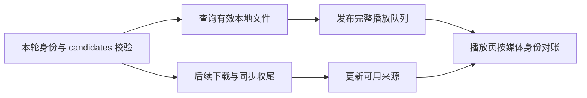

# Moment 轮播：缓存准备好了，为什么当前画面不该重新开始

一张照片正在相框上显示，后台恰好完成了它的下载；或者视频已经播放到中间，播放地址从网络 URL 变成本地文件。
这时界面收到了一份“更好的数据”，用户却没有要求换内容。
如果播放器把这次更新理解成新媒体，照片会重新等待整个展示间隔，视频可能从头播放。
如果播放器完全忽略更新，下一轮又用不到缓存，甚至会继续显示已经被移除的媒体。

Moment 这部分最值得展开的技术问题，是让**资源来源可以更新，而当前观看过程只在正确的边界上改变**。
本文围绕 Frame 的实际源码讲这条链，不把它写成下载、列表、设置的功能清单。
源码与测试阅读日期为 **2026-09-14**；本文没有重新运行产品测试、构建 APK 或操作相框，下面的测试段落描述已有测试的设计。
如果还不熟悉页面状态和异步回调，可先读[一张照片怎样暂停与恢复](../beginner/guided/moment.md)，完整模块地图见 [Moment 专题](../modules/moment.md)。

## 从“换了地址”走到“是否换了内容”

先约定三个词。**内容身份（media identity）**回答“当前还是不是同一项媒体”；**读取来源（playback source）**回答“现在从哪里读取字节”；**播放状态（playback state）**回答“用户停在哪一项、是否暂停、何时前进”。
它们可以分别变化。相同内容可以换来源，来源相同也不代表媒体归属相同。

一个教学时序就能暴露朴素方案的问题：照片 A 的间隔设为 10 秒，在第 6 秒缓存更新到达。
如果每次父级通知都重建计时器，A 就会显示到第 16 秒；只要后台持续通知，停留时间就可能被不断延长。
这里的 10 秒和 6 秒是解释用的数字，不是产品默认值或真机测量结果。

另一种常见方案是把 URL 当作 Widget 的唯一身份。
它会把同一内容的地址续签、网络转本地当成新媒体，却无法表达“不同宠物恰好复用同一个媒体 ID 或文件”的差别。
因此问题不在于多写一个 `if`，而在于先决定：哪些变化要求替换播放状态，哪些变化只更新后续可用的来源。

## 播放集合与缓存各自回答一个问题

当前在线链路先由 First Sync 核对本轮身份、显示范围和候选媒体，再查询已有缓存。
这里的**候选集合（candidates）**是本轮被接纳的媒体目录，缓存只是其中一些媒体的字节副本，不能反过来决定用户现在可以看什么。
这也是为什么“磁盘还有文件”不足以把上一只宠物的照片放回当前轮播。[First Sync 入口](../evidence/blog-source-map.md#blog-moment-first-sync)

`FrameAlbumMediaCachePreparer.resolveCached` 负责查询当前 candidates 对应的受管文件。
它检查文件资格，返回本地命中；这一阶段不下载、不刷新 URL、不清理缓存，也不更新缓存访问顺序或索引。
找不到或校验失败的项仍保留本轮网络来源，完整 `prepare` 再负责后续缓存工作。[缓存实现](../evidence/blog-source-map.md#blog-moment-cache)



图中两条工作路径表示职责与发布顺序，不表示它们必然运行在不同线程。
`_cacheFirstPlaybackItems` 遍历本轮 candidates，为匹配项补上本地文件，沿用当前响应中的元数据；它不会直接拿缓存列表替换整个队列。
因此部分命中不会丢掉未缓存的项，历史缓存中的多余项也不会重新出现。
之后 `_imageFirstPlaybackQueue` 会把环形队列旋转到第一张图片开头，保留相对环形顺序，并非将所有图片排到所有视频之前。[队列组装](../evidence/blog-source-map.md#blog-moment-playback)

这里还有一个容易误读的状态名：`FrameFirstSyncPlaybackPhase.cacheReady` 描述 Portrait runtime 的完整性，不能据此断言 Moment 已全部下载，或同步上报已经完成。
名称相近的完成状态，要回到它覆盖的资源范围判断。[Data Transfer owner](../evidence/blog-source-map.md#blog-moment-data-transfer)

## 将“是不是同一项”和“是不是同一来源”拆开比较

`FrameAlbumPlaybackItem` 提供两个值得并排阅读的方法。
`hasSameMediaIdentity` 比较 `petId`、`mediaCacheIdentity`、`id`、`mediaType`；`hasSamePlaybackContent` 在这些条件之外再比较 `playbackSource`。
前者可用于识别队列是不是换了业务媒体，后者表达连读取来源也一致的更严格关系。
当前播放页的队列对账使用前者；不要因为后者存在，就误认为每次地址变化都会触发队列重置。[身份比较](../evidence/blog-source-map.md#blog-moment-playback)

| 身份字段 | 它挡住的混淆 |
| --- | --- |
| `petId` | 两只宠物复用 ID 或物理文件时，旧播放意图不能串过去 |
| `mediaCacheIdentity` | 根据缓存键与可选内容摘要形成的身份变化，不能当作同一缓存版本 |
| `id` | 不同候选媒体项不能仅因共用文件就合并 |
| `mediaType` | 图片与视频不能沿用彼此的播放策略 |

`FrameAlbumItem.mediaCacheIdentity` 委托共享媒体策略生成；本模块传入 `cacheKey`、`contentHash` 和 URL，不能把它简单解释成“文件路径”或“永远只有一段哈希”。
内容摘要可选，所以“同一内容续签 URL 不影响播放”的前提，是生成出的媒体身份仍然相同；这套机制也不能凭空识别服务端没有标识的字节变化。[模型与共享身份规则](../evidence/blog-source-map.md#blog-moment-models) · [共享规则实现](../evidence/blog-source-map.md#blog-moment-shared-identity)

下面是原创的**教学方法片段**，只演示比较的层次，并非可运行页面，也不是产品源码复制。
它假设外部已定义 `LessonMedia`，包含 `owner`、`contentKey`、`kind`、`location` 字段；为突出概念，省略产品中的候选项 ID 和缓存校验。

```dart
bool sameLessonContent(LessonMedia a, LessonMedia b) =>
    a.owner == b.owner &&
    a.contentKey == b.contentKey &&
    a.kind == b.kind;

bool sameLessonLocation(LessonMedia a, LessonMedia b) =>
    sameLessonContent(a, b) && a.location == b.location;
```

两种比较都合理，关键是调用者要说明自己正在做哪一种决定。
要补齐实体 ID、内容版本和物理文件之间的关系，可以回看[缓存与数据身份](../foundations/storage-identity.md)。

## 让新来源等待自然换页，而不是打断当前项

播放页保留 `_activeSource`，表示当前这一轮实际采用的来源；新传入的 `widget.items` 则保存各项下一次可用的来源。
如果 `_samePlaybackQueue` 判断媒体身份和顺序未变，且计时参数未变，`didUpdateWidget` 不重建前进计时器，也不替换 `_activeSource`。
当前视频继续使用原来源，邻项或后续自然重新进入的项才采用新文件。[`didUpdateWidget` 与 `_activeSource`](../evidence/blog-source-map.md#blog-moment-playback)

这看起来像同时保留新旧两份数据，但它们不是两个相互竞争的目录：一份描述“当前已启动的播放”，另一份描述“之后可以采用的来源”。
因此缓存更新后当前视频短时间继续读网络，是连续性策略的一部分，并不代表缓存没生效。

页面上层也需要配合。`_albumPlaybackSessionIdentity` 以 Frame 和显示范围生成页面 key，不把同范围的每次 revision 更新都变成新的播放器页面。
否则下层即使写好了媒体对账，也会因上层整体替换 State 而失去机会；不同设备或宠物显示范围则仍隔离播放状态。[路由接线](../evidence/blog-source-map.md#blog-moment-routes)

这个方案有一个明确取舍：它保证的是身份未变时延续当前播放，并没有实现网络故障发生后在相同进度无缝切换本地视频的算法。
本地文件准备好了与原生播放器支持无缝迁移，是两个不同问题；不能将前者写成“任何弱网情况下零卡顿”。

## 图片暂停、缓存更新和 Never 不是同一种停止

图片不需要视频 controller，但需要页面管理“什么时候前进”。
`_syncActivePlaybackPolicy` 集中判断：用户未暂停、没有手动拖动、不在队列重定位、队列至少两项、间隔不为 `null`，才建立自动前进计时器。
虽然字段叫 `_videoAdvanceTimer`，当前源码也用它管理图片停留；理解职责应读调用位置，不能只看变量名字。[播放策略](../evidence/blog-source-map.md#blog-moment-playback)

这里必须区分两种时序。
**缓存升级**没有换媒体，所以原计时器继续；本文说“保留截止点”，指既有 Timer 的预期触发点，并不是源码另存了一个持久化 deadline 字段。
**用户暂停再恢复**则先取消 Timer，恢复时按当前有限间隔重新建立；它不是扣除已观看时长后继续剩余倒计时。

以 10 秒教学间隔为例，第 6 秒仅收到缓存更新，仍应在原来的第 10 秒附近开始换页；第 6 秒由用户暂停，后来恢复，则重新获得完整 10 秒。
这两个结果服务于不同意图：后台更新保持连续，主动恢复允许用户重新观看当前照片。
实际换页还包含过渡动画，不能把触发换页的时间和下一张完全显示的时间混成一个指标。

暂停提示也有自己的生命周期。照片上的播放箭头展示 1 秒后淡出，但 `_isUserPaused` 仍然保持；图标消失不等于轮播恢复。
提示组件卸载时取消自己的 Timer，避免上一次点击留下的反馈影响下一次暂停。[照片反馈实现](../evidence/blog-source-map.md#blog-moment-playback)

Never 在路由上传入 `Duration? = null`，意思是不自动换页；视频仍可以正常播放，结束后停在当前项，手动导航继续可用。
产品间隔来自 Settings，不能把播放页构造器的默认 12 秒写成产品默认；当前 owner 的默认及未知值回退是 Every 60s。[Settings owner](../evidence/blog-source-map.md#blog-moment-settings) · [参数传递](../evidence/blog-source-map.md#blog-moment-routes)

## 队列真的改变时，保留谁的状态

只处理缓存升级还不够。假设队列是 A、B、C，用户正暂停在 B，Gallery 的已确认可见性变化使 A 被过滤。
如果只保留旧索引 1，就会误跳到 C；如果每次都回到首项并清空暂停，又会打断用户正在看的 B。
这里是教学示例；Gallery 当前只管理图片，视频不受其隐藏目录直接管理。[Gallery 边界](../evidence/blog-source-map.md#blog-moment-gallery)

播放页用旧 `_activeSource` 的媒体身份去新列表寻找位置。B 还在，就保留 B 的来源和暂停意图；B 不在，就选择新列表首项并清除旧暂停、失败和结束状态。
与此同时，它保持屏幕上的虚拟页锚点 `_anchorPage`，调整前后项映射，避免“前面少了一项”变成当前视频被整体重建。
集合变化会走队列重定位流程，不能把“仅来源更新保留原截止点”的结论扩大为任何列表变化都保留计时。[队列对账实现](../evidence/blog-source-map.md#blog-moment-playback)

拖动进行到一半时，旧 PageView 的页差回调尤其危险：它是按旧队列开始的，却可能在新队列发布后才到达。
`_queueReanchorPending` 暂停这段窗口里的旧页差应用；`_queueGeneration` 让已经过期的 post-frame 回调失去重新定位资格。
这里的**代次（generation）**可以先理解成“当前任务版本号”，任务开始时拿到一个编号，准备修改状态时必须还是同一代。

## 异步完成，还要证明结果属于当前播放

视频准备跨越多个 `await`：设置声音、调用播放，再处理用户意图。
假设视频 A 的音量配置迟迟未返回，页面已经换到 B，A 的 Future 依然可能完成。
页面对象还活着，只检查 `mounted` 无法判断 A 是否还有资格启动；`mounted` 也不表达媒体是否处于活动页。

`_configureAndPlay` 在声音配置返回后、`play` 返回后，分别检查 mounted、`isActive` 和 `_sourceOperationGeneration`。
来源任务过期，就不继续执行后续播放动作或提交启动状态；旧任务的晚到失败也要检查归属，避免把 B 标成失败。
如果用户在 `play` 尚未返回时点了暂停，返回后还会再次读取当前暂停意图并补做 `pause`。[视频异步边界](../evidence/blog-source-map.md#blog-moment-playback)

声音与来源使用不同代次：`_soundPolicyGeneration` 淘汰旧声音配置，`_sourceOperationGeneration` 淘汰旧来源任务。
两类变化的失效范围不同，所以不能随便共用一个计数器；换来源会同时使旧声音工作失效，而声音任务更新不应顺手取消仍需完成的来源启动链。
本地视频缩略图另用 `_thumbnailOperationGeneration`，返回时还核对来源，防止旧提帧结果盖到新视频上。

generation 的作用是撤销后续动作或结果提交资格，不是令已经发出的平台调用自动消失。
视频失活还会调用 `stop`，页面销毁时取消订阅并发起 controller 释放；这些资源动作与资格判断需要一起解释。[异步与生命周期基础](../foundations/async-lifecycle.md)

同样不能从本页 `dispose` 推出 App 退到后台时所有工作都停止：播放页没有直接实现 `WidgetsBindingObserver`，后台表现还涉及宿主与播放器。
这里能确认的是页面 Timer、PageController、视频 surface 的局部生命周期；系统后台音视频行为需要继续追平台链路并验证。[播放页资源所有者](../evidence/blog-source-map.md#blog-moment-playback)

## 怎样验证这套设计，而不是只看画面能播放

先挑会区分正确方案与朴素方案的断言。以下已有测试仅在本轮阅读过，不能写成“2026-09-14 已通过”。

| 要证明的行为 | 已有测试定位与观察点 |
| --- | --- |
| 缓存补齐不延长照片本次停留 | `cache upgrade preserves photo deadline and uses next local file`：100 ms 间隔推进 60 ms，补齐下一张缓存，再推进 41 ms 和过渡时间；检查已到下一本地文件 |
| 当前网络视频不因缓存完成重播 | `cache upgrade keeps playing video until its original deadline`：升级前后检查 `playSources`，没有新增当前来源播放或 `seekTo`，下一项才采用本地来源 |
| 晚到准备不启动旧来源 | `a delayed old video setup cannot replay the replacement source`：主动阻塞 A 的音量配置，换 B，再释放 A，断言只播放 B |
| 用户在准备中暂停仍有效 | `video pause resumes the same source without pause feedback`：阻塞第一次 play，在返回前暂停，返回后检查补做 pause，恢复调用 resume 而非重新 play |

上表都在 [播放页测试](../evidence/blog-source-map.md#blog-moment-test)。其中照片缓存测试直接覆盖“新增下一张缓存不会重置当前停留”，不要夸大成已经对当前网络图片的真实解码过程做了硬件验证。
集合变化再读 [运行策略测试](../evidence/blog-source-map.md#blog-moment-policy-test) 的 `current video survives index shift without new play stop or disposal`，以及 `manual drag ... midpoint` 系列：它们把删除发生在拖动中点前后拆开验证。

缓存层也需要自己的反例：摘要计算期间文件可能被另一次受管提交替换，校验过的旧文件就不能直接作为新命中发布。
`resolveCached` 把大文件摘要读取放到存储串行队列之外，返回前再用短事务复查 entry、文件状态和当前资格；对应 `a new managed commit during digest invalidates the old file proof` 与 `digest does not hold Storage FIFO and revoked lookup cannot publish`。[缓存测试](../evidence/blog-source-map.md#blog-moment-cache-test)

这些测试能检查调用次数、来源和时序条件；真实网络视频是否连续、是否闪黑、原生声音是否停止，要在明确版本的 APK 和设备上另做观察。
如果要量化收益，应先定义从哪个事件到哪个事件计时、采样多少次、运行在哪个设备及缓存条件；本文没有这些数据，因此不声称切换提升百分比或首帧达到某个数值。

## 阅读入口与可追溯的改动

第一次深入只打开下面六个入口，遇到具体分支再沿符号向下找。

| 入口 | 先搜索的符号与阅读目的 |
| --- | --- |
| [媒体模型](../evidence/blog-source-map.md#blog-moment-models) | `FrameAlbumItem`、`mediaCacheIdentity`：看业务身份和缓存身份 |
| [首次同步](../evidence/blog-source-map.md#blog-moment-first-sync) | `authoritativeCandidates`、`_publishPlaybackReady`：看播放准入与先发布后收尾 |
| [缓存准备](../evidence/blog-source-map.md#blog-moment-cache) | `resolveCached`、`_validateCacheHit`：看本地文件凭什么成为候选来源 |
| [路由组装](../evidence/blog-source-map.md#blog-moment-routes) | `_albumPageForState`、`_albumPlaybackSessionIdentity`：看参数、过滤与页面身份 |
| [播放页](../evidence/blog-source-map.md#blog-moment-playback) | `_activeSource`、`didUpdateWidget`、`_configureAndPlay`：看连续性与异步结果归属 |
| [播放页测试](../evidence/blog-source-map.md#blog-moment-test) | `cache upgrade`、`delayed old video`：看可控时序如何构造 |

按 2026-08-14 之后的路径历史筛选，可以找到 2026-08-24 的 `a94d28c`：增加独立 source/sound generation、捕获启动参数，以及可注入视频 controller 的回归入口。
2026-09-11 的 `6276bc8` 则包含缓存优先的队列组装与相应连续性测试；这两个提交分别对应本文的异步失效与缓存升级主线。[历史与来源记录](../evidence/blog-source-map.md#blog-moment-playback)
这些是提交差异可核对的内容。用户已说明相框这些部分几乎均由自己负责；这是责任范围的自述，Git 能补充改动线索，不能单独证明团队分工、独占贡献或性能收益。

## 面试中用两到三分钟讲清楚

可以这样组织口述，并按自己的实际经历调整措辞：

“我负责相框端 Moment 相关实现时，处理的一个具体难点是：媒体正在展示，后台缓存完成会更新同一份播放数据。如果把 URL 当成内容身份，网络换本地就会让视频重播，照片也可能重新计时。
我沿着首次同步、缓存、路由和播放页把几个决定拆开：本轮 candidates 决定可以播哪些媒体，缓存只提供匹配的本地来源，页面再决定是否延续当前播放。匹配包含宠物归属和内容身份，避免只按 ID 或文件路径复用错误状态。
页面保留当前已启动的 `_activeSource`。仅来源更新时沿用当前计时器和视频来源，新来源等自然换页再用；队列真的变化时按媒体身份重新找位置，保留仍存在的当前项，被删掉才清除旧暂停状态。
异步部分我重点关注晚到结果的归属：来源和声音各有 generation，在关键 await 返回后确认任务仍有效。用户若在视频准备期间暂停，play 返回后还要补做 pause。验证用可控 Future 和调用记录，检查缓存升级不重播、旧视频不能晚启动、拖动中删除不串页。性能和硬件连续性则需要对应版本实测，不能只凭这些测试下结论。”

## 六个追问，继续讲到实现细节

**1. 为什么不能只比较 URL？** URL 表示位置，还可能续签；播放状态属于带归属的媒体身份。先比 `petId + mediaCacheIdentity + id + mediaType`，才知道是不是同一项。

**2. 缓存文件已经有了，为什么当前视频还走网络？** `_activeSource` 保留本次播放来源，避免重启；新文件供后续自然进入使用。当前实现没有承诺跨来源无缝迁移播放进度。

**3. 暂停恢复是不是接着剩余秒数走？** 当前图片策略重新建立完整有限间隔。保留旧截止点的是仅来源升级的场景，不能把两者混为一个规则；Never 则始终不建立自动前进 Timer。

**4. `mounted` 都检查了，为什么还要 generation？** mounted 只表明 State 尚未销毁；它可能仍活着但已切换媒体。generation 判断任务是否还属于当前来源，isActive 再判断当前 surface 是否在活动页。

**5. 删除前一张，为什么当前视频可以继续？** 实现按媒体身份寻找保留项，并调整虚拟页与队列索引的映射；当前来源和 controller 不需要因为索引变化而重建。当前项消失则选择新首项并清除旧意图。

**6. 怎样证明优化有效，又避免说过头？** 先用测试证明缓存升级没有新增当前 play、原 Timer 没被重置、旧异步结果没提交。再按同一设备、版本、网络和缓存条件测实际切换与播放；未采集的数据不写成成果数字。
