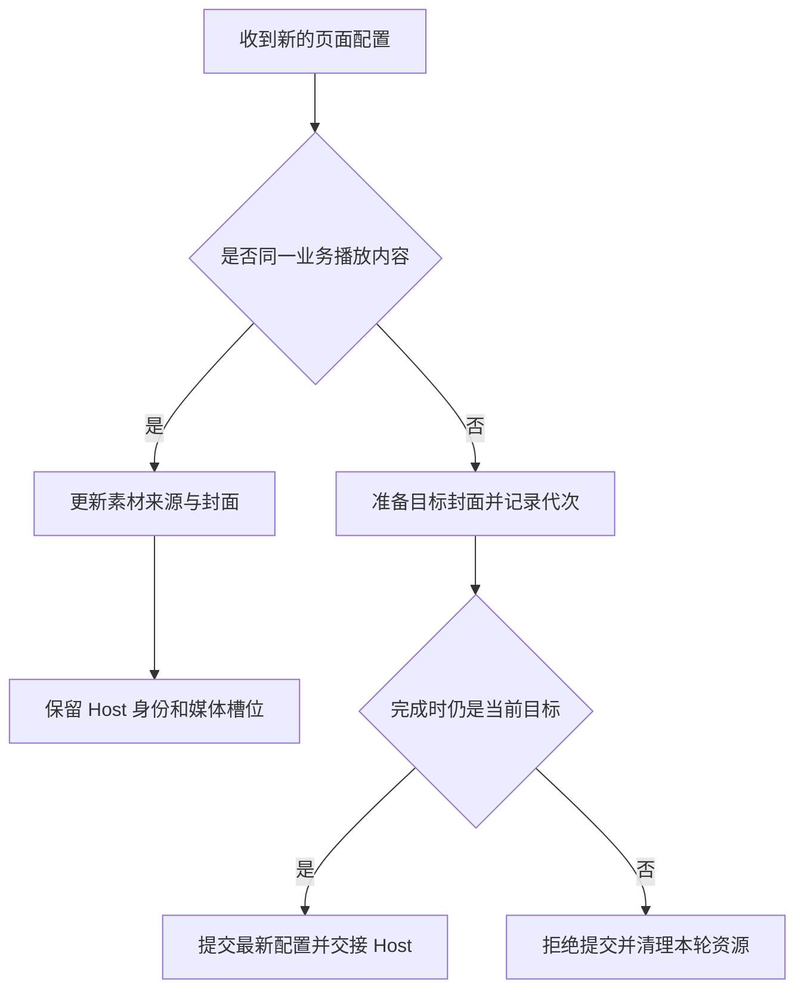

# Portrait 播放连续性的关键：让配置更新、业务身份与资源生命周期各司其职

源码阅读日期：**2026-09-14**。本文核对当前工作区源码、相关 owner 与测试断言，并只读查看 2026-08-14 之后的提交；没有运行产品测试、构建或真机验收。文中的“保持连续”先指代码设计及测试所检查的对象连续性，物理画面仍需独立观察。

如果刚接触 Flutter，建议先读 [State、异步与生命周期](../foundations/async-lifecycle.md)，再把本文当成一次真实问题的拆解。完整模块导航保留在 [Portrait 专题](../modules/portrait.md)，其中较早的学习快照不替代本文的当前来源。

## 同一只宠物，为什么下载完成也可能让画面跳一下？

设想相框正在播放宠物 A。网络素材已允许播放，后台继续下载；稍后缓存准备完成，界面收到一份更新后的配置。宠物没换，内容版本没换，只是视频和封面开始能够从本地读取。用户期待动作接着往下走。

这时有两类看似合理的实现会打断连续性。第一类为了“刷新播放器”，把缓存阶段也放进 Widget 的 key；第二类保留 Host 的 key，却在出现本地封面时临时给媒体外面套上一层 Stack。前者更换整个播放宿主，后者可能更换里面真正承载视频的节点。

再加入一次操作：A 正在播放，用户点 B；B 的封面尚未解码，用户又点回 A。B 的加载稍后完成时，页面仍然存在，但它已经不能把当前画面改回 B。

这两个问题共同指向一个设计问题：**哪些变化只是更新现有对象的配置，哪些变化应结束旧对象的生存期，哪些晚到结果已经没有提交资格？** Portrait 的技术特点就在于，它没有用一个 `isLoading` 回答所有问题。

## 先分清四种“还是不是原来的那个”

Flutter 中的 Widget 是描述界面的配置。树中的节点称为 Element，有状态组件的可变数据放在 State。父级重新构建，可能只是把新 Widget 配置交给已有 Element/State，并不必然重新创建播放器。

在框架为某个节点匹配新旧 Widget 时，`runtimeType` 与 `key` 是否相等决定能否更新这个 Element。这个条件必须放在树的更新过程中理解；不能推出“把相同 key 放到任意新层级，都能保留原来的 State”。官方依据见 [Widget.canUpdate](https://api.flutter.dev/flutter/widgets/Widget/canUpdate.html)。

项目还需要 Flutter 不认识的业务身份，以及比页面更短暂的请求身份：

| 要判断的对象 | 项目中的检查 | 它回答的问题 |
| --- | --- | --- |
| 页面节点及状态 | Widget 类型、key、树位置 | 现有 State 能否继续使用？ |
| 当前播放内容 | `transitionIdentity`、`hasSameTransition` | 还是同一相框、宠物和内容版本吗？ |
| 某一次异步工作 | `_posterGeneration`、`_dependencyLoadGeneration`、`_bootstrapGeneration` | 完成的是仍被接纳的那一轮工作吗？ |
| 已分配的播放资源 | dependencies/controller 的引用与释放路径 | 谁现在拥有它，谁负责最后清理？ |

这些检查不是重复代码。比如页面 State 仍在，不代表 B 的旧封面还有效；原生播放器实例仍在，也不代表可以把上一个逻辑 session 的事件用于新队列。

下面只画同内容刷新与真正切换的分岔，不展开完整触摸状态机：



## 第一层：用业务身份决定何时重建 Host

[路由入口 `_portraitStagePageForState`](../evidence/blog-source-map.md#blog-portrait-routes) 把 `frameDeviceId`、`petId` 和 `revisionKey` 组合成 `playbackIdentity`，交给 Stage 的 `transitionIdentity`。缓存阶段没有进入这个组合。

因此，`networkReady → cacheReady` 本身不会被解释成新内容。真正变更相框、宠物或 revision，才需要交接对应的播放宿主。签名 URL 续期、本地文件路径出现，属于来源更新；不能因为字符串变了就顺带重置动作状态。

[Stage 的 `hasSameTransition`](../evidence/blog-source-map.md#blog-portrait-stage) 在存在显式 transition identity 时，还比较 `visibleCompanion`；未提供显式 identity 的调用有封面比较的回退规则。这里的“同内容”是生产路由明确提供的合同，不是仅凭宠物名字相同推测。

Stage 构建共享 Host 时使用由 transition identity 派生的 `ValueKey`。同一个 Stage State 可以收到新配置、保留当前 Host，也可以在提交新业务内容后让 Host 按新 key 重新建立。这把“外层页面仍在”和“内层播放会话已换”清楚地分开。

这一选择也能在历史里找到直接依据。Frame 提交 `a6c92f5`（2026-09-09）从 `playbackIdentity` 中移除了 `session.phase.name`，同时加入素材来源映射与更细的 Stage 交接。旧代码把加载阶段变化升级成了生命周期变化，修订后让两者分别表达。具体路径与 diff 范围记录在 [当前来源索引](../evidence/blog-source-map.md#blog-portrait-routes)。

## 第二层：key 没变，回调对象也可能触发重新加载

只稳定 key 还不够。[共享 Host 的 `didUpdateWidget`](../evidence/blog-source-map.md#blog-portrait-host) 会检查 dependencies、平台、视频缩放模式，以及 `defaultDependenciesLoader` 是否变化。其中 loader 使用 `identical` 比较对象身份。

原因很实际：Host 需要知道“依赖输入真的换了，是否应该重新 bootstrap”。若父级每次 build 都重新创建匿名加载闭包，即使代码内容相同，也可能被识别为新的输入，于是已有 controller/driver 被清理，再启动一轮加载。

Stage 在 `initState` 中保存 `_stableDependenciesLoader`，随后重复传递这个固定引用。这样，播放状态通知导致的界面更新不会附带一个新的加载函数对象。实际切宠仍由 transition identity 处理，函数引用不承担业务内容版本的职责。

这不是“把所有参数永久缓存”。Host 仍会处理真正的依赖对象替换，也会读取更新后的展示配置。稳定的是会被当作重载信号的回调身份，而不是冻结整个页面。

Flutter 在 `didUpdateWidget` 之后会安排 build；但若几秒后 Future 才完成，仍需通过相应通知更新界面。`mounted` 也只表示 State 仍与树关联，不表示页面当前可见。相关基础可回看 [Flutter State 生命周期](https://api.flutter.dev/flutter/widgets/State-class.html)。

## 第三层：Host 还在，里面的视频 State 却可能已经没了

这是比“不要乱改 key”更容易漏掉的一层。Stage 由外层处理网络封面，传给 Host 的网络封面为 null；本地化以后，Host 的 `bootstrapPosterImage` 才可能变成 `FileImage`。

如果没有封面时返回 `media`，有封面时返回 `Stack(background, media)`，媒体就从原位置变成 Stack 内部的后代。外层 Host 的 Element 和 controller 都可能还在，媒体 Element 却已被卸载重建。

当前 [Host 的 `_withBootstrapPoster`](../evidence/blog-source-map.md#blog-portrait-host) 始终返回 Stack，并保留两个槽位：背景槽为空时放占位，有图时放 Image；媒体始终位于另一个槽位。背景有无不再改变媒体所在的层级。

共享包提交 `175928a`（2026-09-11）中可以直接看到这个修改：移除无封面时直接返回 child 的分支，固定背景和媒体位置；同一提交还把媒体子树放入 `AnimatedBuilder.child`，使 controller 的状态通知主要更新交互层。这里能够说清的是构建与节点生命周期的变化，不能直接换算成 FPS 提升。

这个例子提醒我们检查资源所在的真实深度。如果问题发生在视频 View，那么“Host 没被 dispose”只是中间证据。需要继续检查 Surface Widget、媒体 Element/State，必要时再检查原生 View/Surface。基础关系见 [媒体与渲染](../foundations/media-rendering.md)。

## 第四层：让旧工作失去提交权，而不是假设它不会回来

回到 A → B → A。当前 [Stage 的 `_resolveTargetPoster`](../evidence/blog-source-map.md#blog-portrait-stage) 为封面请求记录递增代次，也就是 generation。用户返回当前 A 时，Stage 撤销待切换目标并改变代次；B 的迟到解码回调不再符合当前代次。

这里 `mounted` 无法代替 generation：同一个 State 足以经历多次选择。前者问“接收对象还活着吗”，后者问“这项工作还属于最新目标吗”。只有目标身份也匹配，结果才有资格改变当前状态。

下面是原创教学片段，仅展示一个 State 中的成功分支。`ItemId`、`PreviewLease`、`repository.open` 为未定义的示意接口；错误呈现、真实 I/O 取消、State 的完整定义和卸载清理均未包含，不能直接作为生产代码运行。

```dart
int _requestEpoch = 0;
PreviewLease? _preview;

Future<void> choose(ItemId target) async {
  final myEpoch = ++_requestEpoch;
  final acquired = await repository.open(target);
  if (!mounted || myEpoch != _requestEpoch) {
    acquired.dispose(); // 旧结果不能提交，但本轮取得的资源仍要归还。
    return;
  }
  final previous = _preview;
  setState(() => _preview = acquired); // setState 内只做同步赋值。
  previous?.dispose();
}
```

重点是 `await` 两侧拥有不同的确定性。开始等待时 B 是目标，不保证完成时仍是目标。取消提交资格也不等于下载、解码或平台命令已经停止；那些工作仍需要自己的所有者处理完成和释放。

真实实现还有一个细节：Stage 在 `_commitPreparedSession` 再次读取当前 Widget 输入。假设等待 B 封面期间，B 已从网络素材升级成本地缓存；提交时使用的是当前 B 的最新配置，而不是此前捕获的旧 URL。这同时避免“提交旧目标”和“给合法目标提交过时来源”。

## 不能只挡旧结果，还要保证合法结果不会被误伤

另一个常见错误是把“请求时的配置对象”和“当前配置对象”做引用相等比较，作为全部提交条件。父级普通 rebuild 可能创建新的 `_FramePortraitSessionInputs`，即使业务 transition 没变，对象也已经不同。

如果仅凭对象不同拒绝结果，合法 dependencies 加载完成后，Stage 的显示层可能永远接不到它的 surface。当前 `_loadDependencies` 改以 `_dependencyLoadGeneration` 判断加载及已提交切换是否仍有效，同时检查 mounted 和当前是否使用注入 dependencies。

这与 Host 的 loader identity 检查不矛盾：一个是有意用于表达“依赖输入替换”的回调引用，另一个只是封装配置的临时对象。**对象身份是否有意义，取决于代码为它定义了什么职责。**

共享 Host 自己又持有 `_bootstrapGeneration`。加载返回后，Host 检查自身 mounted、bootstrap 代次以及是否已改用显式 dependencies；过期结果走 `_disposeUnattachedDependencies`，释放 interaction、runtime、driver。Stage 的代次保护显示绑定，Host 的代次保护依赖接管，各自覆盖不同提交点。

封面也是同样的资源原则：解码回调收到 `ImageInfo` 后，即使已经过期，仍先释放这个监听器取得的 handle，再决定是否处理状态。实际 Image widget 持有自己的图像引用。忽略回调不会自动归还资源；释放后的对象也不能继续使用，参见 [ImageInfo.dispose](https://api.flutter.dev/flutter/painting/ImageInfo/dispose.html)。

## 来源可以升级，当前动作不必被打断

稳定 Host 以后，旧 driver 如何读到新文件？[FramePortraitLiveVideoAssetStore](../evidence/blog-source-map.md#blog-portrait-assets) 为已交给 driver 的初始来源保存别名映射；`updateManifest` 接受相同 Frame、pet、revision 下匹配的媒体引用集合，再原子替换内存映射。

后续 `materialize` 可以把旧引用解析为新签名 URL 或可信本地文件。这个更新方法不会 interrupt、seek，也不会替换已经交给原生的当前队列。因此，缓存完成能影响后续素材解析，而不必为了应用本地路径把正在播放的动作从头再来。

这个合同也限制了复用范围：跨宠物、跨 revision、媒体身份或引用位置变化会被拒绝。已经取得的可信本地映射不会因稍后的远程快照而降级；本地文件失效时会返回失败，不偷偷改回旧签名 URL。

播放前的 `File.stat` 检查只确认当前路径仍是非空普通文件，不能被讲成每次播放都重新完成内容摘要校验。业务版本、可信缓存与文件可用性是不同层次，可继续读 [缓存与数据身份](../foundations/storage-identity.md)。

## 按六个入口阅读，能把这条链走完

| 顺序 | 当前源码或文档入口 | 建议只追的符号与问题 |
| --- | --- | --- |
| 1 | [frame_routes.dart](../evidence/blog-source-map.md#blog-portrait-routes) | `_portraitStagePageForState`：哪些字段组成播放身份？ |
| 2 | [frame_portrait_stage_page.dart](../evidence/blog-source-map.md#blog-portrait-stage) | `hasSameTransition`、`didUpdateWidget`：何时刷新，何时准备交接？ |
| 3 | 同一 Stage 文件 | `_resolveTargetPoster`、`_commitPreparedSession`、`_loadDependencies`：哪个提交点检查什么身份？ |
| 4 | [portrait_player_live_host.dart](../evidence/blog-source-map.md#blog-portrait-host) | `_bootstrapDependencies`、`_disposeUnattachedDependencies`、`_withBootstrapPoster`：谁持有依赖和媒体节点？ |
| 5 | [frame_portrait_live_video_asset_store.dart](../evidence/blog-source-map.md#blog-portrait-assets) | `updateManifest`、`materialize`：只更新来源时有哪些准入条件？ |
| 6 | [共享 Portrait owner](../evidence/blog-source-map.md#blog-portrait-shared-owner) | `Diagnostics contract`：固定媒体槽位及测试边界是什么？ |

Frame 侧当前解释另见 [Companion owner](../evidence/blog-source-map.md#blog-portrait-companion-owner)。[HOME owner](../evidence/blog-source-map.md#blog-portrait-home-owner) 区分 UI 生命周期、原生崩溃与物理验收；不要把所有“画面静止”都归结为 Flutter rebuild。

## 怎样验证这套设计，而不是只看起来没问题？

[Stage 测试](../evidence/blog-source-map.md#blog-portrait-stage-tests) 的 `network poster localization retains the mounted video surface` 经过真正的 `NetworkImage` 类型分支，再换成 `FileImage`。它检查 Host、Surface、媒体 Element/State 是同一对象，挂载一次、切换期间未释放，并确认后续模拟帧还能更新、最终离页会释放。

这个断言比只统计 `driver.play` 次数更有解释力：原生输出节点可以重挂而没有新的 Dart 播放调用。反过来，只检查对象没被释放也不够；若后续状态完全不更新，所谓“保留”可能只是把页面冻住。

同文件的 `returning to the active companion cancels a pending poster switch` 人为延迟 B 封面完成，覆盖 A → B → A；`same-transition rebuild while loading still reveals decoded content` 则在加载未完成时先 rebuild，检查合法结果仍能撤掉恢复层。这两例分别保护“不接纳旧结果”和“不拒绝正确结果”。

[共享 Host 测试](../evidence/blog-source-map.md#blog-portrait-host-tests) 进一步覆盖添加、移除及替换背景，保留媒体状态、接受后续 surface 更新，并在最终卸载时检查 driver/runtime 释放。[素材映射测试](../evidence/blog-source-map.md#blog-portrait-asset-tests) 覆盖旧引用解析到本地文件、跨身份更新被拒绝，以及本地文件删除后失败。

这些是本次阅读到的断言，不是本轮执行结果。若验证物理连续性，还需在同一设备、构建和媒体条件下观察联网缓存完成、快速切宠和前后台；Widget 中的媒体 probe 不具备真实 codec、Surface 或 GPU 行为。

## 取舍：保留资源，也要允许真正的交接和失败

保留旧 Host 等目标封面，能够避免一收到新 manifest 就先拆掉可见画面，但代价是选中目标与画面接管不是同一时刻。当前 Stage 对封面失败有独立路径：允许已确认的目标 session 启动，并用已有可见封面保护过程；它不会把失败解码伪装成成功。

相反，永久保留一个全局播放器也不是这套设计。业务内容真正变化时仍要交接；旧 dependencies 仍要释放；失效缓存仍要失败。生命周期边界越明确，越能判断“该保留的被重建了”还是“该结束的还在回调”。

[TinyPlayer owner](../evidence/blog-source-map.md#blog-portrait-native-owner) 还区分原生实例复用与逻辑 session：Android queue replacement 可以复用 ExoPlayer，但新的 `playQueue` 仍有新 session，并隔离旧 listener/generation。实例复用不能推导出 codec 永不重建，也不能替代首帧或设备观感验收。

## 面试时可以怎样用两三分钟讲清楚

下面的讲述以已确认的相框负责范围为前提，具体修复的个人参与仍需结合自己的工作记录补充：

> 我负责相框这部分开发，Portrait 是值得展开讲的模块。它既要支持切换宠物，也要在网络播放期间完成本地缓存，所以我会先把“配置刷新”和“更换播放内容”分开：同一 Frame、宠物和 revision 的缓存完成，不应该顺带让动作从头开始。项目用业务 identity 控制 Host 交接，也固定依赖加载回调，避免普通 rebuild 被识别成重新初始化。
>
> 这里最容易漏的是，Host 没重建不等于视频节点没重建。网络封面变成本地封面后，可选背景可能改变媒体层级，所以共享 Host 固定了背景与媒体槽位。验证时需要看实际媒体 Element/State 的挂载、释放和后续更新，不能只数播放调用。
>
> 对快速 A → B → A，项目为封面和依赖加载分别记录代次。旧任务即使返回，也必须重新确认提交资格；不被接纳的依赖和图片 handle 仍要清理。另一方面，合法的同内容更新不能只因临时配置对象换了就被拒绝。缓存来源则通过映射更新，让下一次解析读到本地文件，同时保留当前动作。这个案例让我能从身份、提交点和资源所有权解释连续性，而不会把源码测试直接当成真机性能结论。

## 常见追问

**1. 为什么 `mounted` 为 true 还会产生旧结果覆盖？**

State 仍在树里，但用户已经从 B 改选 A。mounted 只检查接收对象生存期；generation 与业务身份检查这次结果是否仍属于当前目标。

**2. 相同 key 为什么还不能保证视频连续？**

key 参与当前层级的 Widget 匹配。Host 可以保持不变，其内部却从直接返回媒体改成 Stack 包媒体，导致后代重建；要同时检查真正承载视频的树位置。

**3. 为什么不用一个全局 generation？**

封面请求、Stage 的 surface 绑定和 Host 的 dependencies 接管可以独立变化。一个代次若被无关更新频繁递增，会误伤合法结果；应让每个代次对应明确的失效边界。

**4. 取消旧 Future 和忽略旧结果有什么区别？**

忽略结果只是撤销提交资格，不保证真实 I/O 停止。已经取得的 dependencies 或 image handle 必须由持有者释放；平台命令是否可取消要看平台合同。

**5. 缓存好了，为何不马上把当前原生队列也换成本地？**

来源升级不代表当前动作失效。现有设计更新内存映射供后续 `materialize` 使用；立即替换当前队列会增加一次播放交接，需要另行证明必要性和连续性。

**6. 你能证明性能改善了多少？**

本文能解释固定节点、减少不必要构建以及测试检查的生命周期。具体延迟、帧时间和主观观感需要同设备对照数据；没有这份数据，就不报性能百分比。

个人贡献待补充：我实际定位的现象与日期、亲自修改或评审的提交、运行过的回归、观察过的实体设备结果，以及一次没有成功的尝试。把这些填入 [复盘模板](../review/note-template.md)，再将上面的“项目采用”替换成有记录支撑的个人行动。
