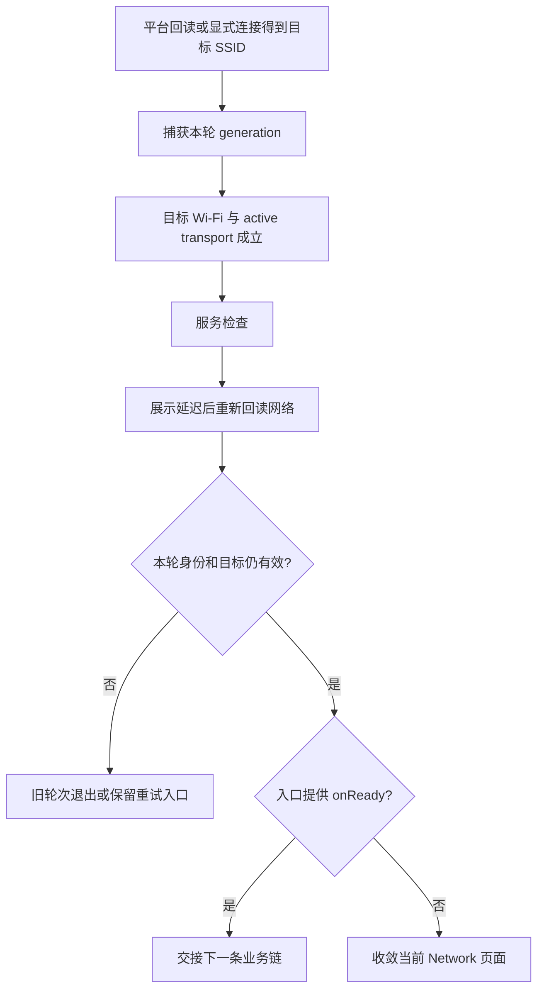

# 已连上 Wi-Fi，为什么相框还不能继续？一次异步准入的设计

[技术博客目录](README.md) · [面试准备](../interview/README.md) · [先读短例子](../beginner/guided/wifi.md)

源码阅读：2026-09-14。本文分析当前实现与已有测试，并用假设时序解释风险；本轮没有执行产品测试或真实配网。具体来源见[本篇索引](../evidence/blog-source-map.md#blog-wifi-page)。

相框冷启动时，Android 可能正在恢复保存的网络。页面已经显示 Wi-Fi 名称，业务却还在等待。若把“连接成功”直接接到页面跳转，另一类问题又会出现：刚检查完服务，用户就切换了网络，旧回调仍把页面带走。

这个模块值得在面试中讲的地方，是**如何判断“现在可以继续业务”，以及谁有权作出这个决定**。按钮、密码输入和平台 API 是必要组成，真正容易出错的是它们之间的异步时序。

## 一个 connected，装不下这么多事实

先想象最直接的方案：平台返回 connected，就调用 `onReady()`。它把三件事合并了：连到了哪个网络、当前请求走哪条链路、目标服务是否可用。

| 已知事实 | 可以说明什么 | 仍需确认什么 |
| --- | --- | --- |
| 有扫描结果 | 周围有候选热点 | 有没有连接到它 |
| Connected SSID | 连接目标的身份 | 当前默认链路是不是 Wi-Fi |
| active Wi-Fi transport | 当前默认网络具备 Wi-Fi 传输 | 目标业务服务能不能响应 |
| 服务检查成功 | 这一次检查得到了成功结果 | 页面、目标网络、这轮操作是否仍有效 |

Android 的网络能力是会变化的快照；`INTERNET`、`VALIDATED`、具体服务请求也不是同一个证明。[Android 网络状态文档](https://developer.android.com/develop/connectivity/network-ops/reading-network-state)解释了这些区别。

Frame 把页面准入放在 `_handoffWhenReady`：先回读目标 Wi-Fi，再检查服务，最后重新回读网络。这里的 readiness，可以先理解成“允许进入下一步之前的条件检查”。

## 检查之后，为什么还要再检查？

假设按这个顺序发生：

1. 网络 A 当前有效，页面开始检查服务。
2. 服务成功，页面等待一个展示延迟。
3. 延迟期间网络 A 断开，或者设备切换到 B。
4. 旧流程准备导航。

前三步都可能正常发生，错误在于第四步继续使用过期的网络结论。这类问题常被称为“检查与使用之间的竞争”；无需先背术语，先记住**检查时成立的条件，使用时可能已经不成立**。

当前流程在实际交接前获取 `finalStatus`，再次确认目标 SSID 和 active transport。它缩小了错误放行的窗口，但不保证下一次业务请求一定成功：网络仍可能在回读之后改变，后续请求也必须处理失败。



图概括正式调用意图；源码允许 `healthRepository` 为空，此时跳过服务检查。因此阅读预览、测试或自定义调用方时，要先看依赖注入，不能只看页面类名。

## mounted 只回答一半问题

`mounted` 判断这份 State 是否仍与树关联，适合拦住销毁后的 UI 更新。[Flutter mounted](https://api.flutter.dev/flutter/widgets/State/mounted.html)并没有赋予它“请求属于当前网络”的含义。

用户点击 Refresh 时，State 通常还活着。新的检查开始后，旧 health Future 也可能完成。所以当前实现还保存 `_readyGeneration`：每开始或失效一轮操作，改变轮次编号；回调拿着启动时的编号回来比较。

以下是原创的步骤示意，省略了外部字段定义、错误处理和重试，不能作为完整 Dart 程序直接运行：

```dart
final mine = ++generation;
final target = selectedSsid;
await checkService();
if (!mounted || mine != generation || target != selectedSsid) return;
final latest = await readWifiStatus();
if (!mounted || mine != generation || target != selectedSsid) return;
if (!isTargetActive(latest, target)) return;
handoff();
```

这段模型想表达的是检查位置：**每经过一次可能让外部状态改变的 await，后续动作都要重新取得资格**。
真实 `_isCurrentHandoff` 还检查 `_readyHandoffCompleted`，防止已经完成的这一轮重复交接；实际字段名和完整失败分支回到源码。

Refresh、Disconnect、Forget、新连接和 dispose 都有相应的失效路径。generation 变化没有杀掉网络请求，它只让旧结果不能再修改当前决策。
遇到 `++`、回调或 await 不熟时，可以先读[旧结果这一课](../beginner/09-stale-results.md)。

## 同一个页面，为什么不能拥有同一种导航权？

首次配网和 Settings Network 复用 `FrameWifiDesignPage`，但它们成功后的职责不同。

| 入口 | 配置 | 成功后 |
| --- | --- | --- |
| 首次配网 | 开启 `autoHandoffSavedWifiOnStartup`，提供 `onReady` | 交接 Pairing |
| Settings Network | 不开启启动准入，没有 `onReady` | 留在 Network 显示状态 |

这些区别由[正式路由](../evidence/blog-source-map.md#blog-wifi-routes)注入。共享的是连接与检查机制，导航副作用则由入口授予。否则设置里改一次网络，就可能意外重走配网流程。

启动准入还有一个重要边界：Android 拥有恢复保存网络的动作，页面只观察它。`_handoffSavedWifiOnStartup` 等待状态回读，不为“继续业务”强行发送一次新的 connect、reconnectSaved 或 disconnect。这样可以避免把业务等待变成网络配置写操作。

## 超时也有两种不同的处理目标

页面的 health 检查使用 `Future.timeout`，避免界面无限等待同一次检查。但 Dart 超时 Future 的结束，不会取消原 Future；原操作仍可能稍后完成。[Dart Future.timeout](https://api.dart.dev/dart-async/Future/timeout.html)

另一个问题出现在首页 Wi-Fi 图标：如果平台读取永远不返回，每过几秒就启动一个新读取，会不断堆积 pending 调用。
App 持有的 [FrameWifiStatusObserver](../evidence/blog-source-map.md#blog-wifi-observer)采用了不同策略：

- 超时先把旧连接显示撤为 `unknown`，不继续展示过期的“已连接”。
- `_readPending` 在底层 Future 真正结束前仍保持，阻止叠加新读取。
- 迟到结果不再恢复旧图标；底层结束后再安排下一次读取。

这里存在真实取舍：如果平台调用永久挂起，图标会保持 unknown，并等待底层结束；它没有承诺靠不断重试自愈。若要进一步恢复，需要在平台层设计有明确取消或重建语义的机制。

页面准入的 health timeout 与 observer 的单 pending 规则属于不同所有者。不能把 observer 的保证推广成整个配网链都只有一个底层请求，也不能把 health 的超时参数相加，当成整条流程的严格总期限。

## 生命周期要按所有者来读

| 所有者 | 保持的状态 | 何时失效或清理 |
| --- | --- | --- |
| Wi-Fi 页面 State | 当前目标、轮次、已交接标记 | 显式新操作或 dispose 使旧轮次失效 |
| App 的 observer | 最近可信状态、pending 标记、计时器 | stop 清显示并撤销本轮；dispose 停计时和通知 |
| 页面入口 | 是否授予 Pairing 导航回调 | 随路由配置决定，不能由复用页面自行推断 |

[App 接线](../evidence/blog-source-map.md#blog-wifi-app)创建 observer、注册消费者，结束时移除 listener 并 dispose。后台/前台切换也会改变观察轮次，避免旧后台回包成为前台“新证据”。

这比只说“我在 dispose 里释放资源”更具体：要说清释放哪个对象、使哪类结果失效，以及哪项外部工作并没有被真正取消。

## 用失败顺序验证设计

已有[页面测试](../evidence/blog-source-map.md#blog-wifi-page-tests)包含以下可搜索名称；这里阅读其输入和断言，本轮没有执行这些产品测试：

| 测试入口 | 人为制造什么顺序 | 保护的行为 |
| --- | --- | --- |
| `handoff rechecks WiFi after health before navigating` | health 前 active，最终回读 inactive | 不调用 onReady |
| `Refresh cancels pending health and only latest handoff navigates` | 先结束旧请求，再结束新请求 | 只有新一轮交接 |
| `a pending health probe times out with Refresh still enabled` | health 长时间 pending，之后才完成 | 超时有重试入口，迟到不导航 |
| `startup entry hands off an already-connected saved WLAN without reconnecting` | 启动已有连接 | 继续业务不必先改网 |

[Observer 测试](../evidence/blog-source-map.md#blog-wifi-observer-tests)的 `timeout clears stale connection without piling up platform reads` 对应另一条约束：超时撤销显示，同时保留单个 pending 平台读取。

单元或 widget 测试能控制这些时序；真实 Android 权限、路由、热点切换和物理恢复仍需要设备证据。面试中应分别说测试的机制覆盖和实际做过的设备验证。

## 从提交记录中回顾技术演进

2026-08-14 之后的日志中，`25f7018a3970`（09-03）实际增加了启动准入开关和相关处理，也拆分了宿主边界；`a6c92f51cf44`（09-09）加入 observer 及相应测试。
它们可用来回看改动前后，具体检索方法与归属说明见[贡献与提交线索](../evidence/contribution-history.md)。提交日期不是每个设计想法首次产生的日期。

## 面试时，怎样用两三分钟讲清楚

> 我负责相框的 Wi-Fi 接入和业务继续流程。它的难点是“平台连接成功”不能直接等于“可以进入下一页”，而且检查期间用户可能刷新、换网或离开页面。
>
> 我把判断分成目标 Wi-Fi、active transport、服务检查和最终网络回读，并用 generation 区分每一轮操作。mounted 负责页面是否仍存在，generation 和目标身份负责结果还能不能生效。
>
> 同一套页面用于首次配网和 Settings，导航权由路由回调授予。启动时只观察 Android 恢复已保存网络，避免为了继续业务再次写网络配置。图标观察则使用独立 observer：超时撤销旧显示，但底层读取没结束前不叠加请求。
>
> 我可以用“health 成功后掉线”和“Refresh 后旧请求先完成”解释反例，并定位到对应测试。当前方案仍有平台永久 pending、非即时轮询等边界，需要按平台能力继续改进。

这段基于作者确认的负责范围组织。具体怎么发现问题、当时怎样重现、实际验收结果，应补上自己能复述的经历，不能从示例测试倒推出一次真实线上事故。

## 面试官继续追问时

**为什么不是加一个 loading 就够了？** loading 是展示/入口控制，不能证明旧请求属于最新选择。旧请求完成时仍需检查结果归属。

**为什么不是所有请求都等上一个完成？** 串行会简化部分竞争，却可能让新的用户意图等待一个旧慢请求。当前准入允许新轮次接管，再让旧轮次失去交接权；平台操作是否互斥由各自边界处理。

**最终回读能保证业务一定成功吗？** 不能。它降低使用旧状态的风险，下一次请求仍须处理网络瞬时变化和服务失败。

**为什么超时了还不释放 pending？** 对 observer 而言，超时仅说明不能再展示旧结果；底层 MethodChannel 还没完成。提前释放会允许堆积新读取。

**为什么采用轮询，而不是全靠系统推送？** 当前实现复用只读状态接口，代价是观察有延迟。系统 callback 能改善及时性，但要设计注册/注销、事件一致性和平台适配；不能把“更实时”直接当成无需生命周期管理。

**如何证明是自己理解，而不是背方法名？** 画出两轮检查交错的时序，分别删掉 generation、最终回读、pending 三个保护，解释哪种错误会重新出现。

下一步：回看[异步生命周期](../foundations/async-lifecycle.md)、[网络基础](../foundations/networking-android.md)，再对照[原 Wi-Fi 专题](../modules/wifi.md)的更完整路径表。官方链接核对日期：2026-09-14。
