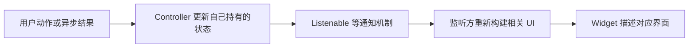

# 01｜先读懂一次“拿数据，再更新界面”

[专题入口](README.md) · 下一篇：[数据从启动到页面](02-startup-api-and-ownership.md)

本章解决一个具体问题：你看到 `final snapshot = await repository.fetchBootstrap();`，怎样知道谁在执行、谁在等待、最终拿到什么？这里的机制服务于 Home 和 Portrait 的阅读，不要求先学完 Dart。

来源基准：2026-09-21 静态阅读。项目入口见[基础与启动源码](../evidence/app-source-map.md#app-basics)；下面标为“教学片段”的代码经过简化，不是完整产品实现。

## 1. 类是类型，对象是这一次实际拿来用的东西

想象 App 刚打开，要读取服务端给当前账号的启动快照。

| 名称 | 它是什么 | 在这次场景中的含义 |
| --- | --- | --- |
| `AppBootstrapRepository` | 接口类型 | 约定“能读取启动快照”的能力 |
| `GatewayAppBootstrapRepository` | 实现这个接口的类 | 通过 App API 取得并解析快照 |
| `repository` | 教学例子中的变量 | 指向这次实际使用的 repository 对象 |
| `fetchBootstrap` | 对象上的方法 | 调用它才开始执行读取逻辑 |
| `AppBootstrapSnapshot` | 返回数据的类型 | 把启动响应表示为 Dart 对象 |
| `snapshot` | 局部变量 | 保存本次方法拿到的具体快照 |

“声明一个字段可以存 repository”和“调用 repository 发起请求”是两件事。把对象引用交给页面，也不等于它的方法已经运行。

`Snapshot` 可译为“某次读取获得的快照”。它有取材时点，不是永远自动更新的数据库视图；后来服务端改变，旧对象不会自己变成新结果。

## 2. 点、括号、尖括号分别在说什么

下面是用于理解类型和调用的**教学方法片段**：外部还需要提供 `repository`，省略了异常处理和账号检查，不能直接作为完整程序运行。

```dart
Future<AppBootstrapSnapshot> load() async {
  final AppBootstrapSnapshot snapshot =
      await repository.fetchBootstrap();
  return snapshot;
}
```

逐句拆开：

1. `Future<AppBootstrapSnapshot>`：调用 `load()` 会拿到一个异步结果对象；成功完成时，它提供 `AppBootstrapSnapshot`。尖括号说明结果类型。
2. `load()`：声明方法名字。调用位置写括号，才表示执行方法。
3. `async`：方法体允许使用 `await`。
4. `repository.fetchBootstrap`：点号从 `repository` 对象取出它的方法；后面的 `()` 执行方法。
5. `await`：这里等待异步结果；成功后拿到快照，再继续下一句。失败会沿异常路径走。
6. `final ... snapshot = ...`：给局部变量赋值，之后不能让这个变量指向另一个对象。`final` 不自动保证对象内部全部不可变。
7. `return snapshot`：把结果交给调用 `load()` 的那一方。

`Future` 是对异步结果的表达，不是已经取得的 JSON，也不是一条专门属于这个函数的线程。`await` 暂停当前异步函数的后续执行，其他事件仍可能推进。语义依据：[Dart async/await](https://dart.dev/libraries/async/async-await)（2026-09-21 查阅）。

## 3. 用 A、B 两个账号理解等待期间会发生什么

先看容易漏掉的时间顺序。下面的数字是教学用代次，不是实际账号数据。

| 时刻 | 当前账号 | 当前代次 | 旧请求携带的身份 | 发生什么 |
| --- | --- | --- | --- | --- |
| T0 | A | 10 | 无 | 用户在 A 的会话 |
| T1 | A | 10 | A / 10 | 发起启动读取 |
| T2 | B | 11 | A / 10 | 等待网络时发生账号切换 |
| T3 | B | 11 | A / 10 | A 的旧请求成功返回 |
| T4 | B | 11 | A / 10 | 结果不是当前身份，拒绝继续交付 |

如果 T3 只检查“网络是否成功”，A 的数据可能被拿去构造 B 的页面。成功响应只能说明一次请求获得结果，不能说明这个结果现在还有资格使用。

项目用 `AppAccountSessionStamp` 保存 `accountId + epoch`，由 `AppAccountSessionLifecycle` 判断 stamp 是否仍属于当前会话。`epoch` 是一轮账号数据生命周期的代号；同一个账号 A 离开又回来，也可能有新的代次。

因此 A → B → A 后，只比较 `accountId` 可能仍接受旧 A 的响应；比较 `accountId + epoch` 才能区分旧轮次。普通同账号 token 轮换不等于账号数据代次变化，具体规则由 Session owner 持有。

在当前 `AccountSessionFencedAppBootstrapRepository.fetchBootstrap` 中，重要顺序为：

```text
captureStamp
→ 等待 readyFor(stamp)
→ 检查 stamp 仍有效
→ await delegate.fetchBootstrap()
→ 再检查 stamp
→ 检查 response user 属于该账号
→ 返回快照
```

这里“检查”拦的是继续使用旧结果的资格，不意味着已经发出去的网络 I/O 或服务端操作被倒放撤销。其它 wrapper 自己的写缓存、发布状态等副作用，也需要在各自关键等待点后守住身份。

## 4. `null`、`?.`、`??` 各解决一个小问题

这是**教学表达式**，`controller` 代表一个可能尚未创建的控制对象，并非当前项目的完整方法：

```dart
controller?.dispose();
final label = petName ?? 'Unknown';
```

- `null` 表示这里没有值。`String?` 允许字符串或 `null`，`String` 通常要求非空引用。
- `?.` 表示对象非 `null` 时才继续访问。所以第一句是“有对象时调用 `dispose()`”。
- 第一句没有 `=`，不会把 `controller` 字段赋成 `null`。对象是否释放、如何释放，仍由该 `dispose` 实现决定。
- `??` 在左边为 `null` 时使用右边；左边是空字符串 `''` 时，不会自动替换为 `Unknown`。
- `=` 是赋值；`==` 是比较。把 `completed = true` 写成 `completed == true`，不会更新状态。

空值操作的语义依据：[Dart null safety](https://dart.dev/null-safety/understanding-null-safety)（2026-09-21 查阅）。不能仅从名字推断一个自定义 `cancel` 方法会清字段、停止网络和释放所有对象。

## 5. Controller、Widget 和 build 怎样合作

用 Home 的加载胶囊来理解：底层预热有自己的进度，页面将进度解释为展示状态，Widget 再描述现在应该画出的按钮、文字和进度。



这是通知模型，具体 Home 接线在第 03 章。不能把“创建了 Controller”理解为“Flutter 自动知道其所有字段变化”；需要真实监听和通知。

| 名词 | 初学时这样理解 | 常见误判 |
| --- | --- | --- |
| `Widget` | 当前配置下希望怎样显示 | 每次 new Widget 就会新建全部原生资源 |
| `State` | 随 Widget 树中该位置存活的可变状态 | 每次 build 都 new 一个 State |
| `build` | 根据当前输入描述 UI | 在 build 里无条件重新请求数据或创建播放器 |
| `ChangeNotifier` | 状态 owner 可以通知监听者发生变化 | 调用了通知就表示物理屏幕已经完成一帧 |
| `setState` | 同步修改此 State 的相关状态并安排重建 | 把整个异步函数放进 setState 回调 |
| `dispose` | owner 结束时清理其持有的资源/监听 | 离开页面必然立即 dispose |

页面被别的路由盖住时仍可能存在；`mounted` 只说明这个 `State` 还关联着树中的位置。它不能证明页面可见、账号没换、当前宠物没换或回调还属于当前播放器。[Flutter State.mounted](https://api.flutter.dev/flutter/widgets/State/mounted.html)（2026-09-21 查阅）。

对 Portrait 而言，这个区别直接影响后台计时、长按和播放回执。第 05 章会把“页面存在”和“当前 attachment 有效”分开演示。

## 6. 回调是“让调用方决定下一步”的接缝

例如一个对象把 `onProgress` 作为参数接收，就表示“当我有进度时调用你传给我的函数”。进度源负责产生数据，回调接收者负责决定怎样处理。

**教学片段**，假设 `reportProgress` 已由外部定义：

```dart
final onProgress = (double value) {
  reportProgress(value);
};
```

第一步只是创建函数并把它保存到 `onProgress`；直到有人调用 `onProgress(0.5)`，函数体才会执行。这里不代表每个回调都自动异步，也不保证调用顺序。

闭包可以记住创建时周围的变量。好处是回调知道请求属于谁；风险是回调很晚才到时，捕获的旧对象或旧身份已经过期。因此要继续检查代次，而不是只检查回调参数是否长得正确。

## 7. 把六种“完成”分开

| 观察到的事件 | 可以说明什么 | 还缺什么 |
| --- | --- | --- |
| 服务端说 pet ready | 业务读模型的某个阶段完成 | App 当前权限、具体资源、本地准备 |
| JSON 解析完成 | 得到合法的数据对象 | 页面是否采纳、是否属于当前宠物 |
| 媒体下载完成 | 得到文件或可使用来源 | manifest 完整、播放器接管 |
| 播放请求返回 | 某次调用完成了其方法合同 | 不自动等同正在播放 |
| 匹配身份的 `isPlaying` 观察 | 当前播放链路报告正在播放 | 不能代替真人看见画面的验收 |
| 用户看到并操作顺畅 | 该设备该场景有物理观察 | 不能自动推广到所有设备和网络 |

这是你几个 App 改动共用的核心基础：业务资格、资源准备、播放请求、播放观察和产品教学完成，各自属于不同层。

## 自测：等待旧结果时不要跳步

<details>
<summary>账号 A 的请求等待时，切到 B 又切回 A。只判断 accountId 相同可以吗？</summary>

不够。旧请求来自上一轮 A；要核对生命周期代次。回看第 3 节，把最后一行改成“当前 A / 12，旧结果 A / 10”，就能看出身份相同不代表轮次相同。

</details>

<details>
<summary>controller?.dispose() 执行后，controller 一定是 null 吗？</summary>

不是。这条语句有条件调用方法，没有给变量赋值。需要看真实 owner 的后续赋值；也需要读 dispose 实现，才能知道取消了哪些监听或资源。

</details>

<details>
<summary>长按满 500ms，但 TouchHold 视频还没有开始播放，能直接说教学成功吗？</summary>

不能。这里要先分清手指时长和匹配播放观察。真正累计规则、触区资格和清零时机，进入第 05 章按真实 controller 推演。

</details>

## 一个不改产品的小练习

用纸写四行：请求开始 → 等待 → 用户切宠 → 旧结果返回。给每行填入 `petId`、代次、谁持有结果、谁允许更新界面。然后去第 03 或 05 章找相同结构。

完成标准：不只说“加一个判断防止异步问题”，而能说出判断哪一个身份、在哪个等待点之后判断、失败时丢弃什么。练习只用于推演，本轮未运行产品代码。
