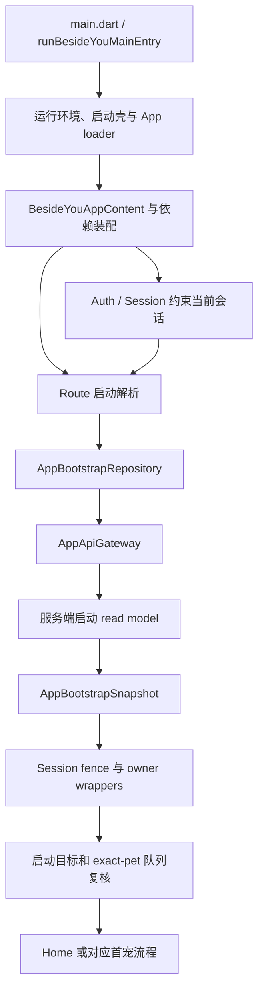

# 02｜从启动到页面：一份数据经过哪些人

[专题入口](README.md) · 上一篇：[基础知识](01-foundations.md) · 下一篇：[Home 数据流](03-home-data-flow.md)

本章是你负责的 Home / Portrait 改动所需的上下游背景，不把整个启动、登录和 API 系统认作你的个人实现。来源为 2026-09-21 当前源码和 owner；[源码索引](../evidence/app-source-map.md#app-basics)记录具体文件。

## 场景：一个已有宠物的用户打开 App

用户只想看到自己的宠物。客户端必须先知道：用哪一套运行配置、有哪些依赖、当前会话是谁、服务端给的启动目标是什么，以及 Home 拿到的宠物队列是否属于这个目标。

先看必要的逻辑依赖，图中不表示所有初始化都严格串行：



`read model` 可以译为“为某种读取用途整理的数据”。服务端知道底层任务和资源怎样生成；App 主要消费明确给客户端的业务字段，不自己从某条底层任务状态猜出页面已经准备好。

## 1. 从哪几个文件开始，不要一次读完整个 App

| 次序 | 相对 App 路径 | 本轮只找什么 |
| --- | --- | --- |
| 1 | `lib/main.dart` | `main`、`runBesideYouMainEntry`、`loadBesideYouMainApp` |
| 2 | `lib/app/di/README.md` | 谁装配依赖，谁拥有释放责任 |
| 3 | `lib/app/bootstrap/app_bootstrap_repository.dart` | `GatewayAppBootstrapRepository.fetchBootstrap` |
| 4 | `lib/app/session/account_session_fenced_app_bootstrap_repository.dart` | 哪些等待之后重新核对账号 |
| 5 | `lib/app/route/app_startup_flow_location_mapper.dart` | `locationForBootstrap` 如何映射目标 |
| 6 | `lib/app/route/session-and-startup-contract.html` | mapper 外面的异步复核与导航边界 |

停止点：能从 `fetchBootstrap()` 解释到“Home 获得哪个宠物上下文”。登录 SDK、支付 SDK、分析上报的内部实现不在本章展开。

## 2. 启动入口、装配和页面状态不是同一件事

`main()` 进入共同的 `runBesideYouMainEntry()`。共同启动逻辑包含 Flutter binding、系统 UI、env 等准备，并由启动壳和 loader 接续正式 App。正式入口不靠每一页重新初始化环境。

`loadBesideYouMainApp` 负责组装正式 App 所需配置和覆盖入口；`lib/app/di/` 再把不同 owner 的对象接成可用的依赖关系。你可以把依赖装配理解为“把已经选好的工具交到业务对象手里”，不是“替业务对象决定所有状态”。

例子：Space repository 需要一个 Gateway。它接收注入的 Gateway；不在自己内部另选一个服务器地址、再创建一套认证系统。这样真实模式与 Mock 模式可以替换明确的外部依赖，而继续经过同一业务解析链。

DI owner 还规定：页面和业务对象不用随处查询 `get_it`；构造参数说明依赖关系。谁创建并接管资源，谁负责清理；借用对象不自动归页面释放。

## 3. Repository 与 Gateway：谁知道业务，谁负责传输

| 层 | 具体名字 | 输入 | 输出或副作用 |
| --- | --- | --- | --- |
| 页面/路由 owner | Home、startup route | 用户动作、当前上下文 | 选择要发起哪项业务动作 |
| Repository | `GatewayAppBootstrapRepository` | 读取启动快照的调用 | 定义路径、附带需要的字段、构造 DTO |
| Gateway | `AppApiGateway` | path、method、query/body、请求策略 | HTTP、鉴权接线、响应 envelope、错误分类 |
| Reader / DTO | `AppApiJsonReader`、`AppBootstrapSnapshot` | 解包后的 JSON 值 | 合法的 Dart 数据对象，或类型错误 |
| 状态 owner | 对应 Controller / wrapper | 已核对身份的结果 | 采纳到状态、通知监听者 |
| Widget | 对应页面 | 当前展示状态 | 现在应绘制的界面描述 |

`Gateway` 的确切意思是“App 的网络入口”。它知道如何请求，不应该替 Home 判断该显示哪个胶囊；`Repository` 知道自己的接口合同，也不应该直接操作 Flutter 导航。

### 真实方法里三段顺序

`GatewayAppBootstrapRepository.fetchBootstrap` 当前可分为：读取可选时区 → `getJson` → 解析为 `AppBootstrapSnapshot`。

```text
await _readTimezone()
  ↓
await _api.getJson(bootstrapPath, headers: ...)
  ↓
AppBootstrapSnapshot.fromJson(...)
```

这是对真实方法的缩写。`bootstrapPath` 在该文件定义为 `app/v1/bootstrap`；路径交给已经配置好 base URI 的 Gateway。示意不包含真实主机、账号或 token。

第一步读取设备时区是 best effort：失败不应该让用户永远卡在启动。第二步可能遇到网络、会话或服务端错误。第三步即使 HTTP 成功，也可能因为响应形状不满足合同而抛出解析错误。

这就是“接口返回了但页面仍失败”的一种可检查解释：要问返回到了哪一步，不能把 HTTP 200 当作后续全部成功。

## 4. JSON 到 Dart：字段合法和业务允许要分开

考虑下面的**虚构最小字段例子**，只是说明类型，不是完整接口响应：

```json
{"pet_id": 7, "can_enter": true}
```

在 Dart 中它起初只是 Map。Reader 检查类型，DTO 把字段映射为有名字的属性。`7` 与 `"7"` 一个是整数、一个是字符串；当前 App API reader 的严格整数字段不自动把后者转换成前者。

通过类型检查，还需要业务规则：例如当前 pet 是否正确、状态是否 ready、是否允许进入。`can_enter` 单独出现不能替代这一整组 owner 合同。缺失字段究竟拒绝还是允许默认值，要看该 DTO 的具体 parser。

`AppBootstrapSnapshot` 带着 `user`、`startupFlow`、`petsSummary`、`assetVersions` 等不同读模型。`assetVersions` 是资源版本信号；它本身不是下载好的视频或运行 manifest。

不要让页面一边读取 DTO，一边凭某个 URL 是否存在猜付费资格。权限、资源与 UI 状态各自有明确定义。

## 5. 为什么 bootstrap 要包上 wrapper

`GatewayAppBootstrapRepository` 是基础读取能力。wrapper / decorator 指的是“外面再包一个同样实现该接口的对象”，它调用内部 `delegate`，再添加自己的责任。

例如 `AccountSessionFencedAppBootstrapRepository` 负责账号身份检查；其它 owner 的 wrapper 负责把相应投影交给用户、会员或资源模块。所有 wrapper 共享同一账号生命周期，不能每个 owner 自己想象一套当前账号。

| 时点 | 捕获的 stamp | 当前状态 | 允许的下一步 |
| --- | --- | --- | --- |
| 请求刚开始 | A / 10 | A / 10 | 等待本轮 cleanup barrier |
| barrier 完成 | A / 10 | A / 10 | 发起实际读取 |
| 网络返回 | A / 10 | A / 10 | 继续检查 response user |
| response user 也是 A | A / 10 | A / 10 | 交付快照 |
| 网络期间切换 B | A / 10 | B / 11 | 抛 superseded，拒绝旧结果 |

`barrier` 在这里是“旧账号清理结束后才能继续的等待点”；`fence` 是“旧工作不能跨进新账号状态的检查”。这两个词不要求存在新的线程。

外层 fence 能挡住最终 route result，但不能回到过去撤销内层 wrapper 已做的写入，所以关键副作用也要有自己的身份检查。更不能把“取消请求”解释成“撤销后端已经接受的写操作”。

## 6. 启动目标如何来到 Home

`AppStartupFlowLocationMapper` 做纯映射。`locationForBootstrap` 先看 `firstEntryHandoff`；存在时构造首宠 preparing 的路径及 exact pet/readiness pointer。没有 pointer 时再消费 `startupFlow`。

| 输入分支 | mapper 的职责 | 外层仍要负责什么 |
| --- | --- | --- |
| 非空合法 `firstEntryHandoff` | 指向对应 pet 的 first-entry preparing | 首宠 readiness 与 handoff 的后续读取 |
| `firstEntryRoot` | 指向 add-first-pet | 路由挂载与实际流程 |
| 合法 `petSpace` | 给出 Home fallback 目标 | 普通 fallback 路径使用 exact pet 复核权威队列 |
| blocked / 无法使用的输入 | 保持 startup 处理路径 | recovery、鉴权和错误呈现 |

mapper 自己不访问网络、不操作 Router。仅看 `targetFor()` 返回 Home，不能推断“已经绕过宠物队列，可以直接播放”。队列复核和用户进入 Pet Space 在它之外发生，下一章会接续这个上下文。

外层 `AppRouteRedirectResolver._startupLocationForBootstrap` 负责这段异步复核。普通 `petSpace` fallback 会调用 `revalidateAuthoritatively()`；已经有合法的待处理启动目标时，`skipPetSpaceFallbackRevalidation` 可以跳过不会使用的 fallback 准备。因此“启动先复核 exact pet”要放在这个具体分支理解，不能推广为每一种 deep link 启动都先回 Home。

普通站内导航也不等于重新冷启动。不要为了“刷新一下”就在每个 Home 点击后重新依赖整个 bootstrap。

## 7. 什么算一个完整的数据流解释

用自己的话说出这一条即可：

> 启动 owner 发起读取，Repository 定义业务请求，Gateway 处理传输与会话。返回内容经过 DTO 校验，再由账号 fence 和各 owner 核对使用资格。路由 owner 根据启动目标建立正确宠物上下文，Home 读取自己的权威队列，按页面状态显示入口。

它包含输入、传输、解析、身份、业务、展示。缺少其中一层时，常见后果是“看到 ready 就导航”“有 URL 就播放”或“旧账号的成功请求覆盖新账号”。

## 自测与阅读停止点

<details>
<summary>Bootstrap JSON 中有 assetVersions，可以立即认为 Portrait 本地资源齐了吗？</summary>

不可以。版本信号帮助资源 owner 判断刷新；本地 manifest、文件完整性和播放器交接仍是不同步骤。回看第 4 节，然后在第 04 章继续追资源链。

</details>

<details>
<summary>为什么不让 Gateway 在拿到 can_enter=false 时直接弹升级页面？</summary>

Gateway 不拥有页面业务和导航。它处理通用传输、解析外层 envelope、错误；业务 read model 与 route/page owner 才知道这个动作的上下文、具体宠物和应该展示的入口。

</details>

<details>
<summary>启动映射器返回 Home，就能证明用户已经看到 Home 吗？</summary>

不能。纯函数给出目标和 Router 完成导航、Widget 挂载、屏幕出帧是不同阶段。还要核对外层会话和 exact-pet 复核是否通过。

</details>

本轮只阅读了源码与 owner，没有发起真实 bootstrap、登录或后端操作。完成本章的标准是能在纸上画出上述责任链，而不是背完所有接口字段。
