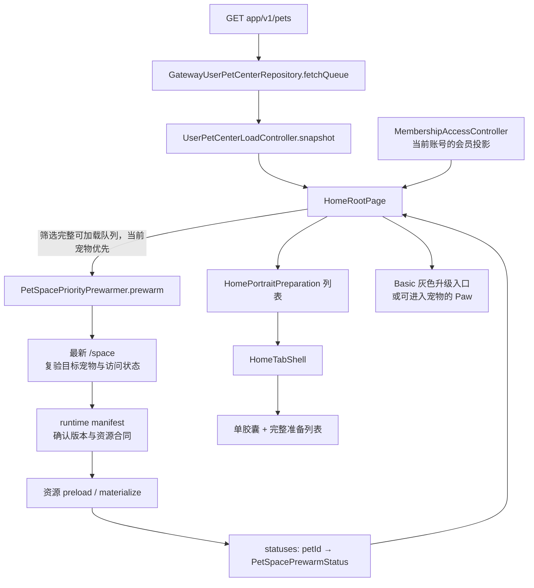

# 03｜Home：从宠物数据到 Portrait 加载提示，再到升级返回

[专题入口](README.md) · 上一篇：[数据从启动到页面](02-startup-api-and-ownership.md) · 下一篇：[Portrait 舞台](04-portrait-stage-and-runtime.md)

这一章解释你提交的 `f840d788`（`feat(home): 完善 Portrait 加载胶囊与 Basic 升级返回链路`）所涉及的 Home 开发。
读完后，你应能说明：顶部胶囊的数据从哪里来，为什么服务端已经 ready 仍要加载，以及为什么升级返回必须再读一次宠物队列。

**取证日期：2026-09-21。** 内容来自当前源码、模块 owner 和提交差异的静态读取；本文提到的测试仅阅读，未在这次整理中运行。
提交说明你的修改范围，当前源码解释整理时的实际实现；两者不能代替真实后端、商店支付或手机上的运行证据。
启动、账号认证、支付交付和共享缓存是这一功能的上下游，不因为本章引用它们，就把它们全部归为你的开发成果。

源码入口统一见 [Home 源码地图](../evidence/app-source-map.md#app-home)。下文保留文件名和英文标识符，便于回到代码搜索。

## 先从用户能看到的场景开始

假设账号里有两只宠物 A 和 B。服务端已经允许它们进入 Portrait，但这台手机还没有完整的播放资源。
用户打开 Home，想先看 Story，再进入 A 的 Portrait。

此时会发生两条并行的事：Home 根据宠物队列展示内容；资源准备在后台排队进行，顶部胶囊解释当前等待。
用户点击胶囊，能看到完整准备列表。A 完成后从列表移除，B 继续准备。最后一项完成，胶囊和列表一起消失。

再考虑另一个场景：用户目前是 Basic，Home 显示灰色 Paw。点击后进入 View Plans。
用户购买或直接返回，Home 都要向服务端复验最新宠物队列，然后才能决定继续显示升级入口、生成中状态，还是可选宠物的 Paw。

这两个场景共同说明：**Home 把不同来源的事实组合成界面，每个事实都有自己的负责人。**

## 1. 先认清数据与对象

| 英文标识符 | 中文理解与类别 | 本章中的作用 |
| --- | --- | --- |
| `GatewayUserPetCenterRepository` | 宠物队列的接口仓库对象 | 请求 `GET app/v1/pets`，把返回内容解析成 Dart 模型 |
| `UserPetCenterLoadController` | 宠物队列加载控制器 | 保存最近的 `snapshot`、读取错误和正在进行的请求 |
| `UserPetCenterQueueResult` | 一次宠物队列读取结果 | `items` 是列表，`summary.initialSelectedPetId` 提供首选宠物 |
| `HomeRootPage` | Home 的业务组合页面 | 读取队列和会员投影，决定入口、预热和展示数据 |
| `PetSpacePriorityPrewarmer` | Portrait 优先预热的接口 | 提交某只宠物的资源准备任务，暴露 `statuses` |
| `DefaultPetSpacePriorityPrewarmer` | 该预热接口的正式实现 | 同宠任务复用、账号和版本检查、结果及进度投影 |
| `PetSpacePrewarmStatus` | 一只宠物的本机准备状态 | 包含 `progress`、`failed`、`assetVersionHint` |
| `HomePortraitPreparation` | 给 Home UI 使用的展示数据 | 把状态与宠物名称、头像、Retry 回调组合在一起 |
| `HomeTabShell` | Home 的界面外壳 | 保持列表顺序、打开/关闭浮层、隔离背景交互 |
| `HomePortraitPreparingPill` | 顶部单个胶囊组件 | 展示首项宠物与额外数量，点击打开完整列表 |

这里的 `snapshot` 是“最近一次确认的数据快照”，不是截图。
`Repository` 负责读取和解析；`Controller` 保存状态并通知监听者；`Widget` 根据状态描述当前应该画什么。
名字很长是因为它表达了边界。例如 `UserPetCenterLoadController` 的 `Load` 表示读取服务端队列，不能与仅保存本地建宠结果的 `PetCenterController` 混用。

## 2. Home 数据流：两份状态在 Root 汇合



图中的箭头有两种含义：从 Home 到 prewarmer 是“发起工作”；从 `statuses` 回到 Home 是“结果变化后更新显示”。
显示进度的组件不负责下载，也不自行请求会员资格。

`HomeRootPage.initState` 注册队列、会员和预热状态监听，然后开始 `_loadQueue()`。
`_loadQueue()` 默认调用 `ensureLoaded()`：已有适用快照可以直接复用，没有时再请求。
队列更新会触发 `_handleQueueChanged()`，随后安排预热；预热状态变化则通过监听回调调用 `setState`，使 Root 重新构建展示数据。

**基础知识：`setState` 不是保存后端数据。** 它告诉 Flutter：“我依赖的本地状态变了，请重新构建这里。”
真正的新数据早已由 controller 或 notifier 写入；`build` 再读取这些状态，生成新的 widget 描述。

源码关注：`home_root_page.dart` 的 `initState`、`_loadQueue`、`_handleQueueChanged`、`build`，以及 `user_pet_center_load_controller.dart`。
对应 [Home 源码地图](../evidence/app-source-map.md#app-home)。

## 3. 三种“好了”必须分开

| 阶段 | 事实来源 | 能说明什么 | 还不能说明什么 |
| --- | --- | --- | --- |
| 服务端允许进入 | 队列 `spaceLifecycle == ready` 且 `canEnter` | Home 可以提供该宠物的入口，并尝试预热 | 这台手机已经具备完整资源 |
| 本机准备显示 100% | `PetSpaceRuntimeAssetPreloadProgress` | 已知资源计数/字节比例达到 1 | materialize 已成功返回、资源已可交付 |
| 资源准备成功返回 | preloader 返回可交付结果，且 owner 检查通过 | 当前预热任务完成，可移除本机加载提示 | 视频已经解码并在屏幕呈现第一帧 |

这张表及后面的 A/B 时间线假设最新 `/space` 仍允许完整播放器。若复验后已不可播放、没有完整访问资格或转为 Free，prewarmer 也可能返回只有 snapshot 的结果并移除 status；因此“胶囊消失”不能单独作为 runtime 资源完备的证明。

`materialize` 可理解为“把服务端资源清单落实成客户端可使用的资源结果”。
它涉及资源准备、缓存和清单交付，因此最后一个字节收到与整项工作完成可能不是同一时刻。
本章只追到 Home 的资源准备结果；播放器是否真正显示第一帧由后续 Pet Space 与播放器链路处理。

还有一种 `preparing`：服务端仍在生成 Portrait。
它使用原有 Paw 生成说明和队列轮询，不直接变成这个本机下载胶囊。
所以看到英文 “Preparing” 时，先追它来自服务端生命周期还是本机 `statuses`，不能凭文案合并两种状态。

## 4. 哪些宠物可以进入本机准备列表

`_isPetSpaceEnterable` 的短片段如下，属于当前真实实现：

```dart
return _isPetRecord(item) &&
    item.spaceLifecycle == UserPetSpaceLifecycle.ready &&
    item.canEnter;
```

逐句看：

1. `_isPetRecord(item)` 确认它是有效宠物记录，且 `petId` 存在并大于 0。
2. `item.spaceLifecycle` 中的点号 `.` 表示读取这个对象的属性。
3. `==` 比较是否相等；这里比较的是服务端生命周期是否为 `ready`。
4. `&&` 表示条件必须同时成立，最后还要 `canEnter == true`。

Home 自动预热进一步排除 `effectiveAccessTier == free`，并排除已确认走 Basic 升级入口的账号状态。
`effectiveAccessTier` 是每宠访问档位；它不能替代上面的生命周期与进入条件。
队列允许尝试预热之后，prewarmer 仍读取最新 `/space`，确认宠物、版本和访问条件，再决定是否准备完整 runtime。

**Paw 的四宠布局上限不限制下载列表。** `_petSpaceEnterablePets()` 为轮盘截取显示数量，而 `_prewarmPriorityPetSpace()` 遍历完整可加载队列。
首选宠物先提交，其余随后提交；“提交了所有任务”并不表示同时启动了所有下载。
默认 scheduler 的后台并发预算是 1；`home` 高于 `bootstrap`，用户主动选择的 `userIntent` 可立即开始。

预热安排在帧后回调中。回调执行前再次检查页面仍挂载、App 在前台，而且待处理快照仍是 controller 当前那一份。
这样同一帧里接连出现的新队列可以替换旧候选，旧队列不会在稍后又启动不合时宜的预热。

阅读注意：整理时 Home owner 的“Pet Space 选择与交互边界”仍保留“只预热当前宠物”的旧句。
同文件“Portrait 本机加载提示与 Basic 入口”、Space 的 `prewarm-scheduler` 段以及当前 `_prewarmPriorityPetSpace()` 都说明完整队列准备。
本章按这些相互一致的实现与更新段落解释；这个现有文档差异未在本次知识整理中修改。

## 5. 沿时间看 A、B 两只宠物的准备过程

下表是帮助理解顺序的逻辑快照，不承诺每行之间都存在人眼能看到的停顿。

| 时刻与事件 | `statuses[A]` | `statuses[B]` | 用户看到什么 |
| --- | --- | --- | --- |
| T0：Home 有两只 eligible 宠物，尚未提交 | 无 | 无 | 正常 Home |
| T1：依次调用 `prewarm(A)`、`prewarm(B)` | `progress=null`，未失败 | `progress=null`，未失败 | 一个胶囊代表 A，显示还有一项 |
| T2：A 在读取 Space / manifest，B 等后台名额 | 未知比例 | 未知比例 | 打开列表后，两项显示加载文案 |
| T3：A 完成 1/2 个资源，另一个下载到一半 | `progress=.75` | 未知比例 | A 显示 75%，B 继续等待 |
| T4：A 报告资源比例 1，但 materialize 未返回 | `progress=1`，仍在 map 中 | 未知比例 | A 仍留在列表中 |
| T5：A 准备成功返回且 owner 有效 | 删除 A | B 开始准备 | 胶囊顺次代表 B，列表移除 A |
| T6：B 下载失败 | 无 | `failed=true` | B 保留 Retry，胶囊停止加载动效 |
| T7：用户点 B 的 Retry | 无 | 新状态，未失败 | B 再次进入准备流程 |
| T8：B 成功完成 | 无 | 删除 B | 最后一项消失，列表和胶囊关闭 |

缓存命中可能让这些阶段很快完成。当前逻辑不为了让用户“看见 loading”而固定延迟。
同账号、同宠物、同版本且可复用的预热会返回已有 `Future` 或完成结果，避免重复准备。
已完成结果默认在两分钟 freshness 窗口内可复用；正在进行的 entry 则依赖账号、版本和失效检查。

## 6. 为什么进度可以是 `null`

`PetSpacePrewarmStatus.progress` 的类型是 `double?`。
`double` 表示小数，后缀 `?` 表示这个值可以为空；这里空值表达“当前无法给出可靠百分比”。
`null` 与 `0` 不相同：0 是已知比例为零，null 是暂时没有足够数据。

真实代码中的筛选如下：

```dart
final unknownDownloadLength =
    value.currentReceivedBytes != null &&
    (value.currentTotalBytes == null ||
        value.currentTotalBytes! <= 0);

progress: value.totalAssets > 0 && !unknownDownloadLength
    ? value.fraction
    : null,
```

第一行检查当前是否已报告收到字节；如果已经在收数据，却没有有效总字节数，就不能算当前文件的真实比例。
括号中的 `||` 表示任一条件成立即可；`!` 用在变量前表示取反，用在可空表达式后则表示断言该值此处非空。
这里先检查 `currentTotalBytes == null`，短路求值使后面的非空断言只在不为空时执行。
最后的 `条件 ? A : B` 是三元表达式：条件成立用 `fraction`，否则用 `null`。

可计算时，底层比例大致为：

```text
fraction =（已完成资源数 + 当前资源的已知完成比例）÷ 总资源数
例：2 个资源，完成 1 个，另一个下载一半 → (1 + 0.5) / 2 = 0.75
```

这是按资源数折算的准备进度，不是所有资源总字节数的加权百分比。
底层旧动效在未知长度时允许使用 `0.3` 估值；这次 Home 数字显示会过滤这种估值，避免给用户一个看似精确的数。
`_publishStatus()` 还按整数百分比合并通知，减少密集下载回调引起的 UI 重建；handoff 保留原始进度。

**容易看错的名字：** `_PreparingPillState._progress` 是五秒循环的 `AnimationController`，负责边缘加载线运动。
`widget.pet.progress` 才是本机准备比例。边缘转到哪个位置，并不代表资源下载到了多少。

## 7. 为什么胶囊不会随接口列表重排而换宠物

`HomeTabShell` 保存 `_preparationOrder`，其中只有 `petId`，没有复制下载状态。
每次 widget 更新，它根据当前准备列表做两步同步：

```dart
_preparationOrder.removeWhere((id) => !ids.contains(id));
_preparationOrder.addAll(
  ids.where((id) => !_preparationOrder.contains(id)),
);
```

第一句删掉已经不存在的 id，例如资源准备完成的宠物。
第二句只追加第一次出现的 id。`where` 是过滤，`addAll` 是把筛选出的多项追加到列表末尾。
随后 `_preparations` 用这个顺序从最新展示数据中找对象，因此名称、头像和进度可以更新，存续项的顺序仍稳定。

| 新数据到来 | 当前稳定顺序 | 胶囊代表 |
| --- | --- | --- |
| 首次观察 `[A, B, C]` | `[A, B, C]` | A |
| 接口重排成 `[C, A, B]` | `[A, B, C]` | A |
| A 完成，新来 D：`[D, C, B]` | `[B, C, D]` | B |
| 准备列表清空 | `[]` | 无胶囊，列表也关闭 |

`preparationOwner` 由账号标识和 queue controller 组成，Root 将它传给 Shell。
账号或队列 owner 替换时，旧展开态和旧顺序清空；新账号不会继承上个账号正在查看的列表。

打开列表时，Shell 暂停 Story 的活跃呈现，并阻止背景分页、Paw 等操作。
通知浮层与准备列表互斥；点空白、关闭按钮或系统返回只收起列表，不把该输入继续交给下面的 Story。
`PopScope` 管返回，`ModalBarrier` 管屏障点击，`ExcludeFocus`/`FocusScope` 管焦点范围，它们各自处理不同输入路径。

手动关闭列表后，焦点在下一帧归还胶囊，因为这一帧先要撤掉背景的 `ExcludeFocus`。
回调再次检查 `mounted`、展示 generation、owner、胶囊是否还存在、route 是否当前以及交互是否允许。
这是为了防止“用户刚切走或下载刚完成，旧回调又把焦点拉回去”。

## 8. Basic 灰色 Paw 怎样决定

这部分是 `f840d788` 所完善的另一条业务路径。
业务条件由 `_usesBasicPortraitUpgrade(snapshot)` 计算，不能只看 Paw 颜色，也不能只看某个商品购买成功。

| 条件 | 要求 |
| --- | --- |
| 当前账号 | `subjectId` 存在，且会员 controller 的 `accountId` 与它一致 |
| 会员投影 | `isCoherent == true` 且 `phase == MembershipPhase.none` |
| 宠物资料 | 队列至少有一个有效宠物记录 |
| 每宠例外 | 没有一只同时满足可进入条件且 tier 为 `subscription` 或 `lifetime` 的宠物 |

全部成立才走灰色升级入口。未知会员数据不推断成 Basic。
账号会员阶段为 none，但仍有可进入的 Lifetime 宠物时，应保留该宠物的正常入口。
灰色按钮仍能点击，语义是打开套餐；不会开启选宠轮盘或新 Portrait 引导。

**行为变更边界：** Home owner 把此项记录为 Basic 首页 Paw 的 breaking change。
已有 Basic 或订阅到期保留的静态 Portrait，不再从 Home Paw 打开；影响 Home 入口和组件宿主，不修改后端权益或持久数据。
其他 Portrait route 仍需由目标 `/space` read model 最终判断。本章描述该既有变更，没有新增兼容层或数据迁移。

## 9. 从点击 View Plans 到返回 Home，逐句看 `await`

先看 route adapter 中传入 Root 的实际回调：

```dart
onViewPlans: () async {
  await NavigatorManager.pushNamed<void>(
    settingsViewPlansName,
    extra: const SettingsViewPlansRouteExtra.homeSettings(),
  );
},
```

`onViewPlans` 是一个“打开套餐页”的回调，不是购买结果。
`async` 让这个函数返回一个异步完成通知；`pushNamed` 把套餐 route 放到导航栈上。
这里的 `await` 让回调直到套餐 route 关闭后才完成，因此 Home 能等待“用户回来”这个时机。
如果宿主打开页面后立即返回，Home 就会过早复验，可能又拿到升级前的数据。

`HomeRootPage._openBasicPortraitPlans()` 的核心顺序是：

```dart
// 教学摘录：省略了 try/finally 和 owner 检查的完整条件。
_basicPlansOpening = true;
final queue = widget.userPetCenterLoadController;
await widget.onViewPlans!();
// 此处先确认页面、账号、queue owner 仍有效。
await queue.revalidate(
  currentPetId: snapshot.summary.initialSelectedPetId,
  returnContextPetId: snapshot.summary.initialSelectedPetId,
);
```

1. `= true` 是赋值，锁住重复打开；不是比较。
2. `final queue = ...` 保存当时的 controller 引用，不是复制队列，更不会发起请求。
3. `onViewPlans!()` 中的 `!` 在前置检查之后确认回调存在，`()` 才真正调用它。
4. `await` 只暂停这个函数后续步骤，整个 App 仍然可以接收购买回调、网络结果和账号切换。
5. 回来后先检查所有权，再 `revalidate`。它保留旧 snapshot 并强制发起新读取，不复用购买前的在途请求。

`ensureLoaded` 追求已有数据复用，`refresh` 会先清空 snapshot，`revalidate` 保留当前画面并重新确认服务端事实。
升级返回使用第三种，是为了让原来的 Home 保留在屏幕上，同时获取新的权限与生命周期。

| 事件 | `_basicPlansOpening` | 宠物快照与界面 |
| --- | --- | --- |
| 点击灰色 Paw | 立即设为 true | 原 Home 留在栈内，打开 View Plans |
| 套餐页尚未关闭 | true | Home 返回续接仍在等待；其他 observer 可独立刷新状态 |
| 用户关闭套餐页 | true | 先检查页面/账号/queue owner，再发起新 `revalidate` |
| 返回 ready 且有可进入付费宠物 | true，直到收尾 | Root 重建入口，必要时开始本机资源准备 |
| 返回仍在生成 | true，直到收尾 | 保留服务端准备状态，不能提前让用户进入 |
| 复验失败 | true，直到收尾 | 保留旧投影和 controller 错误；不回滚已验证购买 |
| 函数收尾后的下一帧 | false | 再允许新的套餐打开动作 |

取消、购买失败、普通返回也走复验，Home 不根据页面返回值自行授予权益。
若 Home 已销毁，auth/queue 对象被替换，或 account-session stamp 已过期，旧套餐页面的返回不再触发旧刷新。

## 10. 最容易漏掉的两种竞态

第一种是“先发请求后返回，结果倒着到”。购买观察者可能在关闭套餐页前发出请求 A，Home 返回时再发出请求 B。
队列 controller 每次新读取增加 `_generation`，只有当前 generation 的结果才写入 `_snapshot`。

| 时间 | 请求 A | 请求 B | controller 接受哪份数据 |
| --- | --- | --- | --- |
| T0 | 已发出，代次 1 | 未发出 | 仍保留旧快照 |
| T1 | 仍等待 | 强制新读，代次 2 | 仍保留旧快照 |
| T2 | 仍等待 | 新 ready 结果返回 | 写入 B |
| T3 | 旧 preparing 结果晚到 | 已结束 | 不把快照改回 A |

A 的网络请求不一定被取消，它自己的 Future 也可能正常完成；禁止的是旧结果覆盖最新共享快照。
账号 reset 还增加 `_sessionGeneration`，旧账号响应会按 superseded 处理。
Home 的返回检查与 controller 的结果检查处在不同时间点，需要同时存在。

第二种是“旧预热还没完，账号或资源版本已经换了”。
prewarmer 通过 account stamp、`_generation` 和 `identical(_entries[petId], entry)` 确认回调仍属于当前任务。
`identical` 比较两个引用是不是同一个对象；同一 `petId` 的新版本任务仍可能是不同 entry。
Home 退后台会丢弃尚未开始的 Home 任务；已经开始的传输不承诺强制终止。
`reset()` 清空 entry/status 并使旧结果失效，含义是停止交付旧结果，而不等于网络字节马上停止传输。

用户在 Home 准备期间选择 exact pet，会把它作为 `userIntent` 提交；已有适用任务可直接复用或提升排队优先级。
`existingWarmup(petId)` 提供 handoff，让目标 Pet Space 接手同一项准备工作，但目标页面仍负责自己的最终门禁、展示与 Retry。

## 11. 失败时先定位在哪一层

| 现象 | 优先阅读 | 需要确认的状态 |
| --- | --- | --- |
| 服务端已 ready，胶囊仍显示 | prewarmer 与 preloader | 是否仍在下载/物化；不能只看 `/pets` 的 ready |
| 列表只显示加载文案，没有百分比 | `PetSpacePrewarmStatus.progress` | 总资源数和当前下载总字节是否已知 |
| 100% 没立即消失 | prewarmer 的 `future.then` | materialize 是否成功返回，而不是先加固定延迟 |
| 完成一只后胶囊跳到奇怪的宠物 | Shell 的 `_preparationOrder` | 是首项完成，还是 owner 替换导致重新建序 |
| 点击灰爪子没开轮盘 | `_usesBasicPortraitUpgrade` | 当前是有意的升级分流；检查会员是否同账号且 coherent |
| 升级回来还是灰色 | `_openBasicPortraitPlans`、queue | 套餐 Future 是否覆盖 route 存续期，新队列是否确实返回可进入付费宠物 |
| 退出账号后旧进度又出现 | prewarmer entry owner | stamp、generation、entry identity 是否都仍有效 |

Retry 也要分层。本机准备失败由 `HomePortraitPreparation.onRetry` 针对该 `petId` 再调用预热；不是重建宠物或重新购买。
服务端生成失败属于另一条 Paw/Support 处理路径，不能拿本机下载 Retry 来宣称重启后端生成。

## 12. 已有测试怎样帮助阅读

以下是此次阅读的测试意图，不是此次执行结果：

| 测试文件 | 读到的关键断言 |
| --- | --- |
| `home_portrait_preparing_test.dart` | 未知进度不猜百分比；5 宠仍是单胶囊+完整列表；接口重排不改变首项；完成后移除；背景点击只关闭浮层 |
| `home_root_page_test.dart` | 购买 observer 与 Home 返回并发刷新，两种完成顺序都保留最新队列；返回前后换账号不会恢复旧入口 |
| `home_basic_upgrade_return_test.dart` | 正式 Home/View Plans 路由结合 Mock backend，模拟 Subscribe 后返回 Home 并刷新灰色 Paw |
| `pet_space_priority_prewarmer_test.dart` | unknown Content-Length 产生 null；100% 后仍保留状态直到媒体提交；失败可 Retry；账号 reset 使晚到结果失效 |

Mock 路由测试能验证页面 Future 和回调接线，不能证明真实商店交付、真实下载耗时或真机视觉体验。
原 owner 中记录的历史测试/手机观察也属于各自日期与环境，本次未重新执行。
测试与源码的统一入口见 [Home 源码地图](../evidence/app-source-map.md#app-home)。

## 自测：用自己的话解释这四件事

<details>
<summary>1. `/pets` 已经返回 ready，为什么胶囊还可以存在？</summary>

ready 加 canEnter 表示服务端允许该入口；胶囊来自本机 prewarmer 的 statuses。手机还可能在排队、下载或 materialize，二者完成点不同。

</details>

<details>
<summary>2. `progress=null` 和 `progress=0` 有什么区别？</summary>

null 表示无法确定比例，例如当前下载总长度未知；0 表示在已知统计口径下比例为零。未知时不能把动效使用的估值显示成真实百分比。

</details>

<details>
<summary>3. 为什么 `await onViewPlans()` 后还要检查账号与 queue owner？</summary>

await 不冻结 App。套餐打开期间可以发生退出、换账号、页面销毁或依赖替换。返回后的代码只能继续操作原来仍有效的上下文；检查通过后才发起复验。

</details>

<details>
<summary>4. 新请求 B 已显示 ready，旧请求 A 后来返回 preparing，会不会覆盖？</summary>

当前 controller 只有请求 generation 仍等于最新 generation 时才写入 snapshot。因此旧 A 可以结束，但不能让共享快照退回旧数据；账号隔离还由 session generation 约束。

</details>
