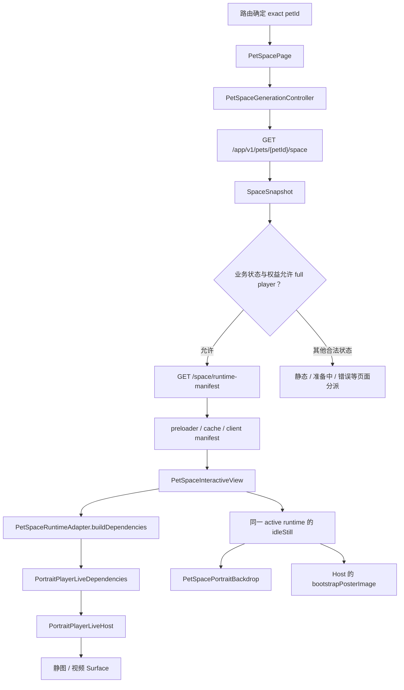
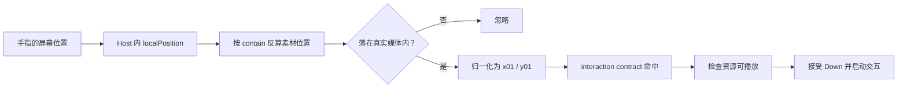

# 04 · Portrait 舞台：资源如何变成可触摸的画面

[专题入口](README.md) · 上一篇：[Home 数据流](03-home-data-flow.md) · 下一篇：[触摸教学与进度](05-touch-guide-and-progress.md)

打开一只宠物的 Love Space，你看到的是全屏静态模糊背景，以及中央完整显示宠物的圆角画幅。
你在画幅里的宠物身上按下，互动动作才有机会开始。
这章沿着这个动作，解释“业务数据怎样变成画面”“换资源时为什么不能直接换图片”“触摸坐标为什么必须跟着画幅走”。

**阅读基线：2026-09-21 本地源码快照。**
你的提交 `c722bf20` 实现了静态模糊背景、居中圆角舞台及相关配对保护。
后续 `ad9ec9cf` 移除了互动页名称，但保留了原顶部留白与画幅位置。
后端授权、资源下载和共享播放器是理解该改动所需的上下游；这里不把整条链路都归为你开发。
文件、符号及 Git 归属统一见 [Portrait 证据索引](../evidence/app-source-map.md#app-portrait)。

## 1. 先分清四种“已经好了”

设想宠物 A 的服务器资源已经生成完。
这并不自动意味着 App 的屏幕已经显示它：页面还需要取得描述、准备文件、建立播放器，最后才有像素出现。

| 看到的名字 | 它表达的事实 | 还不能由此得出的结论 |
| --- | --- | --- |
| `SpaceSnapshot` | 服务器返回的空间业务快照 | 视频已经下载或开始播放 |
| `SpaceRuntimeManifest` | 服务器描述有哪些资源、交互区域和动作 | 所有本地文件已经存在 |
| `PetSpaceClientRuntimeManifest` | 客户端 materialize 后交给播放器的资源描述 | 原生播放器已经开播 |
| `PortraitPlayerLiveDependencies` | 当前播放器使用的一组依赖对象 | 此刻正在显示哪个视频帧 |

`snapshot` 可以先理解为“本次读取时得到的一份状态”。
它不是持续自行刷新的服务器对象；重新请求、解析、发布，页面才会得到新事实。

`manifest` 可以理解为“资源说明书”。
它含资源引用和动作关系，通常不是视频字节本身。

`materialize` 在这里表示把可用资源落实为客户端可消费的描述和本地文件。
不能仅看到一个 URL 就认为对应文件可播放。

`dependencies` 的字面意思是“依赖”。
这里把 runtime、driver、interaction 等协作对象交给 Host，Host 才能组合出播放器。
将这个对象赋给字段，不等于已经看到了画面。

## 2. 数据从哪里来，到哪里去

下面是为理解本章压缩过的主链路；错误、reveal 与入口差异仍由各自 owner 决定。



`petId` 指具体 Companion，不能用“最近一张缓存图片属于谁”来猜当前宠物。
`/space.effective_access_tier` 与资源状态一起决定是否进入 full player。
缓存命中只能减少准备工作，不能替代访问授权。

本章最重要的接缝是 `PetSpaceInteractiveView → PetSpaceRuntimeAdapter → PortraitPlayerLiveHost`：

1. View 接收 App 业务层准备好的输入。
2. Adapter 把 App 的 manifest 形态转成共享播放器认识的模型。
3. Host 使用这些依赖挂载交互和展示层。

因此“API 返回了”与“Host 可用”中间还有转换过程。
转换结果可以是 `PetSpaceRuntimeReady`，也可以是 `PetSpaceRuntimeUnsupported`。
不支持时，当前页面走 runtime 错误展示，不偷偷改用打包在 App 里的调试宠物资源。

## 3. 画面是一组叠放的组件

Flutter 的 `Widget` 描述界面应该怎样组成。
`StatefulWidget` 配合 `State` 保存会变化的状态；`setState` 通知 Flutter 重新计算界面。
重新执行 `build` 不等于每次都新建一个原生播放器，组件身份和所在位置同样重要。

本页主要叠放关系如下，缩进是父子关系示意：

```text
Stack：整个页面
├─ PetSpacePortraitBackdrop：全屏静态模糊背景
├─ Positioned.fromRect：中央画幅的位置与大小
│  └─ ClipRRect：10 逻辑像素圆角
│     └─ Stack：画幅内部
│        ├─ PetSpaceTouchEffectSurface
│        │  └─ PortraitPlayerLiveHost
│        ├─ PetSpacePortraitGuide
│        └─ 可选调试触区与网格
└─ 可选调试控制面板：仍在页面层
```

`Stack` 是叠放容器；后面的子组件通常绘制在前面的上方。
`Positioned.fromRect` 使用一个矩形定位内容。
`ClipRRect` 把子树裁成圆角矩形，所以视频、poster 和触摸特效共享边界。

背景使用 `IgnorePointer`，表示它不参与指针命中。
教学图层也使用 `IgnorePointer`，手势图片不会挡住真正的宠物触摸。
`ExcludeSemantics` 则让装饰背景不成为读屏中的额外内容。

画面上有三件看起来都像“图片”的东西，要分别理解：

| 内容 | 用途 | 当前来源 |
| --- | --- | --- |
| 背景 | 放大、模糊、压暗，补齐中央画幅以外的空间 | active runtime 的静态图 |
| poster | 在共享展示层需要时提供连续的静态画面 | 与背景配对的静态图 provider |
| 视频 | 播放待机、触摸和收尾动作 | 当前 dependencies 与 driver 管理的媒体 |

背景不是实时视频的模糊副本，也没有第二个后台视频播放器。
这能让装饰层不必跟随每一帧视频重新生成。
这里是实现方式解释，不能仅凭这句话得出某台手机帧率已改善多少。

## 4. 9:16 画幅是怎么算出来的

`petSpacePortraitRect` 是一个返回 `Rect` 的函数。
`Rect` 保存左上角坐标、宽和高；它本身不会画东西，后面的布局组件才使用它。

该函数先扣除 `MediaQuery` 给出的安全边距，再避开顶部 chrome 与保留名称条带。
随后给上下边界留出 `16` 逻辑像素间隔，并限制宽高。

源码中的核心计算为：

```dart
final width = math.min(
  safeWidth * PetSpacePortraitMetrics.widthFraction,
  height * PetSpacePortraitMetrics.aspectRatio,
);
final frameHeight = width / PetSpacePortraitMetrics.aspectRatio;
```

逐句看：

1. `safeWidth` 是扣除左右安全区后可用的宽度。
2. `widthFraction` 当前为 `0.88`，限制画幅不要占满可用宽度。
3. `height` 已经过高度 `0.82` 比例和顶部/底部可用空间的双重限制。
4. `aspectRatio` 是 `9 / 16`，即“宽除以高”。
5. `math.min(a, b)` 选较小者，保证两个限制都满足。
6. 确定宽度后，再用除法反算与它配套的高度。

**教学计算例子，不是某台设备实测：**
假设 `safeWidth = 400`，前面计算的可用 `height = 600`。
宽度候选分别为 `352` 和 `337.5`，最终取 `337.5`。
高度是 `337.5 ÷ (9/16) = 600`，比例仍然是 9:16。

左右在安全区内居中；上下在避开顶部内容后的可用条带内居中。
所以“居中”不必等于整个物理屏幕几何中心。
互动页名称虽已移除，旧名称条带仍保留，避免把舞台和触摸位置再次移动。

## 5. `contain` 与触摸坐标必须讲同一种语言

本页默认设置：

```dart
BoxFit _surfaceFit = BoxFit.contain;
TinyPlayerResizeMode _playerViewResizeMode = TinyPlayerResizeMode.fit;
```

`contain` 的意思是：保持原比例，把完整内容放进给定区域。
当素材比例与容器不同，可能留下空白。
`cover` 则尽量铺满容器，可能裁掉边缘；背景采用它，中央舞台不以它作为默认。

触摸从屏幕坐标变成素材坐标，至少要经过下面几步：



“归一化”只是在这里把位置表达成 `0` 到 `1`。
例如横向正中是 `x01 = 0.5`，不依赖当前手机是 390 还是 402 逻辑像素宽。
真正命中的部位由 contract 决定，不能总拿页面九宫格猜宠物身体位置。

**反例：** 如果画幅已缩小，却仍把整个屏幕当触摸表面，手指点在左侧模糊背景也可能被当作宠物左部。
当前结构把 Host、调试触区和特效放在实际画幅里，再按素材投影检查边界。

`PetSpaceTouchEffectSurface` 此处设置 `handlePointerEvents: false`。
它根据 Host 已接受的事件显示特效，避免自己又独立解释一次触摸。
Host 拒绝的额外手指不会因为特效层单独监听而变成另一次有效互动。

## 6. 为何保留 `_PresentedPortrait`

难点出现在页面已经播放 A 版本，而服务器又带来 B 版本时。
新参数进入 `widget.manifest`，不代表 B 的 dependencies 已准备完。

`_PresentedPortrait` 保存**当前正在展示的那一批** manifest、client manifest、poster、identity 和 resize mode。
它与 `_result` 的 ready dependencies 配套发布。

| 时间 | 最新输入 | 依赖准备状态 | 中央 Host | 背景 / poster |
| --- | --- | --- | --- | --- |
| T0 | A | A 已 ready | A | A |
| T1 | B 到达 | B 构建中 | 保留允许继续用的 A | 仍是 A |
| T2 | B ready 且结果仍有效 | 发布 B | B | 同时换成 B |
| T3 | 旧构建迟到 | 已过期 | 不接纳旧结果 | 不接纳旧图片配对 |

这是逻辑时序示意；T1 与 T2 间隔取决于实际异步工作。
保留旧 ready 仅用于允许保留的同宠物、同账号更新场景。
切宠或切账号时会清除旧配对，不让前一个对象继续充当新对象的画面。

如果只在 `build` 中读取“最新 widget 的 stillImage”，T1 就可能出现“宠物 A 在中央，宠物 B 在背景”的错配。
把图片与依赖同批发布，解决的是资源身份的一致性。

## 7. 异步返回时，重新核对它属于谁

以下是 `_buildRuntimeDependencies` 的短片段，省略了构建和发布细节：

```dart
final int generation = ++_generation;
// 后面启动 buildDependencies，并在 then 中接收结果。
if (!mounted ||
    generation != _generation ||
    accountScope != widget.auth.currentState.session?.subjectId) {
  _disposeReadyResult(result);
  return;
}
```

`++_generation` 先把字段加一，再把本次数字存入局部变量 `generation`。
字段会被下一次构建改成更大的数；局部变量仍记得自己开始时的数。

假设 A 构建拿到 `7`，随后 B 构建拿到 `8`。
B 先完成并显示，A 后完成时比较 `7 != 8`，于是 A 不能再盖住 B。

`mounted` 表示这份 Flutter `State` 仍在组件树里。
`!mounted` 的 `!` 是布尔取反，表示页面已经卸载。
`session?.subjectId` 的 `?.` 表示：session 不为 `null` 才读取账号 ID，否则整段结果为 `null`。

`then` 是 Future 完成后执行的回调。
它不是“现在立刻接着执行”，也不阻止中途发生切宠、切账号或离页。
因此身份校验放在回调里，正好检查返回时的最新情况。

丢弃 ready 结果时，还会释放它的 interaction、runtime、driver。
这既避免旧结果覆盖界面，也避免已经创建出来却无人使用的依赖遗留。
该保护不等于整个下载链路都被物理取消；资源 owner 明确区分结果作废与 I/O 停止。

## 8. 静态背景也有自己的异步问题

`bootstrapPosterImageForManifest` 先找 client manifest 的 `idleStill` 本地路径。
没有时再看 server manifest 的 still image，并按需要经过 media resolver。
HTTP(S) 来源需要注入的 `TosImageDownloader`；本地文件和 bundle asset 使用各自 provider。

`ImageProvider` 可以先理解为“怎样取得并解码这张图片的对象”。
创建 provider 不代表像素已解码。
图片下载与解码都可能晚于下一次页面更新返回。

`PetSpacePortraitBackdrop` 用 `ValueKey(identity)` 区分背景身份。
identity 包含账号、宠物以及 runtime 版本身份。
同内容从远端交给本地时允许保留旧像素；跨宠物或跨版本要断开旧图片状态。

`_PortraitBackdropImage` 对解码宽度设 `512` 的 fit 上限，小图不会因此被放大解码。
它不为缩略图再建立一份绕过 TOS 会话清理的全局 `ImageCache` 记录。
原 provider 仍负责自己的字节缓存、并发下载共用与会话校验。

图片当前流在首帧或失败到来前有临时 listener 保活，随后移除。
这处理“组件先卸载、解码后完成”的顺序，不能把保活理解成图片永久驻留。

背景缺图或解码失败时保留深色底，中央播放器不因装饰背景失败而被替换成错误页。
而 runtime 本身不受支持，才走本页 `PetSpaceRuntimeUnsupported` 的 Retry / Support 展示。

## 9. 用具体症状找到应该读的文件

| 现象 | 先核对的事实 | 应读入口 |
| --- | --- | --- |
| 背景与中央宠物不一致 | `_result` 与 `_presented` 是否同批更新 | `pet_space_interactive_view.dart` |
| 背景不显示但宠物能互动 | poster 是否为空、图片是否解码失败 | `bootstrapPosterImageForManifest`、stage |
| 画幅位置挤到安全区 | 实际 constraints、padding、顶部边界 | `petSpacePortraitRect` |
| 留白也触发动作 | Host 的实际矩形与 source projection | shared Host / projection |
| 换宠后偶尔跳回旧宠 | generation、账号和 pet 判断 | View 的异步发布分支 |
| 新资源只是换了签名 URL | 是否满足 `refreshMedia` 的身份校验 | runtime adapter / media store |

`refreshMedia` 成功时，当前实现更新后续视频命令使用的来源映射，保留已安装的 still/poster 配对。
更新一个映射不等于立即发送 play、seek 或重建 Host。
这个优化的资格由媒体 owner 校验；不应该仅因 URL 字符串变化就推断内容换了。

## 10. 读测试时应当验证什么

本次阅读了 stage、backdrop 与互动页相关测试，未执行这些测试。
其中有针对多个窗口尺寸的安全边界、9:16、contain/fit 断言。
还有“candidate 仍等待时保留 active poster”和“旧宠图片迟到不能替换新背景”的回归场景。

测试用 fake adapter / image completer 控制顺序，能说明作者希望守住的代码合同。
它不能证明 Android 或 iOS 原生画面已经在本次任务中实际播放，也不能证明真实触摸延迟或帧率。
本章没有构建、安装、访问后端或做物理设备验证。

<details>
<summary>自测：B 的 manifest 已到达，为什么还可能显示 A？</summary>

因为 manifest 是最新输入，B 的播放器依赖可能仍在准备。
同账号同宠物且允许保留 active 时，中央 Host 与背景一起继续使用 A，直到 B 的有效 ready 结果被同批发布。
这不是把 A 冒充成 B；切宠和切账号不沿用这一保留策略。

</details>

<details>
<summary>自测：`generation != _generation` 是比较两个视频吗？</summary>

不是。它比较“本次异步构建开始时的代数”和“现在最新构建的代数”。
比较结果用来决定这个返回结果是否还有资格影响当前界面。

</details>

<details>
<summary>自测：静态背景先失败了，是否应重新启动整个播放器？</summary>

当前实现不这样做。装饰背景失败由自己的图片错误分支处理，保留深色底。
先区分背景 provider、runtime adapter 和实际播放器哪个环节失败，再决定排查方向。

</details>

继续阅读 [触摸教学与账号进度](05-touch-guide-and-progress.md)，把“有效触摸”进一步追到“确实学会并保存”。
