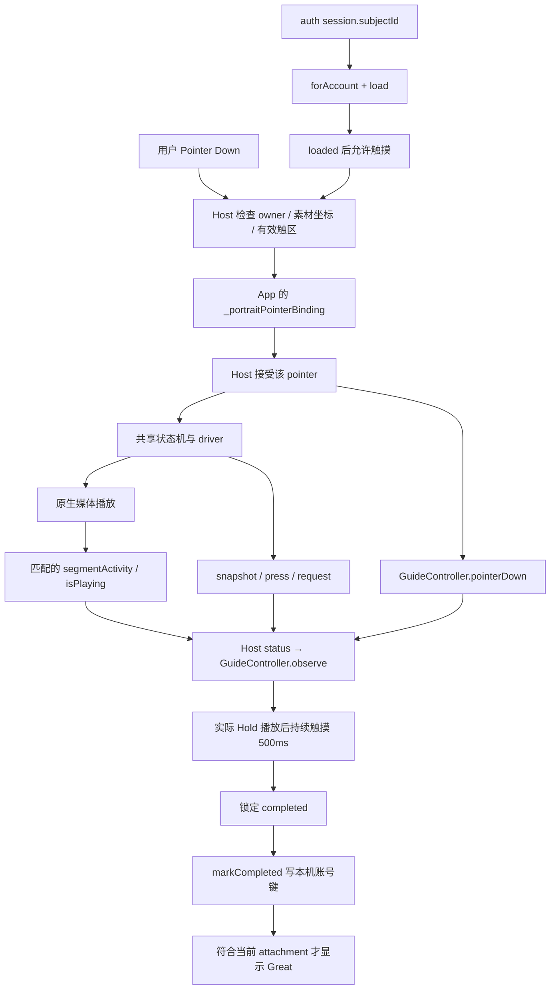

# 05 · 触摸教学：按住多久才算学会，换账号后谁还记得

[专题入口](README.md) · 上一篇：[Portrait 舞台](04-portrait-stage-and-runtime.md) · 下一篇：[Mock 与真实入口](06-local-mock-and-real-entry.md)

第一次进入可教学的 Portrait，屏幕出现 `Touch and hold`。
你按住宠物，提示改为 `Keep Holding`，宠物凑过来闻；满足条件后显示 `Great!`。
同一账号以后进入其他宠物的 Portrait，也不用再学一遍。

这里真正困难的地方是：“手指按下了”“请求播放了”“视频正在播”“持续满足了 500ms”“结果已经落盘”，是不同的时刻。
本章把这些时刻分开，再把它们接成完整数据流。

**阅读基线：2026-09-21 本地源码快照。**
你的 `ad9ec9cf` 建立长按教学，`78a0855f` 加入账号级进度、未完成时固定闻动作及异步隔离。
实际媒体观测、指针仲裁与动作选择还依赖共享播放器；这部分作为配套上下游解释。
源码和提交归属见 [教学证据索引](../evidence/app-source-map.md#app-guide)。

## 1. 三个 App 对象各管一件事

| 名字 | 类型与含义 | 主要负责 |
| --- | --- | --- |
| `PetSpacePortraitGuideController` | 可监听的教学控制器 | 当前提示阶段、计时、中断、一次教学完成 |
| `PetSpacePortraitGuide` | 引导 Widget | 文案图片、手势动画、位置、淡入淡出 |
| `PetSpacePortraitGuideProgress` | 按账号复用的进度对象 | 读取和保存本机完成记录 |

`PetSpaceInteractiveView` 把它们接在一起：它知道当前认证账号、当前播放器依赖，并接收 Host 接受的触摸事件。
共享 Host 告诉 App“现在的交互和媒体事实”；App 决定“这些事实是否满足教学产品规则”。

`ChangeNotifier` 是 Flutter 中一种发布“状态变了”的机制。
对象调用 `notifyListeners()`，监听者才得到通知。
这不是向服务器发送数据，也不意味着每个字段赋值都会自动通知界面。

## 2. 一次按压里有三个不同编号

| 字段 | 表示什么 | 例子 |
| --- | --- | --- |
| `pointer` | Flutter 指针编号，区分手指 | 第一根手指 7，第二根手指 8 |
| `activePressId` / `pressId` | 播放器为一次被接受的按压建立的身份 | 本次按压 21 |
| `activeSegmentRequestId` / `requestId` | 本次具体片段播放请求身份 | Start 31、Hold 32 |

编号是教学示意，真实值由运行时产生。
一根手指先后按两次，可以产生不同 press。
同一次 press 也可能推进多个片段请求，所以不能把 request 当成手指或视频文件。

`source` 是当前 dependencies 的身份。
它说明这条状态来自哪一套播放器，而不只是“它播放的是不是同一个资源 URL”。

`snapshot` 保存共享状态机当前状态和 context。
`activity` 是与片段关联的实际播放观测，其中 `isPlaying` 表达已观测到的播放状态。
只有状态机处于 `TouchHold`，仍然不足以单独证明视频已经开始播放。

## 3. 从手指到本地记录的完整数据流



箭头代表数据或回调关系，不代表每一条都另开线程。
Flutter 可以在等待 Future 时处理别的事件，这正是后面需要身份检查的原因。

## 4. “凑过来闻”究竟选的什么资源

当前 App 使用的选择声明是：

```dart
const portraitGuideSniffBinding = PortraitPlaybackBinding.touch(
  PointerBinding.middle,
  allowedVariantIds: [portraitGuideSniffCandidateId],
);
```

其中 `portraitGuideSniffCandidateId = 'base'`。
`middle` 是动作方向键；`base` 是该方向的基础候选。
`allowedVariantIds` 是允许候选列表，当前教学只允许 base。

现有资源合同把 `curious-sniff` 提升为 `middle.base`，并从 variants 移除。
因此不能要求 variants 里必须还出现一个名为 `curious-sniff` 的条目。
这段映射是当前 App/owner 所依赖的资源合同；本次没有请求后端确认线上某只宠物的 manifest。

一个完整动作通常有 Start、Hold、Release 三段，也称 triplet。
`portraitGuideMiddlePoint` 同时检查：真实触区是否允许 middle/base，以及它是否有完整可播放资源。
函数寻找合适区域的中点作为教学手势位置，不是假定屏幕正中央永远是有效触区。

若找不到这个点，`_guidePoint` 为 `null`。
此时跳过教学及固定闻策略，保留正常分区互动，也不伪造“已经完成”的存储记录。

## 5. 为什么点侧面，教学仍能播放 middle

Host 先确认原始命中有效、资源可播放，才调用 App 注入的 `pointerDownBindingOverride`。
App 根据账号进度选择返回原 binding，或教学专用 binding。

源码中的核心判断：

```dart
if (!_guideProgress.loaded || _guideProgress.accountId != _guideAccountId) {
  return null;
}
if (_guidePoint == null || _guideProgress.completed) {
  return original;
}
return portraitGuideSniffBinding;
```

`return null` 在这个回调合同里表示拒绝本次 Down。
它不是“随机选一个动作”，也不是“播放一张空视频”。
`return original` 则保留 Host 已经解析的原始区域规则。

所以未完成教学时，侧部的**有效触摸**也可以被转成 middle/base。
画幅外留白、V2 空 cell、缺资源区域以及已被拒绝的第二根手指，不会因覆盖策略被变成有效触摸。
覆盖之后，共享层还会再次核对目标 binding 的可播放性，再领取指针所有权。

教学完成后，后续有效 Down 恢复原分区可播放候选的随机选择。
已经开始的这次 press 仍使用原来的闻动作 triplet，直到 Release 收尾；完成瞬间不会中途切换动作。

## 6. 把一次成功教学展开到每个时刻

下表假设账号 B 未完成、进度已读完、资源可教学。
时间仅为说明前后关系，不是性能测量。

| 时刻与事件 | 教学 `phase` | `completed` | 正在等什么 |
| --- | --- | --- | --- |
| T0：Host 进入 IdleStill / PostIdle | `idle` | false | 有效 Down |
| T1：接受 middle Down | `pressing` | false | 对应 press 的状态与媒体观测 |
| T2：TouchStart | `pressing` | false | Start 推进到 Hold；此时不计 500ms |
| T3：逻辑状态 TouchHold | `pressing` | false | 匹配 request 的 `isPlaying=true` |
| T4：实际 Hold 开播通知到达 | `pressing` | false | 500ms 持续接触计时开始 |
| T5：499ms 已过 | `pressing` | false | 最后 1ms，不能提前算完成 |
| T6：达到 500ms 且未被中断 | 通常仍 `pressing` | true | 本地保存调用结束 |
| T7：保存结束且 attachment 仍有效 | `great` | true | 1100ms 成功反馈计时 |
| T8：反馈计时结束 | `learned` | true | 后续正常互动 |

`hidden` 表示当前没有教学提示；不等于已经完成。
`learned` 才是“已学会且不再显示教学”的界面阶段。
进度对象的 `completed` 与控制器的 `completed` 分别承担账号共享事实、这次教学判断，要通过 View 连接。

Great 出现后松手不会把完成撤销。
成功视觉还有 360ms 弹出和 500ms 淡出；这些动画时长与“500ms 完成资格”是不同规则。
减少动态效果设置会调整引导动画，不会把播放请求本身当作开播证据。

## 7. 500ms 从哪一句开始，哪些通知不能启动它

`observe` 先核对当前 source、前台状态、教学资格、available、pointer 与 physicallyTouching。
然后要求 middle 的 `TouchStart` 建立本次 `_pressId`，再观察相同 press 的 `TouchHold`。

实际媒体观测还要满足：

```dart
activity.playback.requestId == snapshot.context.activeSegmentRequestId
activity.playback.pressId == _pressId
activity.playback.kind == PortraitPlayerSegmentKind.touchHold
activity.isPlaying == true
```

这是从源码条件拆出的阅读清单，不是一段可直接独立运行的函数。
`.` 是读取对象成员：`activity.playback.requestId` 从 activity 找 playback，再取 requestId。
`==` 是比较是否相等，不是赋值。

真正通过这些条件后，控制器才创建 `Timer(Duration(milliseconds: 500), ...)`。
`Timer` 安排未来执行回调；它不会阻塞界面等待半秒。

三种常见误读：

1. `TouchHold` 是状态机已经走到 Hold，不证明原生媒体已开播。
2. `onPlayerViewCreated` 表示原生展示对象已创建，不证明它正在播。
3. 测试 driver 报某个请求完成，是测试安排的事件，不是实机解码证据。

正常 Hold 循环可能更新 request，原生通知短时间还未跟上。
当前逻辑对不匹配或暂缺 activity 的通知直接等待，不把同一 press 的正常循环计时反复归零。
计时开始后收到匹配播放的 `isPlaying=false`，则会中断，要求重新按下。

## 8. 中断时到底清理了什么

`interrupt()` 把 `_pointer`、`_pressId` 清为 `null`，`_armed` 设为 false，并取消 Hold timer。
未完成时把提示收为 `hidden`；随后回到 idle 的有效状态通知可以重新显示提示。

```dart
_holdTimer?.cancel();
_holdTimer = null;
```

第一句的 `?.` 表示只有 timer 存在才调用 `cancel()`。
第二句才是把字段清空；调用 `cancel()` 本身不会替你做这次赋值。
两句一起表达“停止等待这个完成回调，并记录现在没有 Hold timer”。

| 中途事件 | 结果与原因 |
| --- | --- |
| 499ms 时 Up / Cancel | 取消未完成计时；下次仍需教学 |
| 切到后台 | `setForeground(false)` 中断；后台停留时间不能累计 |
| 播放失败或不可交互 | status 使计时失去资格，不能完成 |
| 第二根手指按下 | Host 先拒绝非 owner；不会接替第一根继续累计 |
| release 期间又有新 press | 必须等新 press 自己的 Hold 实际开播 |
| 页面卸载 | dispose 取消 timer 和监听；迟到反馈不能更新页面 |

“中断教学计时”不等于“取消所有已经发出去的原生播放命令”。
播放器自己的 Up、Cancel、release 与清理过程由共享层负责。
App 教学控制器只取消自己有权管理的完成资格和提示。

## 9. `await` 保存期间，其他事件还会继续发生

进度对象的实际写入是：

```dart
await storage.write(completedKey!, 'true');
_persisted = true;
```

`await` 暂停当前异步函数后面的代码，直到写入 Future 完成。
它不会冻结整个 App；期间用户可以切宠、切账号、返回上一页。

`completedKey!` 的后缀 `!` 是非空断言，表示开发者在这里要求它非 null。
它与前面 `!mounted` 的布尔取反不是同一种用法。
本对象在 `accountId == null` 时会提前返回，不写匿名键。

`markCompleted()` 先立即把内存中的 `completed` 设为 true，并通知当前进程的其他监听者。
然后才等待写入。
因此“同账号现在不用重复教学”可以先成立，“重启后仍记得”要等持久化真正成功。

写入方法内部捕获失败，不让偏好存储失败阻断 Portrait。
失败后 `_persisted` 仍为 false，但本进程 `completed` 保持 true；后续 `load()` 可以再次尝试写入。
控制器等待的是保存调用结束，因此写入失败被进度对象处理后，也可能正常显示 Great。
Great 不能当作磁盘写入成功的单独证明；未成功落盘就杀进程，完成记忆可能丢失。

同一账号连续请求保存时，还需要避免每个调用都另开一次写入：

```dart
return _saving ??= _write().whenComplete(() {
  _saving = null;
});
```

`??=` 表示左边为 null 时才计算右边并赋值。
如果 `_saving` 已指向进行中的 Future，后来的调用直接拿到同一个 Future。
这里保存的是“一次异步写入任务的结果对象”，不是完成标记字符串，也不是磁盘文件。
`whenComplete` 等该任务结束后清空字段，让尚未持久化成功时仍有下一次重试机会。
清空 `_saving` 只表示当前写入任务结束；是否已经保存成功另看 `_persisted`。

## 10. 为什么既比 source，又比 attachment generation

达到完成条件时，控制器记住当前 `_source` 和 `_attachmentGeneration`。
保存结束后 `showSuccess()` 重新核对这两个身份，以及是否 disposed、是否仍 completed。

只比 source 不能完整处理下面的次序：

| 事件 | 当前 source | attachment generation | 旧保存回调 |
| --- | --- | --- | --- |
| A 上完成并开始保存 | A | 5 | 记着 A / 5 |
| 绑定 B | B | 6 | 尚未返回 |
| 又绑定同一个 A 对象 | A | 7 | 尚未返回 |
| 旧保存返回 | A | 7 | A 相同，但 5 不等于 7，丢弃反馈 |

数字是教学示例。
`identical(a, b)` 比较是否同一个对象引用；它不能表达“这是同对象第几次被挂接”。
generation 补上这层时间身份。

已完成但正在保存时发生有效依赖或资格变化，`attach` 立即把界面收为 `learned`。
这样既保留已完成事实，又不会把旧 `Keep Holding` 留在那里等一个已不该显示的 Great。
相同 source、相同 eligible 的重复 attach 直接返回，正常反馈不会被普通重复接线打断。

## 11. 账号级进度为何不使用 petId

进度的本机键是：

```text
besideyou.portrait_touch_guide.completed.v2.<URI 编码的账号 ID>
```

账号来自 `auth.currentState.session?.subjectId`，先 trim 规范化。
键里没有 petId，因为产品要求是“这个账号学会一次”，不是“每只宠物各学一次”。
`Uri.encodeComponent` 让账号字符串适合放进键中；它不是加密算法。

`forAccount` 在当前进程按规范化账号复用同一个进度对象。
跨宠物可以共享内存状态；跨 App 进程则靠 `SharedPreferencesStore` 的记录恢复。
不同设备之间没有本功能新增的后端同步。

| 场景 | 当前设计 |
| --- | --- |
| B 完成后切另一只宠物 | 仍完成，正常分区互动 |
| B 退出页面再进入 | 仍读取 B 的同一完成事实 |
| B 退出登录再登录 | 已成功保存的 B 记录仍可恢复 |
| 切到未完成的 C | 读取 C 的键，不能继承 B |
| 清数据、重装、换设备 | 不承诺保留本机完成记录 |
| 身份尚未确定 | 跳过教学，不读写公共匿名键 |

匿名进度在内存里设 `completed=true` 是“暂时不教学”的处理。
它不是确认某个真实账号已经学会；登录后要绑定对应账号对象重新读取。

## 12. B 的旧读取迟到，会不会污染 C

每个进度对象的 `accountId` 是不可变的 `final` 字段。
账号切换时 View 移除旧监听，绑定新对象，重置教学；新进度读完前先关闭触摸。
旧异步读写继续属于原来的对象和原来的键。

例如 B 正在读盘，此时用户切到 C：

1. B 的 `_read()` 仍持有 B 进度对象。
2. View 当前监听改为 C，C 自己开始 `load()`。
3. B 返回 true，只能改变 B.completed，不能把 C.completed 设成 true。
4. 触摸覆盖和完成回调另行检查当前认证账号，阻止旧教学写到新账号。

即使同一账号内部发生“旧读取未完成时，新教学先完成”，也有保护：

```dart
completed = completed || saved;
```

`||` 是“或者”。当 completed 已为 true，即便旧读盘结果 saved 为 false，结果也仍为 true。
如果直接写成 `completed = saved`，迟到的旧读取就可能把新完成事实改回未完成。

## 13. 本地 v2 记录是一项明确的行为变化

**Breaking change：原先全局 v1 完成记录不含账号归属，当前 v2 不把它迁移给任意账号。**
受影响的是装过旧全局记录版本的用户，以及创建进度对象的 App 调用方。
没有 v2 记录的账号需要完成一次教学；调用方通过 `forAccount` 或显式账号构造对象。

旧键保留但不再读取；回滚到全局版也不能识别新的 v2 记录。
账号隔离、匿名不落盘与旧键不继承应一起维护测试和模块事实源。
此变更不新增后端接口，不代表整套 App 的账号数据都改成了本地存储。

## 14. 从测试读到的保障，与尚未验证的边界

本次只读了控制器、进度与页面测试，未运行测试、构建或安装。
已有用例明确安排了：错误 request 不计时、499ms 不完成、正常循环不重置、提前松手重试。
还安排了保存等待中切 source / 资格、A→B→A、B/C 延迟读写、旧 v1 不继承和存储失败重试。

这些测试通过 fake playing 通知、Completer 和模拟时间表达期望次序。
它们不能替代真实设备的开播观测、手指触感或跨账号人工验收。
本章陈述源码实现与已读测试意图，不把 owner 中历史测试数字或旧 APK 体验当成本次验证结果。

<details>
<summary>自测：从 Down 起按了 2 秒，为什么可能还没完成？</summary>

因为计时不从 Down 开始。
如果仍在 Start，或尚未收到匹配 request 的 Hold playing 通知，计时还未开始。若已启动的计时被 Up/Cancel、匹配的 `isPlaying=false` 或进入后台等事件中断，则需要重新按下。正常 Hold 循环暂时 request 不匹配不会清零已启动计时。

</details>

<details>
<summary>自测：完成保存正在等待时切宠物，应撤销已学会吗？</summary>

不用撤销已满足的完成事实。
新依赖应收敛为 learned，旧 source / generation 的成功反馈不得再出现；原账号的保存仍归原对象处理。

</details>

<details>
<summary>自测：B 的第二只宠物没有教学，而 C 出现教学，哪个字段决定？</summary>

是当前 session.subjectId 对应进度对象的 completed，而不是 petId。
只有已完成且成功保存的账号记录，才支持跨进程恢复；跨设备不在本地记录能力内。

</details>
