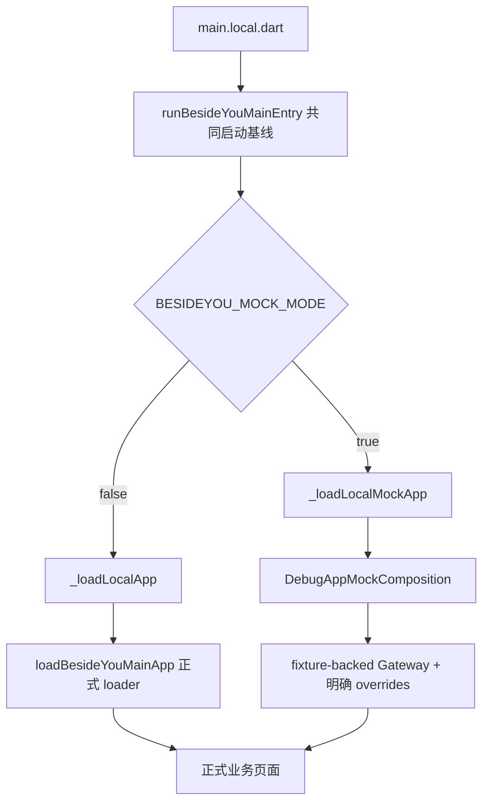

# 06｜Mock 与真实入口：同一页面可以来自不同数据

[专题入口](README.md) · 上一篇：[触摸教学](05-touch-guide-and-progress.md) · 下一篇：[故障推演](07-troubleshooting-and-retelling.md)

对应你的提交 `78498aae`，并联系 Home / Portrait 预览场景。2026-09-21 静态取材；[源码与测试入口](../evidence/app-source-map.md#app-debug)。本章不执行启动、构建、安装或真实接口请求。

## 场景：你想看 Home，却一直进入强制升级页

先问配置与入口，再判断业务接口是否出错。在本地 Mock 路径中，强制升级可以是特意注入的预览结果；画面像真实升级页，不代表它刚从真实后端读到升级政策。

你这次提交补的是本地升级预览与隔离：Mock 可以明确选择继续启动或展示升级，同时正式入口保持独立的真实业务配置路径。理解这件事需要把四个维度分开。

## 1. 四个开关问题不要合成一个“是不是 debug”

| 维度 | 回答的问题 | 当前源码中的入口 |
| --- | --- | --- |
| Flutter build mode | 编译/运行方式是什么？ | debug / profile / release |
| 入口文件 | 走正式入口还是本地适配？ | `lib/main.dart` / `lib/main.local.dart` |
| 数据依赖 | 返回真实接口结果还是预设状态？ | `BESIDEYOU_MOCK_MODE` |
| 调试 UI | 是否把调试路由、面板接入？ | `BESIDEYOU_INCLUDE_DEBUG_ROUTES` |

真实接口使用哪套环境又由 env 配置负责。`debug` 构建不自动等于 Mock；`main.local.dart` 也不自动等于 Mock；隐藏调试面板不会自动切换到真实数据。

Portrait 的正式用户教学提示属于产品功能。关闭调试路由，也不应被理解为取消长按教学。

## 2. 当前 local 入口怎样分流



图把 loader 的选择和调用展开讲解；真正代码是在调用共同 runner 时就传入选好的 `appLoader`。

`main.local.dart` 中最关键的真实表达式是：

```dart
appLoader: _mockModeEnabled ? _loadLocalMockApp : _loadLocalApp,
```

逐个读：

1. `appLoader:` 是具名参数，把一个 loader 函数交给共同启动逻辑。
2. `_mockModeEnabled` 是布尔条件。
3. `? ... : ...` 是条件表达式：真时取前者，假时取后者。
4. `_loadLocalMockApp` 后没有 `()`：这里传的是函数，不是在这一句立刻执行它。
5. runner 随后在需要加载 App 内容时调用选中的函数。

非 Mock 的 `_loadLocalApp` 调用 `loadBesideYouMainApp`，并传递本地选定的 `includeDebugRoutes`。正式 `main.dart` 不消费 `BESIDEYOU_MOCK_MODE` 或 Mock 强更开关来决定业务依赖。

## 3. fixture-backed 到底替换在哪一层

`fixture` 是预先定义的响应资料。`DebugAppApiFixtureBackend` 创建 Gateway，并给 Dio 替换 fixture adapter；`DebugAppMockComposition` 把这个 Gateway 和它对应的 session request scope 一起交出去。

```text
同一页面动作
  → 业务 Repository
  → AppApiGateway
  → fixture adapter 返回预设响应
  → 正常 DTO 解析
  → 页面状态变化
```

这样可以观察业务解析和路由接线，而不必真实创建宠物或执行支付。它也保留了一个重要限制：fixture 写错，页面同样可能报错；看见页面工作并不能证明真实服务已经实现同样返回。

`DebugAppMockState` 是本地情景的可变模型，不是服务端事实。`existing_user_ready` 是预设情景名，不是“线上所有已注册用户都 ready”的断言。你的提交同时调整了这个 fixture 与对应代码，阅读时要看一致的一套。

## 4. 本地强更：一个显式决策，不是真实政策读取

`_mockForceUpdate` 从 `BESIDEYOU_MOCK_FORCE_UPDATE` 读取，当前默认值为 `true`；它只在 Mock loader 的 override 里使用。

| 入口/依赖 | 配置 | 注入结果 |
| --- | --- | --- |
| local Mock | 强更为 true，含未显式修改默认值 | `DebugRequiredAppUpdateStartupGate` |
| local Mock | 强更显式 false | `DebugContinueAppUpdateStartupGate` |
| local 非 Mock | 任意 Mock 强更值 | 不经过这项 Mock override，走正式更新能力 |

`DebugContinueAppUpdateStartupGate.evaluate()` 返回 `AppUpdateContinue`，表示这个预览允许继续。`DebugRequiredAppUpdateStartupGate.evaluate()` 构造 `AppUpdateRequired`，用本地设定的当前 build 和最低 build 触发升级展示。

这两个对象都实现 `AppUpdateStartupGate`；上层消费同一合同，具体实现由 composition 选择。这是“接口”和“实现”最直接的项目例子。

`DebugNoopAppUpdateStoreLauncher.openStore()` 记录将要打开的入口并返回模拟结果，不实际打开商店。`noop` 可以译为“这里不执行真实外部动作”。它返回 `true` 也不能成为真实商店跳转的验证证据。

## 5. 按时间推一次本地 Home 预览

| 时间 | 发生什么 | 应该怎样解释 |
| --- | --- | --- |
| T0 | local 入口读编译参数 | 决定 Mock 与调试 UI 等配置 |
| T1 | 共同 runner 启动 | 启动壳、环境等基线仍有共同来源 |
| T2 | Mock loader 组合依赖 | Gateway 返回 fixture 业务结果 |
| T3 | 评估注入的 update gate | 默认强更时先看到升级页；显式关闭才继续 |
| T4 | 页面消费 fixture read model | Home / Portrait 展示的是此情景下的客户端结果 |
| T5 | 操作页面 | 验证客户端交互；不升级为真实购买/生成证据 |

首启视频 Gate 也是独立因素。当前 local 入口默认仍共享安装级持久化判断；重复预览首启视频有自己的显式 Mock 开关。看到启动视频不能用来判断 Mock 是否开启。

## 6. 出问题时检查这五项

1. **入口**：这次使用的入口文件是什么？不要只看 IDE 配置名称。
2. **依赖**：`BESIDEYOU_MOCK_MODE` 的实际构建值是什么？进入了哪个 loader？
3. **情景**：Mock state 的名字和内容是否匹配想观察的业务阶段？
4. **前置 Gate**：是否被 Mock 强更或首启视频挡住，还没到 Home？
5. **调试 UI**：`includeDebugRoutes` 控制的面板，与正式 Portrait 教学是否被误认为同一东西？

这五项先形成可核对事实，再决定是否需要构建或设备验证。本章提供读取方法，不代替源项目 LOCAL / PACKAGING 的实际运行与发布规则。

## 7. 测试文件能证明到哪里

`test/app/debug/debug_local_entry_test.dart` 中可以找到正式入口没有 Mock 状态加载、local 入口维持共同 runner、强更 override 只在 local 以及相关 owner 文档接线的断言。

这类检查有些是源码字符串约束：它能发现意外把 Mock 接线带进正式入口，却不能直接证明一次真实打包用的 env、安装包运行或商店操作。当前章节只阅读了这些断言，未执行 App 测试。

## 自测

<details>
<summary>main.local.dart + debug 构建一定是假数据吗？</summary>

不一定。Mock 取决于明确的依赖选择。非 Mock local loader 会进入正式 loader，运行环境还需要检查 env 配置；编译模式是另一维度。

</details>

<details>
<summary>关闭 INCLUDE_DEBUG_ROUTES 后还有 Touch and hold 提示，是隔离失败吗？</summary>

不能这样推断。正式 Portrait 教学是业务功能，debug 面板是调试能力。应先找到提示来自哪个 Widget / controller。

</details>

<details>
<summary>Mock 升级按钮返回成功，可以写成“验证了真实商店跳转”吗？</summary>

不可以。当前 Mock launcher 是 no-op。它只让上层得到预期模拟结果，真实商店路径必须有另外的运行证据。

</details>

完成标准：拿到一张 Home 或升级页截图时，先列出需要核实的入口、build mode、数据依赖、env 和调试 UI，而不是从画面猜整套运行模式。
