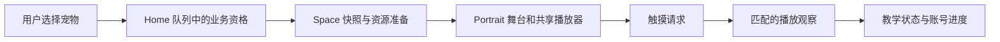

# BesideYou App：从自己的提交读懂开发链路

[返回知识库](../README.md) · [提交范围](../evidence/app-contributions.md) · [源码索引](../evidence/app-source-map.md) · [复核记录](../evidence/app-validation.md)

这一组材料围绕作者的 App 提交展开：从一个用户动作开始，解释数据从哪里来、哪个对象作决定、界面何时变化，以及失败后怎样恢复。先能说清自己改过的链路，再顺着必要的上下游补基础。

这里按 Git 中核对的开发范围组织内容；关联的启动、鉴权、API、资源下载和共享播放器只作为理解背景。具体提交、去重办法和来源日期统一放在[贡献证据](../evidence/app-contributions.md)，不把整套 App 都归为个人实现。

## 阅读顺序

| 章节 | 要回答的一个问题 | 读完能做什么 |
| --- | --- | --- |
| [01 基础知识](01-foundations.md) | 代码中的对象、Future、回调和状态到底是什么？ | 逐句解释一次请求，以及为什么回来时要重新检查身份 |
| [02 数据从启动到页面](02-startup-api-and-ownership.md) | JSON 怎样变成页面能使用的状态？ | 分清 Gateway、Repository、Controller、Widget 各自的工作 |
| [03 Home 数据流](03-home-data-flow.md) | 选中宠物后，加载胶囊和升级返回由哪些数据决定？ | 从 Home 动作追到队列、预热、进度投影和 exact-pet 返回 |
| [04 Portrait 舞台与播放](04-portrait-stage-and-runtime.md) | 一张背景、一幅视频和触摸坐标怎样对应？ | 分清业务可进入、资源可用、播放器已接管、画面可见 |
| [05 触摸教学与进度](05-touch-guide-and-progress.md) | 长按多久算完成，完成后下次为什么不再教？ | 推演按下、播放回执、松手、切宠和账号切换的状态 |
| [06 Mock 与真实入口](06-local-mock-and-real-entry.md) | Debug、Mock、测试接口与黑框为什么要分开？ | 解释本地预览的注入点和正式入口隔离 |
| [07 故障推演与表达](07-troubleshooting-and-retelling.md) | 遇到问题先看哪里，怎样把开发经历讲清楚？ | 写出最后正确点、第一错误点和证据边界 |

如果只想先读最熟悉的功能，可以直接进入 03 或 05；不认识的写法再回到 01。每章的折叠答案可自行展开，不需要停下来等别人批改。

## 两条贯穿全篇的线

这是阅读地图，省略了路由、错误和生命周期分支；每一条箭头的条件在对应章节展开。

**数据线**追问输入、转换、持有者、输出。**时间线**追问立即发生什么、等待什么、等待期间哪些事会让结果过期。只有两条线一起看，才能解释“接口已经回了，页面为什么还不能进去”。

## 怎样使用源码入口

正文保留源码中的 English identifiers，引用跳转到知识库内的[源码索引](../evidence/app-source-map.md)。索引给出相对于 App checkout 的文件、符号和来源指纹；不要求公开仓库携带私有项目源码。

先按每章的最少文件顺序阅读，追到该章的停止点即可。不要为了理解一次长按，先读完所有登录、支付和原生视频代码。

## 和已有 Frame 材料的关系

- [Frame Portrait 专题](../modules/portrait.md)可以帮助比较“业务身份、异步代次、资源生命周期”；手机 App 的页面准入和教学规则仍以本专题对应源码为准。
- [异步与生命周期基础](../foundations/async-lifecycle.md)解释跨模块机制；本专题把这些机制落到你改过的 App 场景。
- [自学课程](../beginner/README.md)适合进一步练习语法；[面试准备](../interview/README.md)提供组织项目经历的方法。

这里是带日期的学习快照。当前产品合同回到源项目 owner；文档检查、源码阅读、产品测试和物理设备验收分别记录，不混成一个“已验证”。
