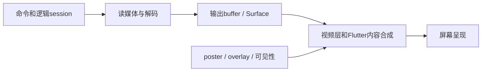

# 媒体渲染：从“想播放”到“看见画面”

> 基础卡，2026-09-09 整理。用于理解 [Portrait](../modules/portrait.md) 与 [Moment](../modules/moment.md)。
> 原理图是教学模型；实际线程、播放器与图形路径须结合工程版本和设备证据确认。

## 先分清五件事

| 层 | 它回答的问题 | 它没有独自证明什么 |
| --- | --- | --- |
| 播放逻辑 | 播哪项？暂停吗？当前 request/session 是谁？ | 没有证明解码器已产出图像 |
| 解码与时钟 | 压缩数据如何成为视频帧？何时呈现？ | 没有证明输出目标仍有效 |
| Surface / 输出 | 帧交给哪个图形输出目标？它还活着吗？ | 没有证明内容未被上层覆盖 |
| 合成 | 视频层与 Flutter 控件如何叠放、变换？ | 没有证明设备每帧都及时完成 |
| 用户所见 | 当前屏幕是否显示了正确宠物与姿态？ | 单次观察没有证明长期稳定性 |

图中每一段都可能等待、失败或持有旧身份。因此“controller 不为空”是很早的证据点。
排查黑屏时，把最后已确认的点与第一个未确认的点标出来，比反复重新创建整个页面更有用。

## Surface 不是一个视频文件，也不是播放器对象

Android 的 BufferQueue 连接图形数据生产者与消费者；生产者填充 buffer，消费者取用后归还。
队列传递的是 buffer handle，不能把它理解为每一跳都复制整张图片。
图形内存分配还受尺寸、像素格式与用途约束。见 [AOSP：BufferQueue and Gralloc](https://source.android.com/docs/core/graphics/arch-bq-gralloc)。

**项目推理练习：** 原生 player 仍在，但旧 View 已卸载，可以出现“播放逻辑继续、旧输出目标失效”。
反过来，View 已创建但媒体尚未准备好，也可能没有新帧。
所以资源表应分别记录 player、logical session、view、surface，不能只记录一个 `isPlaying`。

## playing、首帧与屏幕可见是不同信号

先查事件的定义与触发代码，再判断它支持什么结论；不同播放器的同名状态不一定同义。

| 信号 | 在 Frame 学习中怎样读 |
| --- | --- |
| 播放命令已返回 | 命令阶段已结束，后续准备/输出仍可能失败 |
| `playing` | 检查它来自哪个 backend、属于哪个 session，以及是否允许无真实 Surface 时出现 |
| `positionMs > 0` | 播放时间线有推进；仍需结合画面层和覆盖层判断 |
| 某请求的 first-frame callback | 比 View 创建更接近该输出已产生帧；先核对请求与输出身份 |
| still 解码成功 | 可以提交这张静图；不能替代视频首帧 |
| 同步录像中的实际变化 | 证明那次设备呈现现象；根因仍要与日志和版本对应 |

[Portrait](../modules/portrait.md) 专门区分 Stage 的揭示 gate 与 TinyPlayer interrupt 的原生首帧等待。
“延迟一会儿再隐藏封面”是一种 UI 策略，不能被记录为硬件首帧测量结果。

## 工作发生在哪里？

把它们先当成职责分区，不要假定每个分区永远对应独占线程：

| 分区 | 阅读代码时关注的工作 |
| --- | --- |
| Dart UI | 输入响应、状态通知、build/layout，以及当前 isolate 上的计算 |
| Flutter raster | 根据绘制信息生成 Flutter 图形内容 |
| Android platform | Android View、插件调用和平台消息 |
| 原生媒体与图形 | 播放调度、codec、输出缓冲、图形驱动与系统合成 |

Hybrid Composition 会涉及 raster 与 platform 工作的同步/合并，不能只看 Dart build 次数推断整机 FPS。线程与合成边界见 [Flutter Platform Views](https://docs.flutter.dev/platform-integration/android/platform-views)。

**项目推导：** 减少 Stage 重建，只证明减少了这层工作；大文件摘要仍可能占用计算时间，原生输出也可能独立等待。
给卡顿找原因时分别检查事件排队、构建范围、媒体准备与输出，不把所有停顿都叫“Flutter 太慢”。

## 合成方式是一项取舍

传统 Hybrid Composition 把原生视图放进 Android 视图层级；texture-layer 路线把平台内容作为纹理参与 Flutter 绘制。
二者在表现保真、变换、同步与性能上有取舍。当前文档的 HCPP 另要求 API 34+、Impeller/Vulkan，不能套给本项目讨论的 Android 10。见 [Flutter 的实现选择与要求](https://docs.flutter.dev/platform-integration/android/platform-views)。

**Frame 源码快照：** App 为播放路由注入 `TinyPlayerAndroidComposition.hybrid`；播放器 factory 另外设置 `requireVideoSurface`。
一个选择视图如何合成，一个约束播放输出准入；二者不能互相替代。具体文件与 owner 在 [Portrait 来源索引](../modules/portrait.md#来源路径与关键符号索引)。
切换 flag 后编译通过，只能证明配置被接纳；是否改善，要在相同设备、制品模式、素材、缓存和交互条件下对照观察。

## 生命周期也是资源预算

每个待解码 poster、未完成 Future、存活 controller、原生输出和队列都可能占用资源。
“旧结果不再使用”不等于资源已释放；过期 image handle、subscription、未接纳 dependencies 仍需要所属层清理。
复用 ExoPlayer 与保留新 logical session 可以同时成立：前者减少资源重复创建，后者拒绝旧事件污染。

复习时画一张所有权表：谁创建、谁持有、谁接管、何时释放、释放前晚到回调怎么办。
如果优化只是不断重建或扩大缓存，应进一步问资源峰值、旧工作收尾和下一次触摸是否被拖慢。

## 把结论放在证据覆盖的那一层

| 证据 | 能支持的结论 | 仍需另外确认 |
| --- | --- | --- |
| Unit test | reducer、身份检查、错误/重试策略符合断言 | 平台调用与真实渲染 |
| Widget test + fake | 交互、gate、子树挂载/释放符合断言 | 真 codec、Surface 与 GPU 行为 |
| 原生测试或日志 | 对应平台路径和那次状态变化 | 画面是否符合用户观察、长期是否稳定 |
| 同设备对照与用户操作 | 该版本、该场景的实际体验 | 未覆盖设备、媒体、时长与异常组合 |

本基础卡没有执行上述测试或设备实验；回到模块测试入口，可以先用 fake 练习身份和生命周期。

## 三道自测

1. playing 已到但仍见旧封面，接下来查什么？

先核对 playing 所属 session，再查 Stage 的揭示 gate、当前 Surface 与 continuity poster。不要直接断言是下载失败或解码失败。

2. Host 的 State 没变，能证明 native 视频视图没卸载吗？

不能。媒体子树的层级、类型或 key 仍可能改变；应检查实际媒体 probe 或平台 View 的挂载/释放事件。

3. widget tests 全过，Hybrid Composition 就已修复设备崩溃了吗？

不能。测试可以证明接线和生命周期合同，设备崩溃还涉及真实输出与驱动；需要对应制品和设备上的独立证据。

