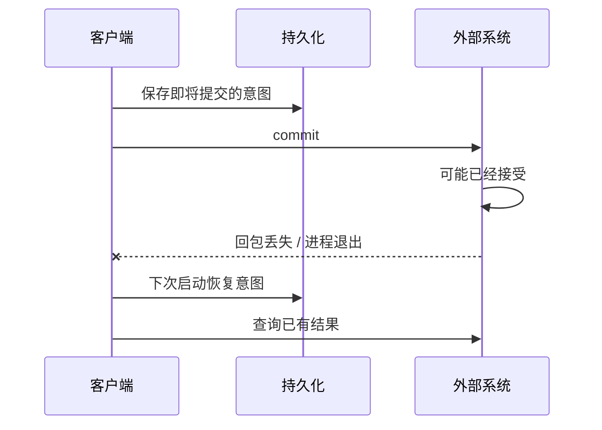

# 更新与跨系统一致性：下载完成以后还有哪些事实？

[返回首页](../README.md) · [App Update 专题](../modules/app-update.md)

## 字节、身份、授权分别检查

| 检查 | 解决的问题 | 不能单独证明的事 |
| --- | --- | --- |
| 文件长度 | 是否符合期望大小 | 内容正确、来源可信 |
| 内容 hash | 字节是否匹配期望摘要 | 摘要来源可信、允许安装 |
| package / version | 是否是目标应用和允许的版本 | 发布者身份 |
| signer certificate | 是否符合签名身份策略 | 新版本运行健康 |
| 系统安装回执 | PackageInstaller 的处理结果 | App 业务播放已恢复 |

Android 用签名证书参与应用身份和更新兼容判断；签名轮换也有自己的机制。本项目采用什么 signer 规则，应看具体 host 和包身份模型，不能把通用 Android 能力直接等同于本项目支持。[Android 应用签名](https://developer.android.com/studio/publish/app-signing)

教学推导：hash 像“这一包字节的指纹”，前提是**期待的指纹来源可信**。如果攻击者同时换掉文件和期望 hash，单独算 hash 没有解决真实性问题。

## 为什么 commit 附近最难处理

安装 session 接受写入，经过 `fsync` 和 `commit` 进入系统处理；结果通过状态接收方异步返回，可能需要用户操作。客户端提交方法返回与最终安装完成是不同阶段。[PackageInstaller.Session](https://developer.android.com/reference/android/content/pm/PackageInstaller.Session)

这是通用教学时序。没有回包只能说明客户端不知道结果，不能说明系统没有接受。具体错误码与准入规则见更新专题。

## Retry 先分类

| 已知事实 | 教学上的恢复原则 |
| --- | --- |
| 尚未提交，已有资源已确认清理 | 重新核对输入后可考虑重试 |
| commit 可能被接受，结果未知 | 查询原结果，保留归属，不盲目创建第二个事务 |
| 内容或身份校验确定失败 | 拒绝这份输入，不能以“重试”绕过校验 |
| 本地事件已发送，ACK 丢失 | 重放同一事件身份，服务端按同一操作识别 |

不是所有失败都适合指数退避；退避只解决“何时再次尝试”，不解决“重试什么、是否会产生重复副作用”。

## 幂等与事件身份

假设事件有 `eventId=demo-event-1`、`sequence=1`。先把完整事件写入待发送记录，再发送；ACK 不确定时继续发送**同一个事件**。如果每次重试都生成新 ID，接收端可能把同一事实当成两条新事件。

这不等于整个系统实现了“恰好一次”。客户端重放策略、服务端去重、持久化可靠性、ACK 校验要共同成立。当前项目的客户端保证回到 `_reportIfNeeded` 和 `_flushQueuedEvent` 阅读；服务端处理不能凭客户端测试推定。

可运行的模拟见 [event_replay.dart](../labs/event_replay.dart)：其内存接收端只为演示，不能证明真实后端幂等。

## 自测

1. `commit` 抛异常，是否一定能重新创建 session？
2. 内容 hash 一致是否足以认定 APK 可信？
3. 发送成功但保存 ACK 失败，下一次用什么 eventId？
4. `health_confirmed` 这样的名字是否自动证明长时间播放健康？

参考答案

1. 不一定。可能已经跨过系统接受点，应按实际提交状态核对，不能把异常统一归类为未提交。
2. 不足。还要有可信的期望元数据、包身份、版本和签名策略。
3. 仍应使用持久化的原事件身份和原 payload，避免用新 ID 掩盖不确定性。
4. 不会。必须阅读这个事件由什么检查触发；项目身份回报与业务运行验收分开。

资料检索：2026-09-09。只解释相关机制，不提出修改系统安装或签名策略的建议。
