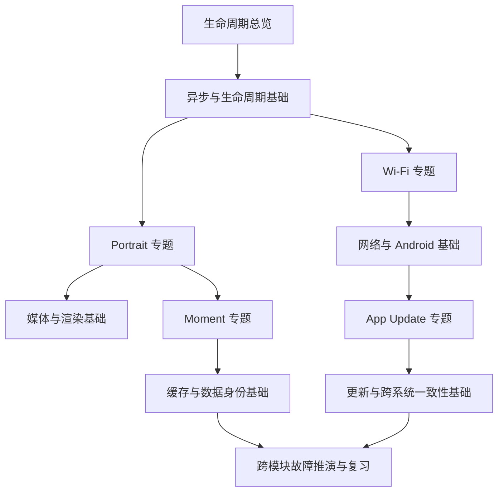

# 先学什么：从症状倒查知识

[返回首页](README.md)

先带着一个可以解释的问题阅读。第一次不要求记住所有类名，要先记住每条链路的输入、状态持有者、提交点和退出条件。

## 推荐顺序

起点：[生命周期总览](lifecycle-map.md)。专题可按实际遇到的问题换顺序，不需要先学完整套 Android Framework。

## 根据问题选择阅读入口

| 我解释不清的问题 | 先读专题 | 再补基础 | 合上文档后的产物 |
| --- | --- | --- | --- |
| 为什么只是切设置回来，视频可能被重建？ | [Portrait](modules/portrait.md) | [异步与生命周期](foundations/async-lifecycle.md) | 画出页面、session、native surface 的不同生存期 |
| 为什么播放状态是 playing，画面仍可能没出来？ | [Portrait](modules/portrait.md) | [媒体与渲染](foundations/media-rendering.md) | 区分逻辑信号与可见帧证据 |
| 为什么有网、有缓存，仍不能显示指定宠物？ | [Moment](modules/moment.md) | [缓存与身份](foundations/storage-identity.md) | 列出授权身份与资源可用性的独立条件 |
| Gallery 的列表和自动播放列表为什么不同？ | [Moment](modules/moment.md) | [缓存与身份](foundations/storage-identity.md) | 用输入、过滤、输出解释两个读模型 |
| Wi-Fi 图标连接了，为什么后端请求仍失败？ | [Wi-Fi](modules/wifi.md) | [网络与 Android](foundations/networking-android.md) | 给每一层证据写一句“能证明 / 不能证明” |
| 页面退出后，为什么迟到的读取还会影响新状态？ | [Wi-Fi](modules/wifi.md) | [异步与生命周期](foundations/async-lifecycle.md) | 用 generation 复现并拦截旧结果 |
| 更新下载完了，为什么还不能说安装成功？ | [App Update](modules/app-update.md) | [更新与一致性](foundations/updates-trust.md) | 画出下载、校验、commit、回执、身份回读 |
| Retry 为什么不能统一“重新再来一次”？ | [App Update](modules/app-update.md) | [更新与一致性](foundations/updates-trust.md) | 分清确定失败和结果未知 |

## 如何知道自己卡在哪一层

1. **看不懂语法**：先解释 `await`、closure、枚举、Stream、nullable 的语义，再回源码。
2. **认得类名但串不起来**：只追一个用户动作，写 5–8 个节点，不遍历整个目录。
3. **知道正常流程但不会排障**：选一个 `await`，假设在等待期间切宠物、离开页面或断网。
4. **会修当前 bug 但不能迁移**：把宠物替换为搜索词，把 APK 安装替换为支付提交，检查哪些不变量仍成立。

## 优先内化的四个问题

每读完一篇，口头回答：

- 谁拥有这个状态，谁只有读取权？
- 哪个事件会使旧结果失去提交资格？
- 失败后哪些数据保留，哪些事实要重新读取？
- 这项证据到底证明到了哪一层？

继续：[复习计划](review/plan.md) · [个人复盘模板](review/note-template.md)
