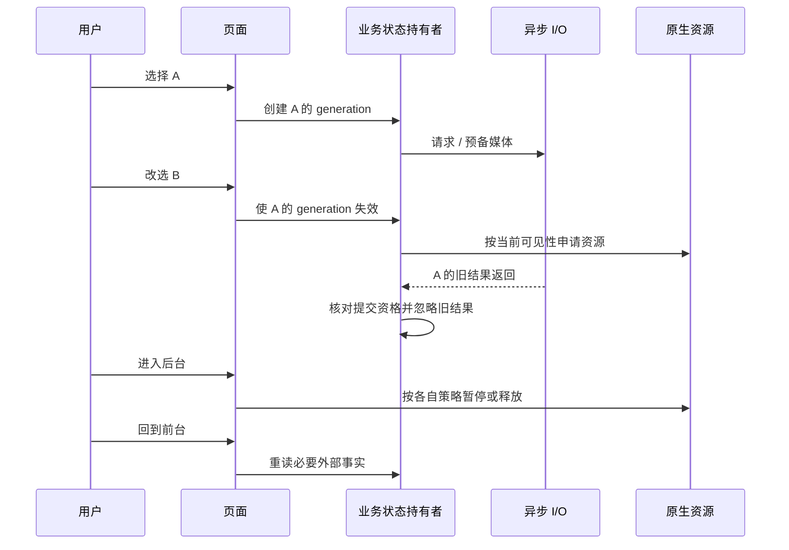

# 生命周期总览：同一画面背后的六条时间线

[返回首页](README.md) · [基础卡](foundations/async-lifecycle.md)

初学先读 [06 单个 State 的生命周期](beginner/06-lifecycle.md) 和 [07 参数变化](beginner/07-config-updates.md)。本页用于之后比较多层生命周期，不要求第一遍就画出六条时间线。

这是一张教学地图。具体创建、暂停、恢复与释放动作，以四个专题中的源码链为准。

## 六种生命周期不能混成一个

| 层次 | 回答的问题 | 常见入口或标记 | 学习入口 |
| --- | --- | --- | --- |
| Widget / State | 这个位置是否仍用同一个 State？ | `initState`、`didUpdateWidget`、Key、`dispose` | [Portrait](modules/portrait.md) |
| 路由与可见性 | 页面还在树中吗？是否真正可见？ | route push/pop、mode、overlay、可见性策略 | [Moment](modules/moment.md) |
| 业务 session | 当前结果属于哪个选择和数据版本？ | session identity、`petId`、revision、epoch、lease | [Portrait](modules/portrait.md)、[Moment](modules/moment.md) |
| App 前后台 | 能否依据旧的网络和渲染状态继续工作？ | `didChangeAppLifecycleState`、resumed、observer | [Wi-Fi](modules/wifi.md) |
| 原生资源 | Decoder / Surface / receiver 现在归谁管理？ | surface attach/detach、player dispose、install receiver | [Portrait](modules/portrait.md)、[App Update](modules/app-update.md) |
| 进程与持久化 | 内存全部丢失后，靠什么重建事实？ | checkpoint、persisted attempt、安装状态回读 | [Moment](modules/moment.md)、[App Update](modules/app-update.md) |

“页面没销毁”不能推出“画面可见”；“State mounted”不能推出“请求仍属于当前宠物”；“播放器存在”不能推出“Surface 仍可用”；“进程活着”也不能推出“Wi-Fi 证据仍新鲜”。

## 用一条时间线练习

下图是**故障推演**，不是对当前实现所有分支的保证：

看代码时逐条确认箭头。某一层没有实现对应动作，就不能把这张教学图当成已交付行为。

## 状态所有权检查表

拿一张纸写下一个对象的五件事：

| 项目 | 要填的内容 |
| --- | --- |
| 创建者 | 构造函数在哪里被调用？ |
| 持有者 | 是页面字段、App 字段还是持久化记录？ |
| 失效事件 | dispose、选项切换、失去授权、revision 更新、进入后台中的哪些？ |
| 释放者 | 谁移除 listener、cancel Timer、close client、detach surface？ |
| 恢复凭据 | 恢复靠当前 API、已校验缓存、generation，还是已落盘 attempt？ |

如果创建者和释放者不同，要找到明确的所有权交接。不能看到一个 `dispose()` 就假定整条链已释放。

## 三个反例题

1. 页面还 mounted，请求 A 就一定能更新 UI 吗？
2. 取消 Timer 就能取消已经开始的 HTTP 请求吗？
3. 安装时进程退出，重新启动后只看内存布尔值够吗？

参考答案

1. 不够。当前选择可能已变，必须另外验证业务 generation / identity。
2. 不够。Timer 只控制尚未触发的回调；正在进行的操作需要自己的取消机制或结果提交门。
3. 不够。跨进程恢复要依赖持久化意图以及 Android 的安装状态和已安装包身份回读，见更新专题。

