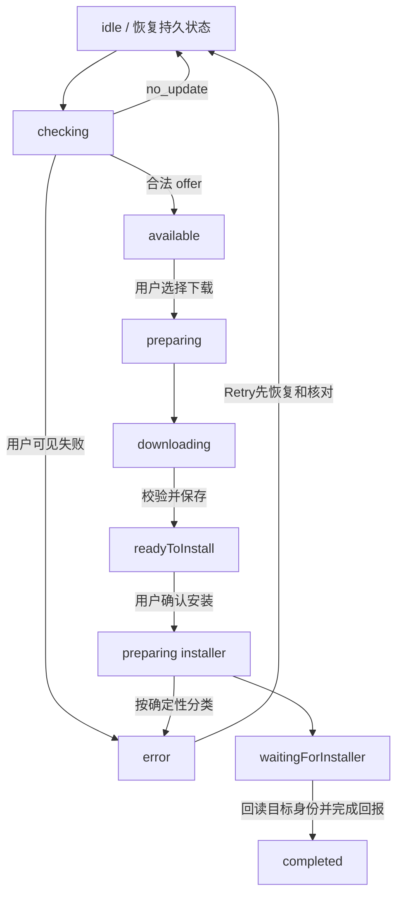
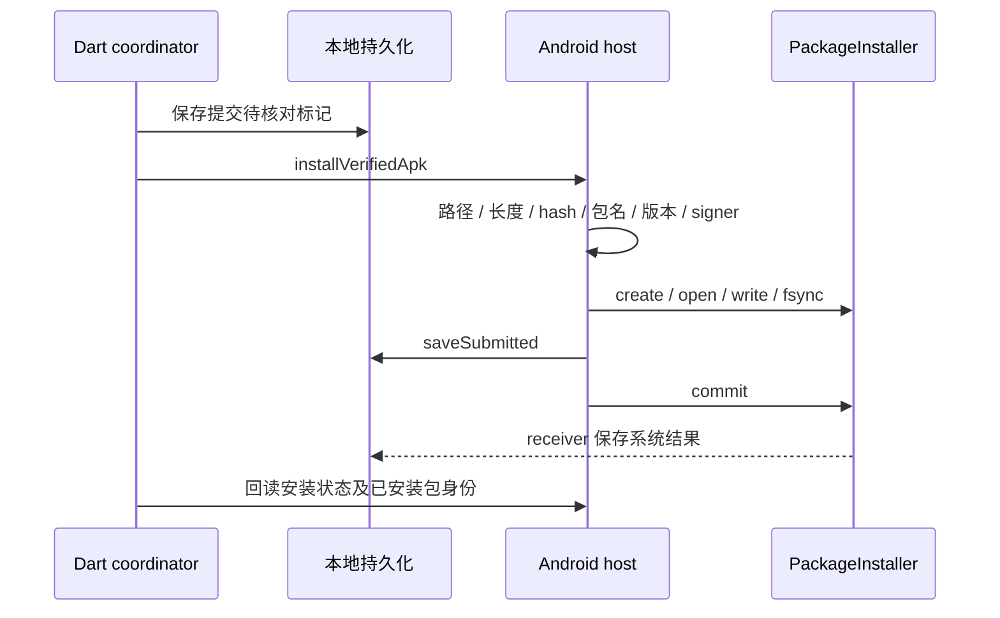

# App Update：把跨进程升级看成可恢复的状态机

[返回首页](../README.md) · [Wi-Fi](wifi.md) · [基础：更新与一致性](../foundations/updates-trust.md)

学习快照：2026-09-09 当前源码工作区（含未提交改动）。本篇解释 App APK 更新；Android / Allwinner 系统固件 OTA 不在这条实现链内。当前行为与验收状态回到 [App Update owner](../evidence/source-map.md#source-b14673fdce)，不由本篇维护。

## 1. 核心问题

下载只是其中一步。一次更新还需要发现合适版本、确认身份、持久化尝试、向 Android 提交、等待系统确认、跨进程恢复并回报服务端。任何一步都可能遇到断网、回包丢失或进程替换。

阅读时重点回答：**已经发生了什么，哪一方能证明，下一次 Retry 可以重做哪一步？**

## 2. 源码主链

| 层 | 文件 / 符号 | 责任 |
| --- | --- | --- |
| 组装 | [main.dart](../evidence/source-map.md#source-e61eb31d01)：`FrameAppUpdateController` | 注入 API、platform、downloader 和设备身份解析 |
| App 接线 | [frame_app.dart](../evidence/source-map.md#source-95e8dab761)：`_handleAppUpdateWifiChanged` | App 前后台与 Wi-Fi observer 驱动请求准入 |
| 协调 | [controller](../evidence/source-map.md#source-2dca7594fe)：`FrameAppUpdatePhase`、`_PersistedUpdateAttempt` | UI phase、尝试持久化、重放、安装恢复 |
| API | [repository](../evidence/source-map.md#source-df8b06d269)：`FrameAppUpdateRepository` | check、download-ticket、attempt events 的客户端请求 |
| 下载 | [downloader](../evidence/source-map.md#source-cff9022b11)：`HttpFrameAppUpdateDownloader` | 文件下载、长度/hash 校验、进度 |
| 平台桥 | [platform](../evidence/source-map.md#source-3b58bc259c)：`AndroidFrameAppUpdatePlatform` | 下载文件、协调状态、安装状态、安装动作 |
| Android | [host](../evidence/source-map.md#source-add2a0c82e)：`FrameAppUpdateHost` | 私有缓存路径、APK 身份复核和系统安装接入 |
| 原生提交 | [submission](../evidence/source-map.md#source-0318a5d1ab)：`submit` | write/fsync/persist/commit 的顺序和不确定性分类 |
| 安装回执 | [receiver](../evidence/source-map.md#source-2cfb9e5af4)：`FrameAppUpdateInstallReceiver` | 保存系统安装结果，供协调器重新读取 |

服务接口客户端使用 `/frame-update/v1` 下的 `device/check`、`device/releases/{releaseId}/download-ticket`、`device/attempts/{attemptId}/events`。这些是协议路径，不包含服务器地址；本篇没有核验本轮实时后端。

## 3. 先区分五种身份

| 字段 | 作用 | 不能拿来代替什么 |
| --- | --- | --- |
| `releaseId` | 哪次发布的 offer | 具体设备的一次尝试 |
| `installSessionId` | 客户端持久化的更新关联标识 | Android 数字 sessionId |
| `attemptId` | download-ticket 返回的服务端尝试 | release、原生安装 session |
| Android `sessionId` | PackageInstaller 创建的安装会话 | 后端 attempt |
| `eventId` + `sequence` | 同一尝试里的事件身份与顺序 | 每次网络请求都新建的无关事件 |

模型定义见 [frame_app_update_models.dart](../evidence/source-map.md#source-07808b3663)。把这些 ID 都叫“session”会丢掉它们跨系统的归属。

## 4. 状态与用户动作

这是主路径的压缩图，`error → I` 表示回到恢复逻辑，不意味着把内存/文件清空。`preparing installer` 是图中的解释名称，代码仍使用 `preparing` phase。

`available` 时 Later 通过 `_suppressCurrentPrompt` 收起自动弹层，保留 assignment。下载后 Later on 保留 attempt 与已校验文件。Settings → Device → Firmware 复用同一个 controller，因此“关闭弹层”不会被误当成“取消更新事实”。

## 5. 生命周期：更新不属于某个弹层

| 对象 / 工作 | 开始 | 恢复与结束 |
| --- | --- | --- |
| controller | main 组装，App 调用 `start()` | 由生产 App 的 `onDispose` 释放 |
| 检查 Timer | 成功检查或可重试失败后安排 | `_scheduleCheck` 替换旧 Timer，dispose 取消 |
| installer poll | 等待原生结果时安排 | 读取既有安装事实；不自动新建安装 |
| App lifecycle observer | `start()` 注册 | resumed 有 attempt 时请求恢复；dispose 移除 |
| persisted attempt | 开始更新后保存 | ACK 与平台清理完成后才清理内存归属 |
| 原生 session / receiver | 明确安装动作建立 | 原生系统结果跨越 UI 和进程生命周期 |
| downloader HTTP client | main 创建 | 生产 `onDispose` 关闭 client |

`dispose` 中取消 Timer、阻止后续 UI 通知，不等于任意已发起平台操作都已取消。需要追到底层所有者。特别是安装提交后，不能靠 Flutter 页面释放撤销已经被 Android 接受的效果。

## 6. 网络准入、互斥和退避

源码事实：`start()` 先恢复本地记录；发现新 offer 前，`_checkForUpdate` 需要 `setNetworkReady(true)` 和可解析的设备身份。App 的准入来自“在前台且 observer 判为 connected”。这只允许尝试服务请求，不保证服务可用。

成功检查按 `nextCheckAfterSeconds` 安排下次检查。临时失败使用 `_scheduleCheckRetry` 退避；网络恢复可以补偿失败，但不能把成功检查的服务端间隔任意缩短。

`_runExclusive` 防止同时执行两条操作；`_automaticWorkPending` 合并碰到忙碌状态的自动通知。前者避免重入，后者防止网络恢复通知被静默丢掉。成功检查会清掉已被本次结果覆盖的通知，避免紧跟第二次检查。

教学推导：**互斥负责一次只做一件事；合并负责重要的唤醒不会丢；准入和到期时间负责现在应不应该做。**

## 7. 下载到安装之间的持久化顺序

`_downloadUpdate` 读取 ticket，核对 release、target、attempt 和有效期；保存 attemptId，记录下载开始，执行下载。得到已校验文件后，先保存 `downloadedApk`，再回报完成/hashVerified 并显示 `readyToInstall`。

`_submitDownloadedUpdate` 在平台调用前先保存 `package_installer_commit_unconfirmed`。如果进程刚好在跨平台调用中消失，下次启动不能把缺少回调解释成“从未提交过”。

提交 helper 在尝试 commit 前失败，会处理尚未提交的 session 清理；尝试 commit 后遇到异常保留不确定状态，不把它降格为普通准备失败。`close()` 只释放句柄，不能把 commit 后的 close 失败解释成重新提交授权。

## 8. 同样显示 Retry，允许的动作却不同

| 情形 / 搜索符号 | 保留什么 | 下一步与边界 |
| --- | --- | --- |
| `package_installer_prepare_failed` | APK、attempt、错误 | 显式 Retry 重读 Android 状态，确认资格后再提交 |
| `apk_signer_missing` | 已下载 APK、原 attempt | 显式 Retry 再读证书；不能绕过 signer 校验 |
| `package_installer_commit_unconfirmed` | 原归属与 APK | Retry 核对既有结果，不新建安装 session |
| `package_installer_cleanup_unconfirmed` | 原归属与 APK | 清理未证实，不能继续制造新会话 |
| signer/hash/package/version 明确不符 | 记录确定拒绝 | 走终态，不把安全拒绝变成保留式安装重试 |
| `kiosk_` 错误 | `readyToInstall`、attempt、APK | 安装器安全准入失败；明确点击才再次尝试 |
| `offer_no_longer_applicable` | 先完成旧尝试收尾 | 当前实装可能更高，不能回装旧目标或误报旧目标成功 |

Android 10 archive 读取的项目适配见 [FrameAppUpdateArchiveReader.kt](../evidence/source-map.md#source-e7a423158c)：请求 `GET_SIGNATURES` 与 `GET_SIGNING_CERTIFICATES`，实际校验仍读当前 signer。具体平台历史原因由 owner 的固定 AOSP 引用解释。

## 9. ACK 丢失与安装成功是两个问题

`_reportIfNeeded` 先把完整 `queuedEvent`（eventId、sequence、payload）持久化，再发送。`_flushQueuedEvent` 校验 receipt，成功后先更新内存 acknowledged state、清空 queuedEvent，再保存。未收到 ACK 时仍保留原事件重放；若 ACK 已收到但保存失败，同进程内存已前进，不能保证立即重放。进程重建后从旧持久记录恢复时，才重新发送原 eventId 和 payload。阅读恢复测试时必须区分这两个时间点。

`_continuePersistedAttempt` 优先恢复事件和核对当前安装身份。PackageInstaller 的 succeeded 状态仍需要等待读到准确目标包身份，才进入 `_confirmInstalledApp` 的成功回报。

这里的 `healthConfirmed` 是当前实现的身份回报，不能替代播放恢复、长期运行或真实用户可见验收。源码里名称包含 health，不代表已做完整业务健康检查。

## 10. 结合现有测试阅读

本轮只把测试作为检索入口，未重跑产品测试。

| 文件 | 搜索测试名 / 片段 | 学什么 |
| --- | --- | --- |
| [controller tests](../evidence/source-map.md#source-3a278e482c) | `offline startup waits for Wi-Fi before resolving or checking` | start 与网络准入分别发生 |
| 同上 | `binding and service retry at 30 and 60 seconds then honor interval` | 失败补偿与成功间隔 |
| 同上 | `prepare failure retains the verified APK until explicit Retry` | 准备失败保留和明确动作 |
| 同上 | `Retry after a prepare failure requires successful Android readback` | 旧 retry 标记不能永久授权 |
| 同上 | `pending event ACK save failure replays the same durable event after restart` | 同事件重放与持久化不确定 |
| [App network tests](../evidence/source-map.md#source-4662a48519) | `FrameAppUpdateController` | App 到 observer/controller 的接线 |
| [Firmware tests](../evidence/source-map.md#source-dca3a09fbe) | `Check for updates` | Settings 与更新协调器共享状态 |

## 11. 自测与实验

1. 为什么 `start()` 不应直接等同于“已经请求后端”？
2. 为什么 Later 不清除 assignment？
3. `readyToInstall` 与 Android 安装授权差在哪？
4. 为什么 `apk_signer_missing` 和 `apk_signer_mismatch` 恢复不同？
5. commit 抛异常，重新下载再安装能解决不确定性吗？
6. event ACK 丢失时，重新生成 eventId 为什么可能重复？

参考答案

1. start 恢复本地状态；新检查还受网络、身份和未收尾 attempt 等准入控制。
2. Later 是展示选择，Firmware 仍需读取和继续同一个 offer。
3. ready 仅代表下载校验阶段；host 还要复核输入并进入系统安装流程。
4. 前者是证书读取缺失，可在明确重试后重新校验；后者是身份明确不符，不能放行。
5. 不能。新文件无法证明之前的 commit 有没有被系统接受，仍应查询既有事实。
6. 服务端可能已经接受旧事件；新 ID 会把一次事实变成新的业务事件。

练习（除独立 Dart lab 外，本轮未执行）：在 controller tests 选一个断网或 ACK 保存失败用例，列出 fake platform/api 每次调用前后保留的 attempt、eventId 和 phase；再预测插入一次 dispose 会改变哪一步。若操作真实更新或设备，需回到项目的命令与验收边界。

下一步：[异步](../foundations/async-lifecycle.md) · [网络](../foundations/networking-android.md) · [一致性](../foundations/updates-trust.md) · [复盘卡](../review/note-template.md)
