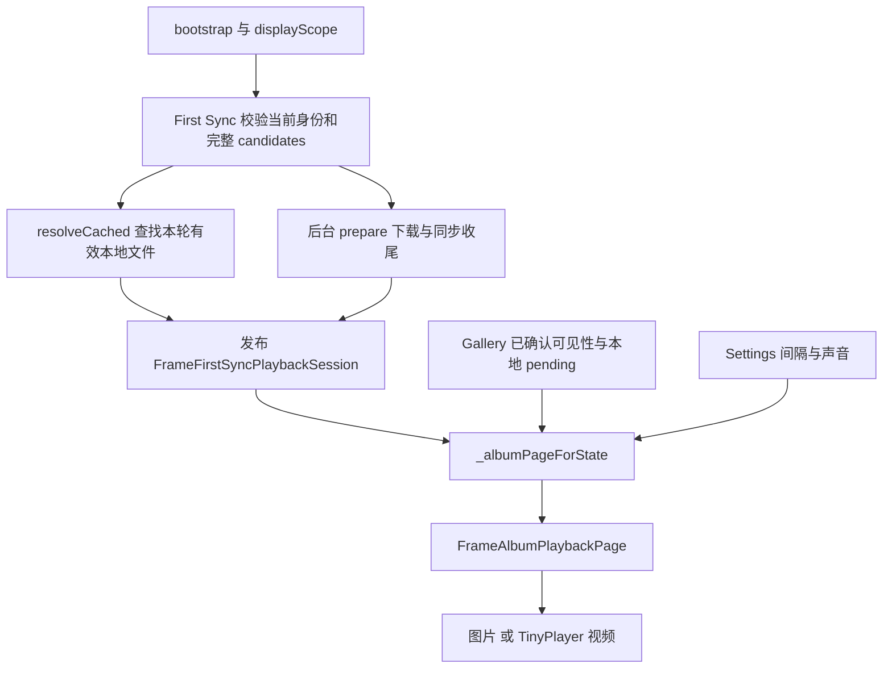
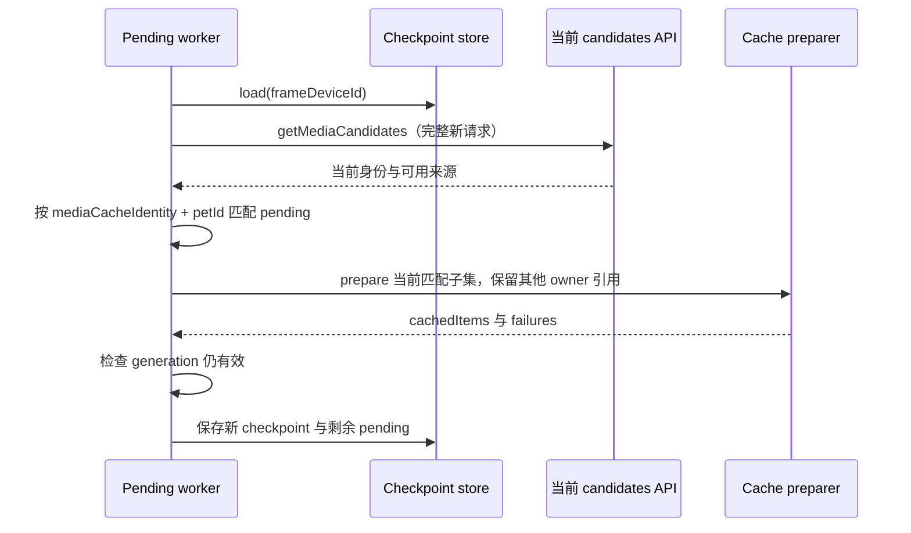

# Moment：从一组媒体到连续、可恢复的播放

首次阅读先看 [短导读：一张照片怎样暂停与恢复](../beginner/guided/moment.md)。本专题供你在掌握小例子后按问题深入查阅。

> 学习快照：2026-09-09 工作区。本文用当前源码讲解设计与推演方法；当前行为、验证状态、延期项以 [Data Transfer owner](../evidence/source-map.md#source-83200d27ef)、[Gallery owner](../evidence/source-map.md#source-0a00066c7d)、[Settings owner](../evidence/source-map.md#source-fcd62b8e37) 为准。本轮只阅读源码与测试，没有执行测试或设备实验。

## 先建立三个不同的概念

用户说的 Moment，在这个 Frame 项目里跨越多个模块，并没有一个包办全部行为的 `moment/` 目录。

| 你看到的概念 | 当前代码映射 | 它负责什么 |
| --- | --- | --- |
| 首页的照片、视频轮播模式 | [FramePlaybackMode.memorySlideshow](../evidence/source-map.md#source-2dede5f35f)，持久化值 `memory_slideshow` | 选择首页播放哪一类内容 |
| Moment 中包含哪些照片、哪些显示或隐藏 | [FrameGalleryPage](../evidence/source-map.md#source-d2b4879401)、`FrameGalleryVisibilityController` | 管理照片可见性；Gallery 不负责删除媒体，也不能代表所有视频的管理目录 |
| 真正的轮播、下载、缓存 | [frame_album](../evidence/source-map.md#source-e11368de0f)，核心 `FrameAlbumPlaybackPage` | 消费经授权的播放队列，展示图片或播放视频 |

`FrameAlbumItemSource.momentId` 是来源 Moment 的身份，`mediaId` 是来源媒体身份，`FrameAlbumItem.id` 是候选项身份，`petId` 是宠物归属。看到几个 `id` 时，先找各自的业务实体，不要凭同名就合并。

本章要解决的难点是：**服务器决定本轮可播放的内容，缓存决定从哪里读取字节，Widget 决定如何保持当前播放连续；三个决定怎样协作，又怎样防止互相越权。**

基础补课入口：[异步与生命周期](../foundations/async-lifecycle.md) · [媒体与渲染](../foundations/media-rendering.md) · [存储与身份](../foundations/storage-identity.md)。

## 一次用户操作怎样走到像素

建议先在 [frame_routes.dart](../evidence/source-map.md#source-83653d89db) 搜索 `_albumPageForState`，再反向找 session 来自哪里。

1. 首页由 `ShellRoute` 创建 [FrameHomeShell](../evidence/source-map.md#source-312b7f3e18)，同时获得 `portraitContent` 与 `albumContent` 的构建描述。
2. 用户选择轮播模式后，Shell 调用 `FrameSettingsController.setPlaybackMode`；持久化模式与 UI 切换在这里协调。
3. `_FrameContentSwitcher` 用 `KeyedSubtree(ValueKey<bool>(showAlbum))` 只挂载选中的媒体子树。退出模式会回收旧播放器 State；普通顶栏变化保留当前 child 身份。
4. `_albumPageForState` 从 `FrameFirstSyncSessionStore.sessionFor(frameDeviceId: ...)` 取 session，同时监听 Settings、Gallery `playbackChanges`、session 更新。
5. 路由调用 `filterPlaybackItemsByOwnership` 或 `filterCachedItemsByOwnership`，过滤本轮可见、归属正确的媒体，再交给 `FrameAlbumPlaybackPage`。

因此不能把“从 Portrait 切到 Moment”理解为一定进入一个独立 `/moment` 路由；这里主要是 Home Shell 内的媒体模式切换。



## 同步为何分“可以播”和“全部处理完成”

真正主链在 [frame_first_sync.dart](../evidence/source-map.md#source-886fe19d83)，媒体请求接口是 [FrameSyncApi.getMediaCandidates](../evidence/source-map.md#source-1b1d9f5b4b)。不要因为旧的 `frame_album_repository.dart` 存在 `getManifest`，就将它当作当前首次同步主入口。

阅读 First Sync 的 `authoritativeCandidates`、`_matchesMediaIdentity`、`_hasOnlyAuthoritativeHttpsAlbumMedia` 与 `_publishPlaybackReady`，可以把过程分成两段：

| 阶段 | 要回答的问题 | 对当前画面的作用 |
| --- | --- | --- |
| 首次发布前 | 本轮身份、displayScope、候选媒体归属与网络引用是否成立？哪些当前文件可以直接命中？ | 满足准入后可发布 session，本地命中与当前 HTTPS 可以混合使用 |
| 后台收尾 | 剩余媒体下载、校验、缓存、report、checkpoint 是否完成？ | 增强同一 session 的本地资源，不应让正在看的视频重新开始 |

[FrameAlbumMediaCachePreparer.resolveCached](../evidence/source-map.md#source-4c34a86877) 只查当前 candidates 对应的受管文件。它不下载、不刷新 URL、不清理缓存、不更新 LRU/index；命中失败仍保留当前 candidates 的网络来源。

`prepare` 才承担完整缓存准备；`restoreCached` 则按恢复约束重建有效本地集合。三个方法都返回数据，但副作用权限不同。看到相近名称时，要问“它能不能写盘”，不能只问“它返回什么”。

在线 `albumPlaybackItems` 保留本轮 candidates 的集合和顺序；部分缓存命中不会把队列缩成命中的几张。[播放页的 `_cacheFirstPlaybackItems`](../evidence/source-map.md#source-e11368de0f) 逐项匹配 `petId + mediaCacheIdentity + id + mediaType`，仅替换文件来源。

播放页之后仍执行 `_imageFirstPlaybackQueue`：找到第一张图片，将队列循环旋转到该图片开头，保留其余环形顺序。它不是按媒体类型重新排序全部条目。

容易误读的状态是 `FrameFirstSyncPlaybackPhase.cacheReady`：这里描述 Portrait runtime 的完整性。**看到它不能推出 Moment 已经全部下载，也不能推出 report/checkpoint 已完成。**

补课：[状态建模与异步结果的语义](../foundations/async-lifecycle.md)；重点理解一个状态名字为什么不能替代多个独立条件。

## 图片和视频共用页面，但前进条件不同

主要阅读 [frame_album_playback_page.dart](../evidence/source-map.md#source-e11368de0f) 的 `_syncActivePlaybackPolicy`、`_handleVideoCompleted`、`_togglePlayback`。

| 事件或状态 | 实现中的判断 | 学习要点 |
| --- | --- | --- |
| 当前为图片 | 有至少两项、未暂停、未拖动且间隔不为 `null` 时，建立图片计时器 | 自动换页是页面级策略 |
| 当前为视频 | 建立最大播放时长计时器；`TinyPlayerState.completed` 也可触发前进 | 正常结束事件与时间上界是两条路径 |
| 间隔为 Never | `imageDisplayDuration == null` 禁止自动前进；视频仍可正常播放 | “不自动换页”与“用户暂停视频”不是同一状态 |
| 单项队列 | 不建立自动换页计时；关闭页面滑动；视频结束后显示 ended 语义 | 边界条件不能依赖取模自动解决 |
| 用户点击 | `_isUserPaused` 变化，取消或重建页面计时；视频调用 pause/resume | 暂停意图应独立于反馈图标是否还显示 |
| 用户手动拖动 | `ScrollStartNotification` 取消计时，`ScrollEndNotification` 按当前状态重新建立 | 手势生命周期与计时器不能各自推进页面 |

图片恢复后的计时是重新调用策略建立的间隔，并不是一个记录剩余秒数的倒计时。当前媒体仅从网络升级为缓存时则不同：队列身份未变，既有截止时间得到保留。

生产路由传入 `settings.slideshowInterval.duration`，不能把播放页构造器的默认图片时长直接写成产品默认值。设置枚举与默认解析行为在 [FrameSlideshowInterval](../evidence/source-map.md#source-2dede5f35f)。

视频默认最大时长来自播放页；当前路由没有将 `FrameAlbumDisplayPolicy.maxVideoSeconds` 直接传入此构造参数。练习追踪“字段存在”与“调用链实际消费”之间的区别。

## 身份稳定，才可能保持播放连续

[FrameAlbumPlaybackItem](../evidence/source-map.md#source-e11368de0f) 明确区分两个比较：

- `hasSameMediaIdentity` 比较 `petId`、`mediaCacheIdentity`、`id`、`mediaType`，回答“是不是同一业务媒体”。
- `hasSamePlaybackContent` 再比较 `playbackSource`，回答“是否连当前读取来源也相同”。

`didUpdateWidget` 和 `_samePlaybackQueue` 使用媒体身份判断队列变化。当网络来源升级成本地、或同一内容续签 URL 时，`_activeSource` 保留当前来源，让正在播放的视频和图片停留时间继续；后续自然进入该项时再使用新来源。

同 scope 的 session revision 改变也不应整体重建播放器。[`_albumPlaybackSessionIdentity`](../evidence/source-map.md#source-83653d89db) 按 Frame 与 displayScope 建 key，把同 scope 的内容变化交给播放页逐项对账。

若当前项仍在新队列，保留它的索引映射；如果当前身份消失，选择新列表首项并清除旧暂停/结束状态。`_queueGeneration` 让旧的 post-frame 回调不能修改新队列，`_queueReanchorPending` 暂停旧拖动页差的应用。

反例：宠物 A 与 B 恰好都有 `id=photo-1`，甚至引用同一个物理缓存文件。只比较 `id` 或路径会错误保留 A 的暂停/播放状态；`petId` 必须属于播放身份的一部分。

补课：[Widget 身份与媒体资源](../foundations/media-rendering.md)；[业务身份、内容身份与物理文件](../foundations/storage-identity.md)。

## 四层生命周期要分别查

| 层级 | 创建/变化/结束的证据入口 | 不可混淆的边界 |
| --- | --- | --- |
| 播放页面 | `initState`、`didUpdateWidget`、`dispose`、`_videoAdvanceTimer`、`PageController` | Widget dispose 会取消本页计时器，但它不是所有后台任务完成的证明 |
| 视频 surface | `_FrameAlbumVideoPlayerState`、`_sourceOperationGeneration`、`_soundPolicyGeneration` | 每个视频 surface 有独立 controller；失活调用 stop，dispose 撤销订阅与 controller |
| Home/route | `FrameHomeShell`、`_FrameContentSwitcher`、`_albumPlaybackSessionIdentity` | 切模式销毁退出的媒体子树；同 scope 刷新交给媒体身份对账 |
| App/session/同步运行 | `FrameFirstSyncRunCoordinator`、pending scheduler、App 的恢复调度 | 页面不再显示，不代表网络 Future、文件提交或系统 wakeup 自动消失 |

`_configureAndPlay` 在设置声音后和 `play` 返回后都核对 source generation。否则“旧视频的异步配置终于完成”可能重新启动已经退出的媒体。用户若在准备期间点了暂停，`play` 返回后还要补做 `pause`，保留用户意图。

声音与 source 有不同 generation：调整音量只让旧声音任务过期，不应取消必须完成的首次 `play`；换 source 则同时废弃两类旧任务。

缩略图提取也有独立 `_thumbnailOperationGeneration`。本地视频提帧完成后要同时检查 mounted、generation 与来源，才能把结果提交到当前画面。

**源码观察边界：**`FrameAlbumPlaybackPage` 本身没有 `WidgetsBindingObserver`；Home 的 `didChangeAppLifecycleState` 清理 pointer 与浮层，不等于已经证明 Album 的计时器、原生音视频在后台全部暂停。要判断后台实际表现，还需继续追踪 TinyPlayer/Android host 并进行相应验证。

这就是为什么只说“已经写了 dispose”不能解释整个模块的生命周期。先列出资源所有者，再逐个问创建、失效、提交、清理发生在哪里。

## 下载失败后，为什么不能直接重试旧 URL

[FrameAlbumPendingDownloadEntry](../evidence/source-map.md#source-40e71fa779) 保存重试所需的媒体快照、reason、attempts、updatedAt；身份由 `mediaCacheIdentity` 与 `petId` 确定，恢复不能靠旧签名 URL。

[FrameAlbumPendingDownloadWorker.runOnce](../evidence/source-map.md#source-6146168e7f) 的流程可按下图阅读：



重新请求的意义有两个：更新可能过期的地址，确认该媒体现在仍被允许返回。远端已删除的项不应因为磁盘还有旧字节就重新进入本轮队列。

pending 是完整 catalog 的一个子集，所以 worker 使用 `preserveUnreferencedOwnerEntries: true`。若把“本次没处理的项”误判成“已删除的项”，重试一张失败图片就可能清理掉其他正常媒体。

`FrameFirstSyncRunCoordinator` 的 generation、`trackOperation` 与 `commitForGeneration` 约束旧任务发布和写盘。Reset/解绑相关的停止与排空合同继续查 [Data Transfer owner](../evidence/source-map.md#source-83200d27ef)，不能用简单 `mounted` 替代存储层提交资格。

离线播放路径由 `_albumPageForState` 在远程播放权限关闭时选用 `FrameAlbumPlaybackPage.cached`；它只能消费已接纳的本地集合。缓存命中不是账号、绑定或宠物选择的授权来源，完全离线冷启动准入仍属于 App/First Sync。

## Gallery 隐藏一张照片：草稿、持久意图、服务器确认

[FrameGalleryPage](../evidence/source-map.md#source-d2b4879401) 里有两层用户草稿：Manage Photos 的 `overlayDraft` 只在弹层内修改；Save 把结果合并为页面 `pagePending`；页面 Confirm 才调用 `replaceHiddenMediaIds`。

Moment 分组单击、长按都打开 Manage Photos；All Photos 预览的眼睛直接编辑页面草稿。不要把“选中 Moment”理解成“把整个 Moment 设为当前播放队列”。

[FrameGalleryVisibilityController](../evidence/source-map.md#source-320fb1f6cd) 则区分服务端 last-confirmed 和本地 `pendingVisibility`。后者是已持久化、等待联网同步的用户意图，和未 Confirm 的页面草稿不同。

| 具体场景 | 保存了什么、界面如何恢复 | 可检索符号 |
| --- | --- | --- |
| 离线隐藏已缓存照片并 Confirm | 先持久保存完整目录与 pending，成功后才更新 Album 过滤并清除页面草稿；提示稍后同步 | `_saveLocalVisibility`、`effectiveHiddenIds` |
| 本地写盘失败 | Confirm 失败，草稿与原播放事实保留；不能先隐藏再假装已保存 | `catalogStore.save`、`_confirmChanges` |
| 联网重试之前服务器已删除该照片 | 先 GET 对账，丢弃不存在的 pending 身份，不再 PUT | `syncPendingVisibility`、`_syncPendingScope` |
| 服务端已经与本地意图一致 | GET 即可确认 pending，无需重复 PUT | `_syncPendingScope` |
| GET/PUT 遭明确权限拒绝 | 撤销 scope 目录与待同步状态；不能伪装成普通离线继续使用旧目录 | `_revokeGalleryScope` |
| 管理目录仍有照片，但本地文件缺失 | 保留 Moment 身份和 failed 占位，不能变成已知 0 Moments；缺失项不可编辑 | `FrameGalleryCachedCatalog.resolve` |

[frame_gallery_catalog_cache.dart](../evidence/source-map.md#source-227b9b2daa) 的目录按可信 `bindingIdentity`、Frame、pet 隔离，不保存签名 URL 或绝对文件路径；媒体解析复用 `frame-album` 的文件。binding 变化同步增加 epoch，旧 GET 或写盘完成后不能发布到新绑定。

这能解释“隐藏没有立即影响播放”应先查哪里：是否只点了 Manage Save、是否到达 Confirm、持久保存是否成功、是否触发 `playbackChanges`、路由过滤是否收到正确 ownership。不要第一步就怀疑 PageView。

## 用现有测试学习设计，不背历史通过数字

本轮未运行下面的测试。它们是可检索的可执行规格；源码存在用例，不等于当前测试通过，更不能证明实体视频解码或触摸表现。

| 测试文件 | 精确测试名或可检索前缀 | 要先预测的结果 |
| --- | --- | --- |
| [frame_album_cache_lookup_test.dart](../evidence/source-map.md#source-dde4bff34e) | `lookup preserves authoritative image/video order and performs no cache writes` | 只读查找应保留什么，又不能修改什么 |
| [frame_album_playback_page_test.dart](../evidence/source-map.md#source-ab0b20ab1e) | `cache upgrade preserves photo deadline and uses next local file` | 同一媒体本地化后，本轮时限是否改变 |
| [frame_album_playback_page_test.dart](../evidence/source-map.md#source-ab0b20ab1e) | `a delayed old video setup cannot replay the replacement source` | 哪个 await 后的 generation 检查阻断旧播放 |
| [frame_album_playback_page_test.dart](../evidence/source-map.md#source-ab0b20ab1e) | `changing only companion ownership still replaces the queue` | 只改 petId 为什么也必须换队列 |
| [frame_album_download_queue_test.dart](../evidence/source-map.md#source-862c84709e) | `worker matches pending identity and attempts within the same pet ownership` | 失败次数为什么不能跨宠物继承 |
| [frame_gallery_offline_test.dart](../evidence/source-map.md#source-fbc0000dd6) | `offline Confirm survives process recreation and filters Album` | 哪些状态跨进程保留，哪些只是 UI 草稿 |
| [frame_gallery_offline_test.dart](../evidence/source-map.md#source-fbc0000dd6) | `binding change during reconnect discards old GET without pending PUT` | 旧网络响应为什么不能触发后续写请求 |

## 20 分钟学习实验：先预测，再读断言

这些实验本轮未执行。先在自己的学习笔记写下预测，再在项目源码中阅读对应测试；需要运行时遵守 [TEST Command Boundary](../evidence/source-map.md#source-5ab7526def)，复用项目已有 SDK 与 [bounded runner](../evidence/source-map.md#source-1e09c6e685)。

1. **5 分钟，查链路：**从 `_albumPageForState` 开始，手画 `session → visibility filter → widget`，在每条箭头旁写出参数名。完成标准：能解释 Gallery 完整目录与播放 candidates 为什么不同。
2. **5 分钟，推演缓存升级：**读 `cache upgrade preserves photo deadline and uses next local file`，遮住 expect，先写“当前图片剩余展示过程”和“下次进入来源”；再对照断言。
3. **5 分钟，推演竞争：**读 `a delayed old video setup cannot replay the replacement source`，标记旧 source 在哪个 await 被阻塞、新 source 如何让它过期。只删 `mounted` 或只删 generation，会分别留下什么问题？仅做纸面推演。
4. **5 分钟，推演持久化失败：**读 `FrameGalleryVisibilityController._saveLocalVisibility`，在 `catalogStore.save` 处假设抛错，沿调用栈写出草稿、播放隐藏集、pending 的最终归属，再与离线测试比较。

可直接执行的只读检索示例，在 Frame 源码仓库根目录使用 PowerShell；它只打印测试场景及紧邻的 setup，不启动 Flutter 或访问设备：

```powershell
Get-Content test/src/features/frame_album/frame_album_playback_page_test.dart |
  Select-String -Pattern 'cache upgrade preserves photo deadline|a delayed old video setup|changing only companion ownership' -Context 0,12
```

## 自测：不要看答案，先指出源码位置

1. `cacheReady` 到了，能不能报告全部 Moment 已离线可播？至少还需要核对什么？
2. 三个 candidates 只有一个缓存命中，首次在线 session 应该放一项还是三项？哪个方法保证匹配不串宠物？
3. 网络视频正在播放，新 session 给出同媒体的本地文件，为什么不立即替换 `_activeSource`？
4. Never 与用户暂停分别改变哪些行为？单项视频结束后为什么不能继续提供有效的播放切换动作？
5. 用户在旧视频 `_applySoundPolicy` 等待期间切了模式，`mounted` 与 generation 各能拦住哪种情况？
6. 离线 Manage Save 后直接退出，与 Confirm 后重启进程，分别保留什么？
7. 两只宠物共享物理文件，为什么 pending 恢复既需要 `mediaCacheIdentity` 又需要 `petId`？

<details>
<summary>参考答案：先用自己的话回答，再展开校对</summary>

1. 不能。phase 描述 Portrait 完整性；还要核对 Album 的当前授权集合、逐项有效缓存、Gallery 过滤结果与实际离线路径，不能以 phase 替代。
2. 三项，前提是它们通过本轮准入。`_cacheFirstPlaybackItems` 按四元组替换文件；命中影响来源，不改变权威集合。
3. 立即换 source 可能重播视频或重建图片计时。`_samePlaybackQueue` 用业务媒体身份维持当前过程，下次自然进入再用新来源。
4. Never 关闭自动换页，视频仍播放；用户暂停表达当前媒体的暂停意图。视频 ended 状态使 `_togglePlayback` 不再提供虚假的有效动作，单项也没有下一项可切。
5. `mounted` 拦截已经销毁的 State；generation 拦截仍挂载但旧 source/声音操作已被新操作取代的结果。实际换模式会回收旧媒体子树，source 更新也可能发生于同一个 State。
6. Save 只把弹层草稿交给 pagePending；未 Confirm 的退出受页面放弃草稿交互处理。Confirm 成功后由服务端确认或本地 durable pending 接管，进程重建仍可恢复后者。
7. 物理文件可共享，但播放资格与重试历史有宠物归属。只认文件 identity 会串用其他宠物的候选项、失败次数或快照。

</details>

## 来源与关键符号

此表便于以后定位和刷新学习快照；源码路径与符号是检索索引，不包含设备、账号、私有地址或源码正文。

| 路径 | 关键符号 |
| --- | --- |
| `lib/app/route/frame_routes.dart` | `_albumPageForState`、`_albumPlaybackSessionIdentity` |
| `lib/app/route/frame_home_shell.dart` | `FrameHomeShell`、`_FrameContentSwitcher` |
| `lib/src/features/settings/frame_settings_store.dart` | `FramePlaybackMode`、`FrameSlideshowInterval` |
| `lib/src/features/data_transfer/frame_first_sync.dart` | `FrameFirstSyncPlaybackSession`、`FrameFirstSyncRunCoordinator`、`_publishPlaybackReady` |
| `lib/src/features/frame_device_api/frame_device_repository.dart` | `FrameSyncApi.getMediaCandidates` |
| `lib/src/features/frame_album/frame_album_models.dart` | `FrameAlbumItem`、`FrameAlbumItemSource`、`mediaCacheIdentity` |
| `lib/src/features/frame_album/frame_album_cache.dart` | `FrameAlbumMediaCachePreparer`、`resolveCached`、`prepare`、`restoreCached` |
| `lib/src/features/frame_album/frame_album_playback_page.dart` | `FrameAlbumPlaybackPage`、`_configureAndPlay`、`hasSameMediaIdentity` |
| `lib/src/features/frame_album/frame_album_download_queue.dart` | `FrameAlbumPendingDownloadWorker.runOnce` |
| `lib/src/features/frame_album/frame_album_sync_state.dart` | `FrameAlbumPendingDownloadEntry` |
| `lib/src/features/gallery/frame_gallery_page.dart` | `_confirmChanges`、`_setPagePending` |
| `lib/src/features/gallery/frame_gallery_visibility.dart` | `_saveLocalVisibility`、`syncPendingVisibility`、`setBindingIdentity` |
| `lib/src/features/gallery/frame_gallery_catalog_cache.dart` | `FrameGalleryCachedCatalog.resolve` |
| `lib/src/features/data_transfer/README.html` | `moment-cache-first-playback` |
| `lib/src/features/gallery/README.html` | `offline-visibility` |
