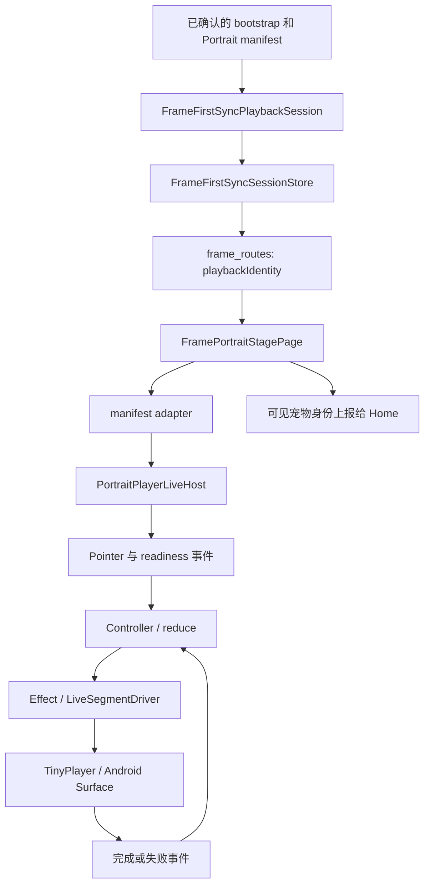
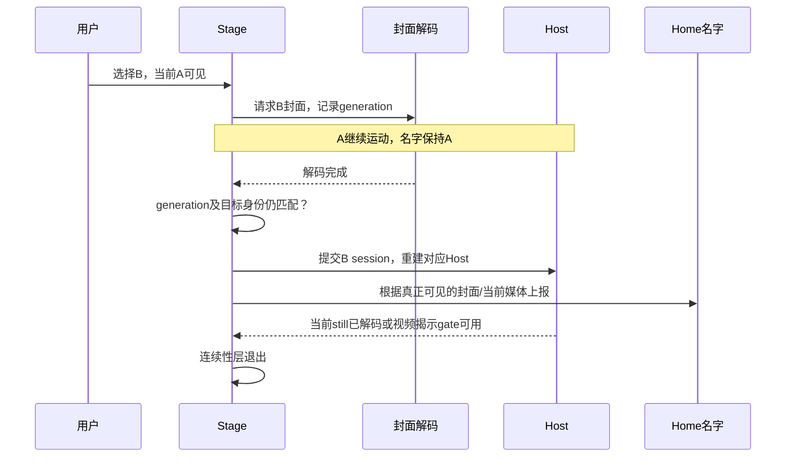
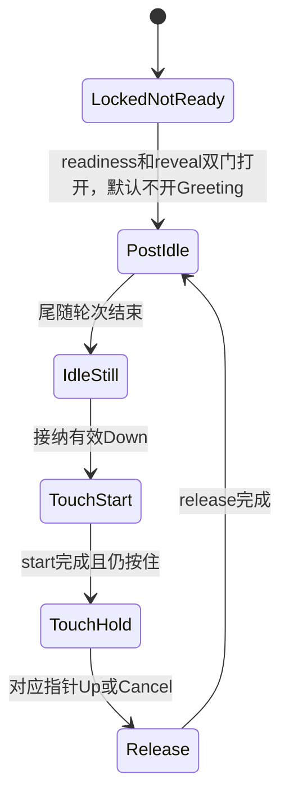

# Portrait：把“宠物会动”拆成可以推理的系统

> 学习快照：2026-09-09 当前工作区。正确拼写是 **Portrait**，不是 potrait。
> 本章解释源码中的设计及可迁移的知识，不维护产品验收状态。
> 当前行为与验证入口以 [Companion owner](../evidence/source-map.md#source-4c7d22fe13)、[HOME owner](../evidence/source-map.md#source-46f2776d39)、[Data Transfer owner](../evidence/source-map.md#source-83200d27ef) 和共享播放器 owner 为准。
> 本章没有运行测试、构建 APK 或操作设备；测试名称是阅读入口，实验是待做练习。

## 先带着三个问题阅读

1. 同一只宠物从网络播放升级到本地缓存，为什么不该重新播放开场动作？
2. A 正在运动，用户选择 B，但 B 的封面还没解码，此刻应显示谁的名字？
3. 页面还在，但旧 Future、旧触摸、旧原生事件迟到了，谁有权改变现在？

能回答这些问题，才开始理解 Portrait 的难点：**内容身份、画面连续性、异步提交权必须一致**。
视频解码只是其中一层。UI 选中了 B、业务 session 指向 B、屏幕真正显示 B，是三个时刻。

## 阅读地图：从 Frame 壳走到共享内核

| 顺序 | 文件与关键符号 | 负责回答的问题 |
| --- | --- | --- |
| 1 | [frame_routes.dart](../evidence/source-map.md#source-83653d89db)，`_portraitStagePageForState` | session 如何成为页面输入？什么变化会重建 Host？ |
| 2 | [frame_first_sync.dart](../evidence/source-map.md#source-886fe19d83)，`FrameFirstSyncPlaybackSession` | `networkReady` 和 `cacheReady` 分别描述什么？ |
| 3 | [frame_portrait_stage_page.dart](../evidence/source-map.md#source-c969a6cf62)，`FramePortraitStagePage` | 封面、恢复层、视频和可见身份怎样交接？ |
| 4 | [frame_portrait_manifest_adapter.dart](../evidence/source-map.md#source-12c9674a6e)，`framePortraitDependenciesFromManifest` | 服务端 manifest 怎样转换为共享运行时？ |
| 5 | [portrait_player_live_host.dart](../evidence/source-map.md#source-3b077ba16d)，`PortraitPlayerLiveHost` | 谁创建控制器、处理指针并释放资源？ |
| 6 | [portrait_player_controller.dart](../evidence/source-map.md#source-6f42997bd9)，`dispatch` | 事件怎样变成状态与播放副作用？ |
| 7 | [portrait_player_reducer.dart](../evidence/source-map.md#source-fae440641f)，`reduce` | 什么事件在当前状态有效？ |
| 8 | [live_segment_driver.dart](../evidence/source-map.md#source-7d3d8e4308)，`LiveSegmentDriver` | 业务动作怎样选择素材、驱动播放并回传结果？ |

**源码事实：** Frame adapter 解析 `fullPlayer`，创建 runtime manifest 与 runtime bundle，再交给 `PortraitPlayerLiveDependencies.fromRuntimeManifest`。
触区、动作变体和状态机主要由共享 `besideyou_client_core` 持有；Frame 页面不直接拼接所有触摸视频。

图是教学简化：缓存准备、事件订阅及错误路径并不都画在图中，实际顺序查对应方法。

## 难点一：至少有六种生命周期

| 生命周期 | 建立与结束边界 | 容易混淆的地方 |
| --- | --- | --- |
| Widget / Element / State | Flutter 根据树位置、类型和 key 更新或卸载 | `build()` 再执行，不等于播放器已经重新创建 |
| Route / Home 内容 | 路由壳与 Portrait、Moments 内容选择 | URL 相同，不保证同一媒体子树持续挂载 |
| 业务播放 session | Frame、pet、manifest revision 组合 | 缓存阶段或签名 URL 改变，不一定是新内容 |
| Host 依赖与控制器 | Host bootstrap、输入替换、dispose | 异步依赖完成时，接收它的 Host 可能已过期 |
| 播放请求与逻辑 player session | `requestId`、队列替换、失败 | 原生 ExoPlayer 被复用，也必须隔离旧逻辑事件 |
| Android View / Surface / codec | 平台视图挂载、输出可用性与底层解码器 | controller 存在，不代表有可用输出或屏幕已显示像素 |

**源码事实：** 路由构造 `frameDeviceId:petId:revisionKey` 作为 `playbackIdentity`，传给 Stage 的 `transitionIdentity`。
Stage 用 `ValueKey('frame-portrait-session-$transitionIdentity')` 标识共享 Host。
`networkReady → cacheReady` 不进入这个 key；同内容续签或缓存完成不会仅因为阶段变化重置播放状态机。

Stage 在 `initState` 固定 `_stableDependenciesLoader`。共享 Host 的 `didUpdateWidget` 会比较 loader identity。
因此，频繁变化的 readiness 只应刷新显示，不能每次构建都生成一个“看起来新了”的依赖加载回调。

**教学推导：** key 是资源生命周期的策略，不是解决所有刷新的万能开关。
为了“刷新一下”把时间戳塞进 key，会同时丢失当前动作、指针归属、队列与视图连续性。
先补 [异步与生命周期](../foundations/async-lifecycle.md) 中的 Element 身份、`didUpdateWidget`、资源所有权，再读这几行。

## 难点二：保持旧画面，等待新内容有条件接管

**源码事实：** `didUpdateWidget` 检测真实 transition 改变时，先调用 `_resolveTargetPoster`。
目标封面未解码期间，旧 Host 继续运动；不会一收到 B 的 manifest 就把 A 换成静帧。
解码完成后，`_commitPreparedSession` 再检查当前 Widget 的 transition，采用最新输入并交接 Host。
这样等待期间 B 恰好完成缓存时，也能使用最新来源，而不是重新拿早先捕获的签名 URL 启动。

如果 B 封面失败，Stage 仍允许 B 的已确认 session 启动，并保留此前可用封面保护加载过程。
如果此前也没有可见封面，就保留恢复面；选择了 `still` 或创建了 View 都不足以撤掉它。
`framePortraitVisibleCompanionForSurface` 在当前 session 像素未确认时保留 continuity poster 对应的身份。
因此，“画面还是 A，但标题先变成 B”是值得单独测试的数据与视觉不同步问题。

这里的“视频可揭示”有明确证据边界：

- Stage 收到 `playing` 且 `positionMs > 0` 时可打开 gate；`completed` 也可以。
- 缺少进度事件时，Stage 使用 `playing` 后的 350 ms 安全延迟。
- still 则等待共享 surface 的 `stillImageDecoded`。
- **这套显示策略不是硬件像素测量，也不等于 TinyPlayer interrupt 的原生首帧提交合同。**

`FramePortraitVisibleCompanionController.reporter()` 为每个 Stage 提供独立 lease。
旧 AnimatedSwitcher child 的 `dispose()` 只能清除自己的报告；旧回调不能覆盖新 Stage 的名字。
通知合并到 post-frame，避免图片同步命中缓存时在 build 过程中连锁修改 Home。

## 难点三：过期判断要保护“本次请求”，不只保护页面

**源码事实：** Stage 分别维护 `_posterGeneration`、`_dependencyLoadGeneration` 等代次。
共享 Host 另有 `_bootstrapGeneration`；reducer 以 `activeSegmentRequestId` 与 segment kind 匹配完成/失败事件。
这些标识保护的资源不同，不能随意合并成一个全局 `isLoading`。

| 竞争场景 | 需要检查什么 | 只检查 `mounted` 为什么不够 |
| --- | --- | --- |
| A → B → A，B 封面晚到 | poster generation 与当前 transition | 页面仍挂载，但 B 已不是用户目标 |
| B 的 dependencies 尚未完成又切 C | load/bootstrap generation | 同一 State 中已经开始了更新的加载 |
| 旧视频完成回调迟到 | `requestId` + active segment kind | 当前请求可能是下一次触摸的同类动作 |
| 旧 Stage 清理 Home 标题 | reporter lease 与报告代次 | 新 Stage 可能使用相同 pet 或 playback identity |
| 缓存校验期间重新绑定 | binding / selection guard 与 generation | 本地文件存在不能证明当前绑定仍有权使用 |

`ImageStreamListener` 只消费解码就绪信号时，也要释放收到的 `ImageInfo` handle。
代码先 `image.dispose()`，再判断回调是否过期；过期不代表这次回调没有取得资源。
Host 对晚到但未接纳的 dependencies 调用 `_disposeUnattachedDependencies`，这是同一原则。

**教学推导：** 取消旧结果的提交权，与取消真实 I/O 是两件事。
即使 Future 无法真正取消，也必须拒绝旧结果，并正确释放已经创建的资源。
练习时在每个 `await` 后问：“等待期间谁可能改变？继续写入前我验证了谁？”

## 难点四：一次触摸是一段有身份的动作

`InteractionBindingAdapter.canResolvePointerDown` 先判断能否接纳该指针，再进入触区与素材解析。
它保留 `_activePointer`，主指针的 Up/Cancel 负责收尾；其他手指不应积累成延迟播放队列。
controller 将输入送入 `reduce`，先更新 snapshot，再执行 `PlayTouchStart` 等 effect。
driver 通过 `onFinished` / `onFailed` 回传带 request identity 的事件，reducer 拒绝过期回调。

可先用下面的简化动作路径理解命名，再去读真实条件分支：

这是**教学路径**，不是完整状态图；真实 reducer 还处理 Greeting、ListenTilt、提前松手、失败和重新按下。解锁读取 `interactiveReady` 与 `revealCompleted` 的双门条件。
阅读时同时记录 `state`、`activePressId`、`activeSegmentRequestId`、pointer owner，避免只看状态名猜因果。
`IdleStill` 是正常静止状态；“静止且不接受下一次有效触摸”需要继续沿输入与请求链定位。

共享 Host 观察 App lifecycle：进入 hidden/paused/detached 记录 `_wasBackgrounded`。
恢复 resumed 后，若仍有 active segment，会清除接受的指针与待完成触摸响应，再派发对应 `PlaybackFailed`。
这不等于所有返回前台都重播开场；没有 active request 时该恢复路径直接返回。

## 难点五：复用播放器，需要保留逻辑隔离

Frame 的 `createFramePortraitPlayer` 调用共享 `createFrameVideoPlayer(reusePlayerOnQueueReplacement: true)`。
Android factory 同时请求 `requireVideoSurface: true`；App 根为路由树设置 `TinyPlayerViewScope` 的 Hybrid Composition。
前者约束输出可用性，后者选择平台视图合成方式；它们解决不同边界。

**源码事实：** TinyPlayer 的 `scheduleInterruptFirstFrameTimeout` 在 Frame 的 real-surface 路径累计 eligible wait。
`!pauseIntent && hasAvailableRealVideoOutput()` 才累计等待；预算为 5000 ms，耗尽调用真实失败路径。
暂停或输出不可用时停止累计，恢复后保留已消耗预算；这是 interrupt 的规则，不是所有下载或启动的统一超时。

**教学推导：** ExoPlayer 实例复用可以减少创建释放工作，但不能证明 codec 永不重建，也不能代替首帧等待。
固定 Host key 还不够：可选背景如果改变媒体子树层级，实际视频 Element 仍可能卸载。
所以连续性测试既要检查业务调用次数，也要检查实际媒体 probe 的挂载、释放以及后续更新。
涉及 Surface、codec、合成与首帧时，补 [媒体渲染基础](../foundations/media-rendering.md)。

## 难点六：缓存更新来源，不应重新定义内容或授权

`FramePortraitLiveVideoAssetStore.updateManifest` 只接受相同 Frame、pet、revision 和匹配的媒体引用集合。
它更新内存来源映射，旧 driver 的 alias 可以在后续 `materialize` 时解析到新签名或可信本地文件。
已经交给原生的当前队列不在这个更新方法里被 interrupt、seek 或替换；本地命中也不会被后续网络快照降级。
每次本地播放仍执行一次 `File.stat`，检查普通文件和非零长度；失效后抛出错误，不偷偷回退旧签名 URL。

`networkReady` 表示本轮被接纳的网络播放能力；`cacheReady` 描述 Portrait runtime 完整本地化。
它不能拿来证明 Moments 全部缓存完成，也不能替代离线绑定准入。
完整缓存与 SHA-256 校验主要在准备/恢复层，不能把播放前的非零 `stat` 误讲成完整内容校验。

`FrameOfflinePortraitStore.bindingKeyFor` 把 Frame id、绑定 pet id、bound-at 时间组合后散列。
相同 Frame 再次绑定也必须能区分；缺失可信绑定信息时，磁盘索引本身不能授权播放。
`restoreMixed` 从授权目录的 ready companion 尝试完整恢复，成功集合可以是本机可恢复子集。
它仍保留目录权威与本地选择的区别，不把离线点击冒充服务器成功的 PUT。

**教学推导：** 内容摘要回答“字节有没有变”，binding 回答“当前有没有权使用”，revision 回答“是否同一内容版本”。
三者不能互相替代。补 [存储与身份](../foundations/storage-identity.md)，再解释为什么“文件还在”不足以恢复旧宠物。

## 把测试当成可执行的设计问答

下面是当前源码中的真实测试入口；本章不转抄历史通过数量，也不声称本轮执行。

| 文件 | 可搜索的测试名称 | 它能帮助理解什么 |
| --- | --- | --- |
| [Stage tests](../evidence/source-map.md#source-2aa098367c) | `switch keeps the old moving host until the target poster resolves` | 切换期间保留旧运动层 |
| 同上 | `returning to the active companion cancels a pending poster switch` | A → B → A 的过期目标 |
| 同上 | `network poster localization retains the mounted video surface` | 同内容缓存升级的真实视图连续性 |
| 同上 | `repeated poster switches release decoded image handles` | 图片 handle 所有权 |
| 同上 | `same-transition rebuild while loading still reveals decoded content` | 合法加载不能因普通 rebuild 被错误拒绝 |
| 同上 | `equivalent video surface changes do not rebuild the stage host` | 更新范围与观察者去重 |
| [Asset store tests](../evidence/source-map.md#source-f9320751c0) | `missing trusted cache fails without using stale remote URL` | 缓存失效后的失败边界 |
| 同上 | `cross-frame, pet, revision, media and reference changes cannot remap active driver` | 媒体来源更新的身份约束 |
| [Factory tests](../evidence/source-map.md#source-658a01be8b) | `android Frame factory preserves session isolation on replacement` | 原生复用与逻辑 session 分离 |
| [Visible identity tests](../evidence/source-map.md#source-73ee6eb2f8) | `visible identity stays with the actual continuity poster` | 标题和可见画面一致 |

离线扩展阅读：[frame_offline_portrait_store_test.dart](../evidence/source-map.md#source-4dfe8d51ff)。
共享状态机扩展阅读：[portrait_player_reducer_touch_test.dart](../evidence/source-map.md#source-ff9505ca47)。
原生首帧与硬件限制回到 [TinyPlayer owner](../evidence/source-map.md#source-80523e2c42)；widget fake 不产生真实 GPU 证据。

## 本地学习实验：先预测，再看断言

1. **画身份时间线，约 15 分钟。** 阅读 Stage 的 A → B → A 用例，标出每次 generation、active session、poster owner。先预测 B 迟到时的标题，再看断言。
2. **比较两种更新，约 20 分钟。** 对比“同 revision 网络→本地”和“petId 改变”，写出 Host、driver、Surface 各自应保留还是释放。以媒体 probe 断言核对。
3. **模拟资源晚到，约 20 分钟。** 在独立学习测试中用 `Completer` 控制 dependencies 完成顺序，页面先退出再完成 Future，观察资源应由谁释放。
4. **追踪触摸闭环，约 25 分钟。** 从 reducer touch tests 选提前松手场景，逐步记 state、pressId、requestId 与 effects；再加入旧 `SegmentFinished` 并预测是否有效。

这些实验尚未执行；需要运行时遵循项目 TEST 的命令边界和 watchdog，使用 fake 与假时间即可，不依赖真实设备。

## 自测：合上源码能解释吗？

1. 为什么不能把 cacheReady 放进 Host key？

它是同内容的加载阶段。key 改变会让 Flutter 重建 Host，丢失动作与资源连续性；真实内容身份由 Frame、pet、revision 组合判断。

2. mounted 为 true，为什么还要检查 generation？

同一个 State 可以先后请求 A、B、C。mounted 只证明对象还在；generation 证明完成的是仍有提交权的那次请求。

3. B manifest 到达后，为什么 Home 可能仍显示 A 的名字？

如果可见画面仍是 A 的运动层或 continuity poster，名字就应保持 A。目标数据已到达不等于 B 像素已接管。

4. Stage 的 350 ms 与原生 interrupt 的 5 秒是一回事吗？

前者是 playing 后用于显示揭示的兜底延迟；后者是 real-surface interrupt 等待真实首帧时的有效等待预算。它们的触发条件、用途与证据强度不同。

5. 为什么忽略过期 ImageInfo 回调前仍要 dispose image？

回调已经取得一个 image handle。禁止旧回调修改状态，并不会自动释放它拥有的资源；显示 Widget 持有自己的 clone。

6. 同一宠物的视频文件还在，重新绑定后为何不能直接播放？

文件存在或摘要正确只证明资源事实。离线恢复还需要当前可信 binding、授权目录、revision 和提交 guard；旧磁盘记录不能建立新绑定授权。

## 来源路径与关键符号索引

下面仅列源码导航，不包含业务凭据、设备标识或媒体 URL。共享包路径以 workspace 根为基准，其余以 Frame repo 根为基准。

| 来源路径 | 关键符号 |
| --- | --- |
| `lib/app/route/frame_routes.dart` | `_portraitStagePageForState`、`playbackIdentity` |
| `lib/app/frame_app.dart` | `TinyPlayerViewScope`、`TinyPlayerAndroidComposition.hybrid` |
| `lib/src/features/data_transfer/frame_first_sync.dart` | `FrameFirstSyncPlaybackPhase`、`FrameFirstSyncPlaybackSession`、`FrameFirstSyncSessionStore` |
| `lib/src/features/data_transfer/frame_offline_portrait_store.dart` | `bindingKeyFor`、`restoreMixed`、`invalidate` |
| `lib/src/features/portrait_stage/frame_portrait_stage_page.dart` | `_FramePortraitSessionInputs.hasSameTransition`、`_resolveTargetPoster`、`_commitPreparedSession`、`_FramePortraitVisualReadinessController` |
| `lib/src/features/portrait_stage/frame_portrait_manifest_adapter.dart` | `framePortraitDependenciesFromManifest` |
| `lib/src/features/portrait_stage/frame_portrait_visible_companion.dart` | `framePortraitVisibleCompanionForSurface`、`FramePortraitVisibleCompanionReporter` |
| `lib/src/features/portrait_stage/frame_portrait_live_video_asset_store.dart` | `updateManifest`、`materialize` |
| `lib/src/features/portrait_stage/frame_portrait_player_factory.dart` | `createFramePortraitPlayer` |
| `lib/src/shared/media/frame_video_player_factory.dart` | `createFrameVideoPlayer`、`requireVideoSurface` |
| `packages/besideyou_client_core/lib/src/portrait_player/presentation/portrait_player_live_host.dart` | `_bootstrapDependencies`、`_disposeUnattachedDependencies`、`_recoverActiveSegmentAfterBackground` |
| `packages/besideyou_client_core/lib/src/portrait_player/presentation/interaction_binding_adapter.dart` | `canResolvePointerDown`、`_activePointer` |
| `packages/besideyou_client_core/lib/src/portrait_player/application/portrait_player_controller.dart` | `dispatch`、`_executeEffects` |
| `packages/besideyou_client_core/lib/src/portrait_player/domain/portrait_player_state.dart` | `TouchStart`、`TouchHold`、`Release`、`PostIdle` |
| `packages/besideyou_client_core/lib/src/portrait_player/domain/portrait_player_reducer.dart` | `reduce`、`_matchesActiveSegment` |
| `packages/besideyou_client_core/lib/src/portrait_player/presentation/live_segment_driver.dart` | `LiveSegmentDriver`、`_playbackGeneration` |
| `packages/tiny_player/android/src/main/kotlin/com/example/tiny_player/TinyPlayerPlayerHost.kt` | `scheduleInterruptFirstFrameTimeout`、`updateInterruptPlaybackWaitBudget`、`INTERRUPT_ELIGIBLE_FIRST_FRAME_TIMEOUT_MS` |

owner 文档来源：`lib/src/features/companion/README.html`、`lib/src/features/home/README.html`、`lib/src/features/data_transfer/README.html`。上表和正文测试链接共同构成本章复核入口。
