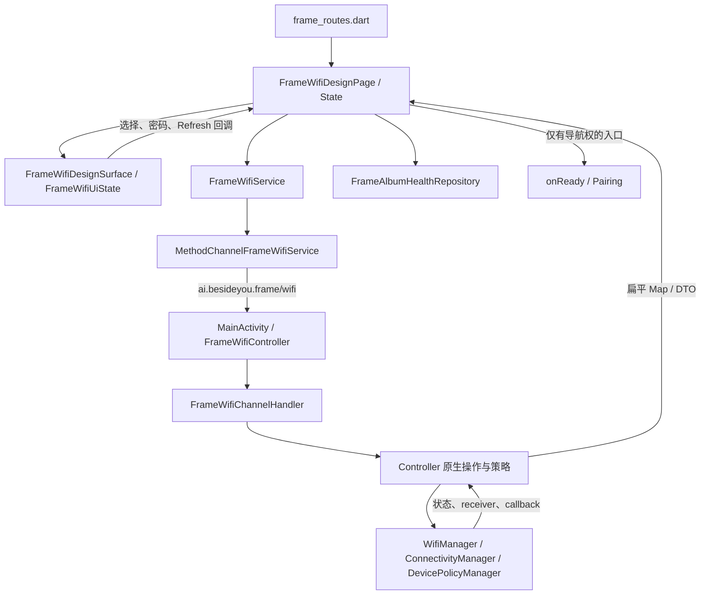
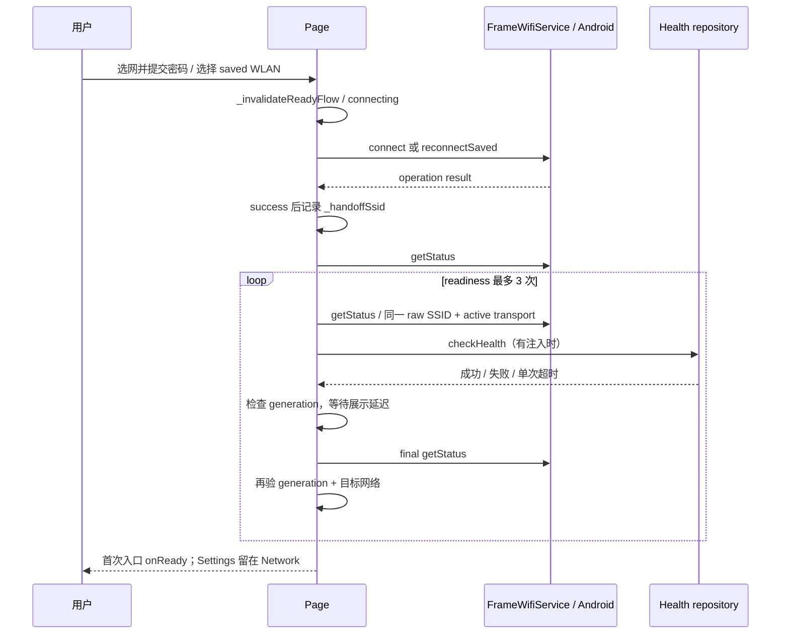
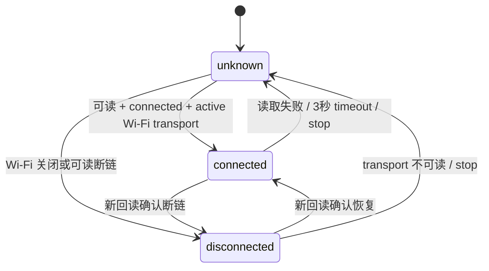

# Wi-Fi：从“看到热点”到“业务可以继续”

> 2026-09-09 工作区学习快照。本文解释设计思路，当前行为、验证状态和延期项仍由 [WiFi 模块 README](../evidence/source-map.md#source-c9be8bed79) 维护。复习或改代码前先回读 owner；这里不继承历史 APK、设备或人工验收结论。

读完后，你应该能沿着“用户选择 → 平台操作 → 状态回读 → 服务检查 → 路由交接”解释一次配网，并判断失败属于哪一层。
先准备纸笔画出自己理解的连接流程，再对照下面的图；标出自己原先把哪些状态合并成了一个 `connected`。

## 1. 先把五种事实分开

| 层次 | 本项目中的事实或入口 | 能回答什么 | 不能推出什么 |
| --- | --- | --- | --- |
| 扫描候选 | `FrameWifiScanSnapshot.networks`、`fresh` | 周围候选、扫描是否新鲜 | 用户已选中、已连接 |
| 网络身份 | raw `ssid`、security family、saved inventory | 正在操作哪一个网络配置 | 同名热点可随意互换 |
| 平台链路 | `FrameWifiStatus`、`wifiTransportActive` | 系统当前 Wi-Fi 连接/默认 transport | DNS、TLS、后端健康 |
| 服务可达性 | `FrameAlbumHealthRepository.checkHealth()` | 当前配置的服务 readiness 请求是否成功 | Frame 已绑定、账号有效、媒体可下载 |
| 业务准入 | `onReady`、Pairing、First Sync | 谁允许进入下一条业务链 | Wi-Fi 模块拥有全部业务状态 |

`FrameAlbumHealthApiRepository` 的实现请求解析后的 `/readyz`，不是凭 Wi-Fi 图标直接放行。
页面允许注入空 `healthRepository`，这种调用会跳过服务检查；读测试或 preview 时必须先看注入了什么。
基础补课：[网络、Android 权限与服务可达性](../foundations/networking-android.md)。

## 2. 从文件找到真正的生产调用链

正式路由在 [frame_routes.dart](../evidence/source-map.md#source-83653d89db)：`/wifi` 和 `/settings/network` 都创建 `FrameWifiDesignPage`。
页面的 `_FrameWifiDesignPageState` 自身承担生产控制器职责；读正式实现应从它开始，不能把旧 setup 页面当成当前路由入口。

阅读顺序建议：

1. [frame_wifi_design_page.dart](../evidence/source-map.md#source-1605f96079)：`_initialize`、`_scan`、`_connectSelected`、`_startConnection`、`_handoffWhenReady`。
2. [frame_wifi_service.dart](../evidence/source-map.md#source-c021fc3c73)：九个方法组成唯一 Flutter 操作边界；DTO 解码和安全异常映射也在这里。
3. [MainActivity.kt](../evidence/source-map.md#source-9342b10a17)：注册 channel、转发权限回调、`onDestroy` 调用 `detach`。
4. [FrameWifiChannelHandler.kt](../evidence/source-map.md#source-ad184263a1)：分派方法，`reconnectSaved` 的验收类别仍归 `connect`。
5. [FrameWifiController.kt](../evidence/source-map.md#source-12268680fe)：系统服务读取、normal/Device Owner 分流、异步验证。

`FrameWifiDesignSurface` 负责显示与交互回调，权限、连接和路由时序集中在 page；Android 特权操作留在 host。
这是“职责边界”的具体例子：换 UI 不应顺手把 `WifiManager` 调用搬进 Widget。

## 3. 为什么看到热点后仍然不能直接 Connect

`_initialize` 先 `getStatus`，再 `_scan`；扫描前 `_scan` 读取 `getPermissionState`，必要时调用 `requestSetupPermissions`。
权限未授予会停在安全提示，Refresh 再走权限门槛；它不会把拒绝理解成“附近没有热点”。
当前 DO-only 路径仍按 host 的能力事实判断 runtime scan 权限；Device Owner 身份不等于扫描权限自动全部豁免。
`framePrivilegedNotReady` 属于不完整能力姿态，不能通过普通权限弹窗偷偷降级绕过。

`FrameWifiCapabilityProfile` 将权限、status、scan、operation result 的 capability 解码规则集中起来。
重点区分 `deviceOwnerManagedAvailable`、`fullPrivilegedProfileAvailable`、`scanPermissionBypassAvailable`，不要只看名字含 privileged 的布尔值。
权限授权、Location service、Device Owner、platform signing、安装分区各是不同事实；它们如何组合，由原生 capability/backend policy 决定。

扫描完成后还会重新 `getStatus`；`_applyStatus` 用 status 标记连接事实，scan 只负责候选。
`_resolveSelectedNetworkKey` 只保留仍存在的用户显式选择；首次打开、未选时 Refresh、旧选择消失时都不会默认选第一项。
因此“列表非空但 Connect 禁用”可能正是正确行为：先检查 `_selectedNetworkKey`，不要先改按钮。

## 4. SSID 是身份，显示文字不是完整主键

在 [frame_wifi_models.dart](../evidence/source-map.md#source-6f14ca8a71) 中，`frameWifiSetupNetworkKey` 组合 raw SSID、security、frequency、capabilities，保护扫描选择身份。
`frameSavedWifiNetworkSelection` 则按 raw SSID + security family 找保存配置，并对有效 network ID 去重。
只有唯一匹配配置才能走 `reconnectSaved`；多个精确匹配或 inventory 不可读会明确失败。
扫描项身份与保存配置身份服务于不同问题，不宜机械统一成一个字符串主键。

Other WLAN 的 `ssid.trim().isEmpty` 只检查全空白输入；真实 connect 的 SSID 保留前后空格。
否则用户输入 `" Home "`，平台却连接 `"Home"`，最后会变成看似随机的匹配失败。
Enterprise/unknown 会进入 managed provisioning 边界，普通密码框不能替代未实现的企业网配网流程。

`reconnectSaved` 的 channel payload 只有 SSID 与 security，没有 password。
系统已保存密码不回传 Flutter；如果保存凭据被热点拒绝，再显示空的密码重试状态。
这同时体现身份校验、凭据边界和最小外部副作用。

## 5. 主动连接成功，为什么还要等

连接结果可能先于最终 active transport 状态稳定；`_startConnection` 在成功后先保存交接资格。
紧接着 `getStatus` 暂时失败也不丢掉该资格，后续有界 readiness 重试仍可恢复。
`_handoffWhenReady` 校验目标 raw SSID 和 active transport，注入 health 时还要检查服务。
health 成功后的 700 ms 默认展示延迟也是竞态窗口，所以真正导航前再次 `getStatus`。
任一步发现旧 generation、离开页面或换网，旧流程都不得导航。

页面 readiness 的默认重试次数为 3，间隔 1 秒，每次 health 有 20 秒 timeout。
这是具体阶段的限制；页面所有 `getStatus` 调用并没有统一的 Dart timeout，因此不能据此声称“整条流程严格 60 秒结束”。
`Future.timeout` 也不会自动取消底层 HTTP 或 MethodChannel 工作；下一轮检查和旧工作可能同时存在，不能把超时当作资源已释放。
继续补课：[Future、generation 与生命周期](../foundations/async-lifecycle.md)。

## 6. 两个入口复用，导航权必须分开

| 入口 | 参数/所有权 | 系统已经连网时 | 用户改网成功后 |
| --- | --- | --- | --- |
| `/wifi` | `autoHandoffSavedWifiOnStartup: true`，提供 `onReady` | 允许只读 startup admission | readiness 通过后进入 Pairing |
| `/settings/network` | 默认不开 startup admission，无 `onReady`，有返回回调 | 显示当前 Network 状态 | 同样检查 readiness，留在 Network |

`_handoffSavedWifiOnStartup` 默认最多观察 20 次、间隔 1 秒，等待 Android 自己恢复保存网络。
它不发送 connect、reconnectSaved 或 disconnect；找到连接的 raw SSID 后交给同一 readiness 链。
这解决的是“业务何时继续”，网络配置恢复仍由 Android 拥有。
Refresh 会使旧 generation 失效并重开恢复；新的显式平台写操作也通过 `_invalidateReadyFlow` 抢占旧准入流程。
“共享页面”不等于“共享导航副作用”，可以迁移到登录页复用、上传面板复用等 Flutter 场景。

## 7. 三层生命周期，不要只背 dispose

| 所有者 | 持有什么 | 结束或失效时做什么 |
| --- | --- | --- |
| `_FrameWifiDesignPageState` | UI、操作门闩、readiness generation、延迟 Future | `dispose` 增 generation；异步边界检查 mounted/身份 |
| App 的 `FrameWifiStatusObserver` | 只读状态、listener、poll/timeout Timer、一个 pending read | stop 清旧展示并停 Timer；resume 新 generation；dispose 不再通知 |
| `FrameWifiController` / Activity | channel、scan receiver、network callback、Handler 等 | detach 先关闭 channel，再清理各操作 owner 与资源 |

页面的 `Future.delayed` 不是可取消 Timer；取消 generation 表示禁止后续发布，不保证等待立刻消失。
App 的状态订阅实际使用 `addListener/removeListener`，并非每个异步观察都叫 `StreamSubscription`。
阅读生命周期要问四件事：谁创建、谁引用、谁允许回包生效、谁释放外部资源。

[FrameWifiLifecycleCoordinator.kt](../evidence/source-map.md#source-022968973b) 明确 detach 顺序：先断 channel，避免清理 Result 时接收新操作。
[FrameWifiOneShotCompletion.kt](../evidence/source-map.md#source-a054362c43) 先置 `finished`，再 cleanup 和 deliver，阻止 receiver 与 timeout 重复完成 Result。
[FrameWifiOperationSlot.kt](../evidence/source-map.md#source-e4b26e301a) 用对象 identity 保证旧 callback 不能释放后来请求的 slot。
slot 只管理同类操作的 owner；不同操作之间是否互斥仍由 controller 决定，不能把它解释成一个全局 Wi-Fi 锁。

## 8. Home/Settings 图标为什么要独立观察

[FrameWifiStatusObserver](../evidence/source-map.md#source-d0faccd468) 只接受 `getStatus` 读取回调，不扫描、不请求权限、不改网。
[frame_app.dart](../evidence/source-map.md#source-95e8dab761) 创建并持有它，通过 `FrameWifiStatusScope` 供 Home/Settings 使用，同时把链路变化通知更新模块等消费者。

它在一次读取结束后再等 5 秒读取，不是每 5 秒无条件启动一个新请求。
超过 3 秒只撤销旧图标的展示资格；`_readPending` 仍保留，底层 Future settle 前不叠加新 MethodChannel。
永远 pending 时保持 unknown；迟到结果不能重新点亮旧连接，settle 后才重新读取。
后台 `stop` 增 generation、清 Timer 和旧状态；恢复 `start` 重新获取证据；dispose 阻止后续通知。
RSSI 缺失、-127、0 或正数可保留连接事实但强度未知，不伪造满格；observer 的有效强度边界见其 `fromStatus`。

这套图标连接规则显式检查 `wifiTransportProbeReadable`；页面 `_isTargetWifiActive` 的源码条件是同一 connected SSID + active transport。
两个 helper 不完全相同，学习时应分别追踪，不要把一个 helper 的条件直接写成另一个的实现。
App 将“前台且 observer connected”送入更新控制器的 `setNetworkReady`；它只开放尝试请求的门槛，更新请求仍须自己处理后端失败。
断网重连也会触发 App 的离线播放对账入口，不能把“Wi-Fi 变 connected”当作离线选择已经提交到服务端。

## 9. 从最后正确点定位第一个错误点

| 现象 | 最后正确点先看 | 下一步检查 | 不要直接下的结论 |
| --- | --- | --- | --- |
| 列表有热点、Connect 灰色 | scan 已回候选 | 用户是否显式选择、key 是否仍存在 | 按钮坏了 |
| 密码错误仍停在表单 | native 返回认证失败 code/字段 | `_isAuthenticationFailure`、passwordError/Other WLAN 状态 | 必须清空整个页面 |
| 已连接却卡 Checking | 平台接受操作/目标 transport | health 请求、timeout、generation、final status | Wi-Fi 一定没连上 |
| 冷启动已经连网但不继续 | `getStatus` 已有 raw SSID | 入口开关、保存候选、health、onReady | 必须先 Disconnect 再 Connect |
| Refresh 后突然被旧请求带走 | 新 generation 已创建 | 每个 await 后 `_isCurrentHandoff` 是否检查 | mounted 足够防竞态 |
| 拔网后图标暂时还在 | 上一轮 status 曾有效 | 下一轮读取期限、readable、active，是否 pending | 旧 SSID/RSSI 就是仍连接 |
| Disconnect 后连接了另一 WLAN | 原目标已经退出 | operation result 与新 status 分别查看 | Disconnect 必须让全机无网 |

主动输入密码认证失败会保留输入和表单，给出 retry 指引；saved reconnect 传入空密码，因此它的认证失败重试页为空。
Disconnect 保留配置，Forget 删除配置；两者都重读状态，有界等待旧目标退出，不能用本地乐观删除冒充 Android 成功。
即使目标已经退出，native 报未验证失败也必须保留失败反馈，尤其 Forget 的“断开”不能证明配置删除。
日志用安全 code、阶段、能力和计数定位；不要为了排查把密码、BSSID/MAC、原始配置或设备密钥输出到知识库。

## 10. 用现有测试反向学习契约

以下是源码中的测试入口与关键名称，本次知识库整理未执行这些测试；当前通过状态请回 [WiFi owner](../evidence/source-map.md#source-c9be8bed79) 查看。

| 测试入口 | 重点读的测试名 | 练习辨认的契约 |
| --- | --- | --- |
| [frame_wifi_design_page_test.dart](../evidence/source-map.md#source-085fdc4f7f) | `Nearby WLANs start unselected and only preserve an explicit selection` | 候选事实与用户决策分离 |
| 同上 | `saved reconnect authentication failure asks for the current password` | 保存凭据失效后的恢复状态 |
| 同上 | `handoff rechecks WiFi after health before navigating` | 成功后的等待也是竞态窗口 |
| 同上 | `Refresh cancels pending health and only latest handoff navigates` | logical cancellation 与旧 Future |
| 同上 | `Settings connection checks readiness and stays on the Network page` | 复用与导航权分离 |
| [frame_wifi_status_observer_test.dart](../evidence/source-map.md#source-27a9e1407f) | `timeout clears stale connection without piling up platform reads` | timeout 不等于底层调用完成 |
| 同上 | `background response cannot repopulate state after resume` | 生命周期代际隔离 |
| [FrameWifiOperationSlotTest.kt](../evidence/source-map.md#source-f628c07fa2) | `stale owner cannot clear a later owner` | owner identity 与资源释放 |

这些 fake/Widget/纯 Kotlin 测试分别刻画本层规则；它们不等价于真实固件、无线环境或物理触控验收。

## 11. 闭卷自测

1. 扫描看到了 `Home`，为什么不能自动选第一项并开启 Connect？
2. 为什么 Device Owner 已就绪还可能需要请求 Location 权限？
3. health 已成功，700 ms 后直接 `onReady` 有什么竞态？
4. `mounted == true` 为什么不能替代 `_readyGeneration`？
5. `Future.timeout` 后立即循环重试，会带来什么资源问题？
6. Disconnect 后系统接入另一个 WLAN，应看全机是否离线，还是原目标是否退出？
7. Wi-Fi 图标恢复连接时，能否认定更新服务可达、离线选择已写入后端？

展开答案，先用自己的话解释再核对

1. 扫描是候选事实，连接是用户决定；代码只保留仍有效的显式 key。
2. Device Owner 管理能力与扫描/SSID 可见性是不同能力；当前路径依赖 host 的明确权限与豁免判断。
3. 延迟期间可以掉线、换网、Refresh、离开页面；必须重验 generation 和平台目标状态。
4. 旧请求与新请求可能处于同一仍 mounted 的页面，generation 才区分谁仍有发布权。
5. 底层工作可能未终止，会叠加网络或 channel 请求；observer 用 pending 门闩限制平台读取。
6. 原目标退出与 native 操作验收都要看；连接另一 WLAN 不自动意味着本次操作失败或已验证成功。
7. 不能。它只证明当前可读 Wi-Fi transport 状态，业务服务、身份与写入结果有各自事实源。

## 12. 学习实验：均未执行

- 纯阅读：在 page 中圈出每个 `await`，写出返回时可能已经变化的 mounted、generation、SSID 与路由所有权。
- 本地 fake：用 `Completer` 挂起 health，再 Refresh，最后完成旧 Future；预测导航次数，再对照已有测试。
- 本地 fake：挂起 observer 第二次读取，推进时间一分钟，预测读取次数和图标；目标是理解单 pending，而不是增加重试。
- 纯阅读：画出 Disconnect 与 Forget 对“链路、保存配置、UI 候选”的三列影响，检查错误时哪些事实不能乐观修改。
- 真机实验留到明确授权：错误密码、系统冷恢复、真实断链与服务不可达分别取证；每次记录源码/安装产物和观察层级。

## 来源与符号索引

| 来源路径 | 本文使用的关键符号/事实 |
| --- | --- |
| `lib/src/features/wifi/README.html` | 当前模块 owner、能力与验收边界 |
| `lib/app/route/frame_routes.dart` | wifiSetup、settingsNetwork、autoHandoffSavedWifiOnStartup |
| `lib/src/features/wifi/frame_wifi_design_page.dart` | _scan、_startConnection、_handoffSavedWifiOnStartup、_handoffWhenReady、_invalidateReadyFlow |
| `lib/src/features/wifi/frame_wifi_models.dart` | FrameWifiCapabilityProfile、frameWifiSetupNetworkKey、frameSavedWifiNetworkSelection |
| `lib/src/features/wifi/frame_wifi_service.dart` | FrameWifiService、MethodChannelFrameWifiService、reconnectSaved |
| `lib/src/features/frame_album/frame_album_repository.dart` | FrameAlbumHealthApiRepository.checkHealth、readinessPath |
| `lib/src/features/wifi/frame_wifi_status_observer.dart` | FrameWifiStatusObserver、FrameWifiIndicatorState.fromStatus |
| `lib/app/frame_app.dart` | didChangeAppLifecycleState、_handleAppUpdateWifiChanged、_handleWifiChanged |
| `android/app/src/main/kotlin/ai/besideyou/frame/MainActivity.kt` | registerWifiChannel、onDestroy |
| `android/app/src/main/kotlin/ai/besideyou/frame/FrameWifiController.kt` | attach、detach、activeWifiTransportProbe、原生 receiver/callback |
| `android/app/src/main/kotlin/ai/besideyou/frame/FrameWifiChannelHandler.kt` | handle、FrameWifiChannelOperations |
| `android/app/src/main/kotlin/ai/besideyou/frame/FrameWifiLifecycleCoordinator.kt` | detach |
| `android/app/src/main/kotlin/ai/besideyou/frame/FrameWifiOneShotCompletion.kt` | finish |
| `android/app/src/main/kotlin/ai/besideyou/frame/FrameWifiOperationSlot.kt` | isCurrent、completeIfCurrent |
| `test/src/features/wifi/frame_wifi_design_page_test.dart` | 第 10 节列出的 Widget 契约 |
| `test/src/features/wifi/frame_wifi_status_observer_test.dart` | pending/timeout/后台迟到结果契约 |
| `android/app/src/test/kotlin/ai/besideyou/frame/FrameWifiOperationSlotTest.kt` | stale owner 契约 |
